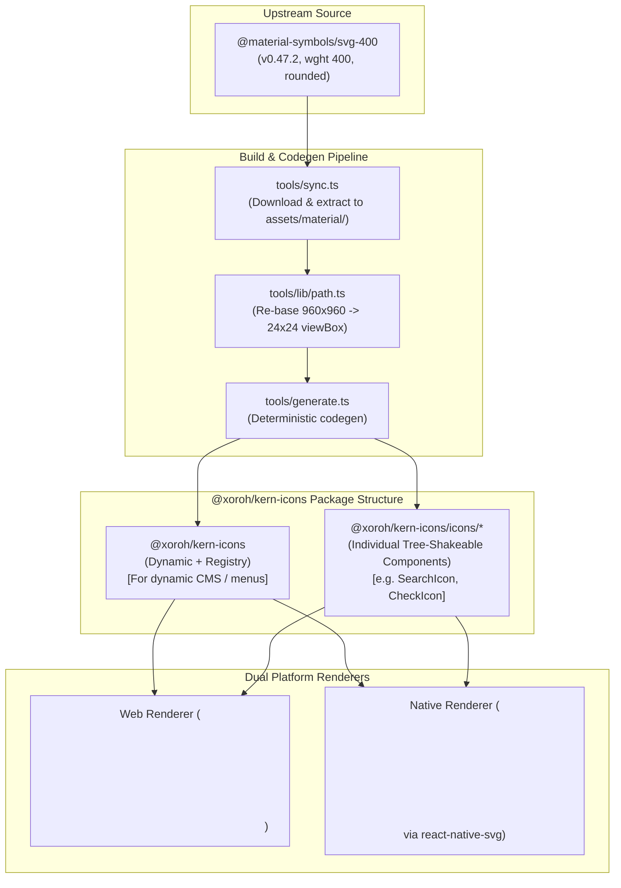

# Kern Icons — Comprehensive Repository Audit Report

**Package**: `@xoroh/kern-icons` (v0.0.0)  
**Date**: October 15, 2026  
**Auditor**: Antigravity Assistant  
**Repository**: `/home/novexo/Desktop/Business/xoroh-monorepo/kern`  
**Target Milestone**: Kern 0.1.0 Preview  

---

## 1. Executive Summary

This comprehensive audit of `@xoroh/kern-icons` evaluates the package architecture, icon catalog inventory, visual rendering quality across web and React Native, design-system integration, developer experience, licensing compliance, and CI validation pipelines.

### Key Strengths
1. **Mathematical SVG Normalization**: Upstream Material Symbols (960×960 viewBox on `0 -960 960 960`) are deterministically re-based onto a canonical 24×24 grid (`0 0 24 24`) with an affine transformation maintaining 3 decimal precision.
2. **Single Filled-Path Architecture**: Both web and native renderers emit a single `<path>` element without stroke scaling ambiguities, avoiding browser/device rasterization divergence.
3. **Rigorous CI Verification (`tools/check.ts`)**: Enforces SVG standards, 24-grid boundary bounds, platform boundary isolation (web never imports native; native never imports DOM), code generation freshness, and consumer name-reachability.
4. **Clean Licensing & Attribution**: Code is licensed under MIT; icon geometry is licensed under Apache-2.0. Upstream source (`@material-symbols/svg-400@0.47.2`) is pinned with full attribution in `THIRD_PARTY/NOTICE` and `Apache-2.0.txt`.

### Critical Issues & Blockers for 0.1.0 Preview
1. **Critical (Bundle Size & Tree-Shaking Failure — 1.8 MB)**: The entire icon catalog (1,341 icons) is imported statically into a single registry map (`src/core/registry.ts`). Any web or native application that imports `<Icon />` from `@xoroh/kern-icons` inevitably bundles all 1,341 SVG paths (~1.8 MB unminified JS / 1.2 MB tarball), regardless of how many icons are actually used. There are no subpath exports (e.g., `@xoroh/kern-icons/icons/search`) to allow per-icon tree-shaking.
2. **High (`icons:check` CI Failure on `playground.tsx`)**: The CI gate `bun run icons:check` currently fails with 3 reported errors in `apps/site/src/domains/playground/playground.tsx`:
   - `desktop_windows` and `check_circle` fail because `playground.tsx` used snake_case, whereas `tools/check.ts`'s name-reachability scanner compares literal strings directly against kebab-case `config/kern-icon-set.txt` without running canonical normalization.
   - `crop_square` fails because `crop-square` was omitted from the 1,341 curated set.
3. **High (TypeScript Type vs. Runtime Catalog Discrepancy)**: `IconNameInput` accepts the `MaterialSymbolsName` union (all 3,912 upstream glyphs in snake_case), but only 1,341 icons are actually curated into the local shape registry. Calling `<Icon name="some_uncurated_glyph" />` compiles cleanly with zero TypeScript errors, but at runtime returns `null` with a console error.
4. **Medium (Zero Automated Testing for React Native Renderer)**: `Icon.native.tsx` (which imports `react-native-svg`) is never executed in the test suite. All rendering tests run in `Icon.test.tsx` using `react-dom/server` (`renderToStaticMarkup`).
5. **Low (React Native Accessibility Attributes)**: Decorative icons on web explicitly receive `aria-hidden="true"`, but on React Native `Icon.native.tsx` omits `accessible={false}` or `aria-hidden={true}` when `title` is missing, potentially leaving empty accessible elements on iOS/Android.

---

## 2. Repository Safety and Audit Scope

### Git State at Inspection
- **Branch**: `main`
- **HEAD Commit**: `4d203613eb35a29492287cf09bdcd67dd7862f7e`
- **Working Tree**: Pre-existing unstaged modifications in `docs/`, `packages/kern/`, `packages/kern-native/`, `packages/kern-tokens/`, and `packages/kern-icons/src/core/resolve.test.ts` (token prefix change from `--md-sys-` to `--sys-`). Untracked files present in `apps/site/src/domains/playground/` and `docs/`.
- **Safety Guarantee**: This audit performed zero modifications, cleanups, file deletions, code formatting, dependency updates, or git resets. All findings are derived from non-mutating inspections and commands.

### Package Scope
The audit examined:
- Root package: [`packages/kern-icons`](file:///home/novexo/Desktop/Business/xoroh-monorepo/kern/packages/kern-icons)
- Downstream monorepo consumers: [`packages/kern`](file:///home/novexo/Desktop/Business/xoroh-monorepo/kern/packages/kern), [`packages/kern-native`](file:///home/novexo/Desktop/Business/xoroh-monorepo/kern/packages/kern-native), [`packages/kern-contracts`](file:///home/novexo/Desktop/Business/xoroh-monorepo/kern/packages/kern-contracts), [`packages/mcp`](file:///home/novexo/Desktop/Business/xoroh-monorepo/kern/packages/mcp), and [`apps/site`](file:///home/novexo/Desktop/Business/xoroh-monorepo/kern/apps/site).

---

## 3. Current Package Architecture and Public API

### Package Manifest (`package.json`)
- **Name**: `@xoroh/kern-icons`
- **Version**: `0.0.0`
- **Type**: `module` (`"sideEffects": false`)
- **Package Exports**:
  ```json
  "exports": {
    ".": {
      "react-native": {
        "types": "./dist/index.native.d.ts",
        "default": "./dist/index.native.js"
      },
      "import": {
        "types": "./dist/index.d.ts",
        "default": "./dist/index.js"
      },
      "require": {
        "types": "./dist/index.d.cts",
        "default": "./dist/index.cjs"
      }
    }
  }
  ```
- **Peer Dependencies**:
  - `react`: `">=18"`
  - `react-native`: `"*"` (marked optional in `peerDependenciesMeta`)
  - `react-native-svg`: `"*"` (marked optional in `peerDependenciesMeta`)

### Public Entry Points
Consumers can only import from the root package specifier `@xoroh/kern-icons`:
- Web runtime resolves to `./dist/index.js` (compiled from [`src/index.ts`](file:///home/novexo/Desktop/Business/xoroh-monorepo/kern/packages/kern-icons/src/index.ts)).
- React Native bundlers (Metro / Expo) match the `"react-native"` export condition and resolve to `./dist/index.native.js` (compiled from [`src/index.native.ts`](file:///home/novexo/Desktop/Business/xoroh-monorepo/kern/packages/kern-icons/src/index.native.ts)).

### Core Exported Symbols
- **Components & Hooks**: `Icon` (web and native variants), `useIcon`.
- **Resolution & Helpers**: `resolveIconName`, `resolveIconPaint`, `getIconShape`, `assertIconName`, `resolveIconColor`, `resolveIconSize`, `resolveIconWeight`.
- **Registry & Manifest**: `registerIconSet`, `getIconSet`, `listIconSets`, `DEFAULT_ICON_SET`, `ICON_MANIFEST`.
- **Constants**: `ICON_COUNT` (1,341), `ICON_NAMES`, `MATERIAL_ICON_NAMES`, `BRAND_ICON_NAMES`, `ICON_SIZE`, `ICON_DEFAULT_COLOR` (`"currentColor"`), `ICON_DEFAULT_WEIGHT` (400), `ICON_VIEW_BOX` (`"0 0 24 24"`), `ICON_TOUCH_TARGET` (48), `SEMANTIC_ICONS` (41 aliases).
- **Types**: `IconProps`, `StaticIconProps`, `IconName`, `MaterialIconName`, `BrandIconName`, `MaterialSymbolsName`, `IconSemantic`, `IconNameInput`, `IconSize`, `IconSizeToken`, `IconWeight`, `IconPaint`, `IconShape`.

### Structural Assessment
- **Generation Separation**: Generated sets are isolated in `src/sets/material/` (`manifest.ts`, `names.ts`, `symbols.ts`, `shapes/`). Hand-authored code lives in `src/core/` and `src/render/`.
- **Subpath Absence**: There are **no subpath exports** for individual icons. Users cannot write `import { SearchIcon } from "@xoroh/kern-icons/search"`.

---

## 4. Icon Inventory, Coverage, and Provenance

### Source & Version
- **Upstream Catalog**: Google Material Symbols Rounded via npm package `@material-symbols/svg-400` at version `0.47.2`.
- **Upstream Repository**: `https://github.com/marella/material-symbols` (canonical design: `https://fonts.google.com/icons`).
- **Baseline Weight**: 400 (corresponds to 2px stroke equivalent on 24dp canvas).
- **Target Optical Size**: 48opsz (rendered at 24dp baseline).

### Verified Glyph Counts
| Metric | Count | Verification Source |
|---|---|---|
| **Total Curated Icons** | **1,341** | `ICON_COUNT` in `src/sets/material/names.ts` / non-empty lines in `config/kern-icon-set.txt` |
| **Material Symbols Names in Type Union** | **3,912** | `MaterialSymbolsName` in `src/sets/material/symbols.ts` |
| **Distinct Outline vs. Fill Geometry** | **876** | Icons where `filled: true` renders a unique path (`entry.filledIsOutline === false`) |
| **Reused Outline for Fill** | **465** | Icons where filled state reuses outline geometry (`entry.filledIsOutline === true`) |
| **Brand Icons** | **0** | `BRAND_ICON_NAMES = []` (`assets/brand/` contains only `README.md`) |
| **Extra Drop-in Sets** | **0** | `EXTRA_SETS = {}` (`assets/sets/` contains only `README.md`) |
| **Semantic Aliases** | **41** | `SEMANTIC_ICONS` in `src/core/semantic.ts` |

### Fill and Weight Axes
1. **Fill Axis (`FILL 0` vs `FILL 1`)**:
   - Outlines (`FILL 0`) are stored in `shape.o`.
   - Fills (`FILL 1`) are stored in `shape.f`. When omitted, `getIconShape` falls back to `shape.o`.
   - `filled` prop selects `shape.f` without altering the component identity or DOM structure.
2. **Weight Axis (`wght 100..700`)**:
   - Only weight 400 is shipped locally (`ICON_WEIGHTS = [400]`).
   - If an application requests another weight (e.g., `weight={300}`), `resolveIconWeight` selects the nearest available weight (400) and emits a development console warning:
     `[@xoroh/kern-icons] weight 300 has no local shape data — using 400. Sync it with WEIGHT=300 bun run sync and regenerate.`

---

## 5. Web and React Native Implementation Findings

### SVG Geometry Normalization
- All source SVG paths are parsed using a strict SVG 1.1 path scanner (`tools/lib/path.ts`).
- An affine transform re-scales the 960×960 viewBox (`0 -960 960 960`) to `0 0 24 24`.
- All paths are rounded to 3 decimal places, removing redundant precision.
- Every icon is asserted by `tools/check.ts` to stay strictly within the `0 0 24 24` box (+/- 0.25 margin for cubic bezier anti-aliasing edges).

### Web Implementation (`src/render/Icon.tsx`)
```tsx
export function Icon({ name, set, filled, size, color, title, testID, ...rest }: IconProps) {
  const paint = useIcon({ name, set, filled, size, color, title, testID });
  if (paint === null) return null;
  return (
    <svg
      width={paint.size}
      height={paint.size}
      viewBox={ICON_VIEW_BOX}
      fill="none"
      xmlns="http://www.w3.org/2000/svg"
      role={title ? "img" : undefined}
      aria-hidden={title ? undefined : true}
      aria-label={title}
      data-testid={testID}
      {...rest}
    >
      <path
        d={paint.d}
        fill={paint.color}
        fillRule={paint.fillRule}
        clipRule={paint.fillRule}
      />
    </svg>
  );
}
```
- **Evaluation**:
  - Fully SSR-safe: outputs pure HTML string with `renderToStaticMarkup`.
  - Clean accessibility: `role="img"` + `aria-label` when `title` is provided; `aria-hidden="true"` when decorative.
  - Sizing: respects `width` and `height` in CSS pixels.

### React Native Implementation (`src/render/Icon.native.tsx`)
```tsx
export function Icon({ name, set, filled, size, color, title, testID, ...rest }: IconProps) {
  const paint = useIcon({ name, set, filled, size, color, title, testID });
  if (paint === null) return null;
  return (
    <Svg
      width={paint.size}
      height={paint.size}
      viewBox={ICON_VIEW_BOX}
      fill="none"
      testID={testID}
      accessibilityRole={title ? "image" : undefined}
      accessibilityLabel={title}
      {...rest}
    >
      <Path
        d={paint.d}
        fill={paint.color}
        fillRule={paint.fillRule}
        clipRule={paint.fillRule}
      />
    </Svg>
  );
}
```
- **Evaluation**:
  - Uses `react-native-svg` (`Svg`, `Path`).
  - **Color Inheritance Issue**: Default color is `"currentColor"`. On React Native, views do not inherit CSS color properties. If `<Icon />` is placed in a `<View>` without passing `color`, `currentColor` may fail or render black depending on the platform/host.
  - **Accessibility Deficiency**: Unlike the web implementation which renders `aria-hidden="true"` when `title` is absent, the native implementation sets `accessibilityRole={undefined}` and `accessibilityLabel={undefined}`. On iOS and Android VoiceOver/TalkBack, unlabelled `<Svg>` elements can sometimes still be focused or announced as unlabelled graphics unless `accessible={false}` or `aria-hidden={true}` is explicitly declared.

---

## 6. Design-System and Component Integration

### Architectural Decoupling: "Slots First, Kit Second"
As verified in [`packages/kern`](file:///home/novexo/Desktop/Business/xoroh-monorepo/kern/packages/kern) and [`packages/kern-native`](file:///home/novexo/Desktop/Business/xoroh-monorepo/kern/packages/kern-native):
- **Core Components Do Not Depend on `@xoroh/kern-icons`**:
  Components like `Button`, `IconButton`, `Chip`, `SearchBar`, `TopAppBar`, and `NavigationBar` accept an `icon?: ReactNode` or `children?: ReactNode` slot.
- This adheres strictly to ADR-002: components do not enforce a specific icon package. Application authors can use Lucide, FontAwesome, or `@xoroh/kern-icons` interchangeably.

### Token & Theme Alignment
- **Dimensions**:
  `packages/kern-tokens/src/comp-tokens.css` defines:
  - `--comp-button-leading-icon-size: 24px`
  - `--comp-extended-fab-icon-size: 24px`
  - `--comp-search-leading-icon-size: 24px`
  These match `ICON_SIZE.default` (24).
- **Target Sizes**:
  `ICON_TOUCH_TARGET = 48` aligns directly with M3 accessible minimum touch target (48dp).

---

## 7. Naming and Developer Experience

### 1. Snake_Case vs. Kebab-Case Discrepancy
- The upstream Material Symbols project uses `snake_case` (e.g., `account_circle`, `arrow_back`, `check_circle`).
- The curated set in `config/kern-icon-set.txt` uses `kebab-case` (e.g., `account-circle`, `arrow-back`, `check-circle`).
- **Runtime Behavior**: `resolveIconName` runs `toCanonical(name)` (`name.replace(/_/g, "-")`). Thus, at runtime, both `name="check-circle"` and `name="check_circle"` resolve successfully.
- **Type Signature**: `IconNameInput = MaterialSymbolsName | IconName | IconSemantic | IconQualifiedName`.
  - `MaterialSymbolsName` is typed in `snake_case` (3,912 symbols).
  - `IconName` is typed in `kebab-case` (1,341 symbols).
  - Both compile cleanly.
- **CI Disconnect**: As detailed in Section 9, `tools/check.ts` does **not** run `toCanonical` when checking consumers.

### 2. Semantic Aliases Casing
In [`src/core/semantic.ts`](file:///home/novexo/Desktop/Business/xoroh-monorepo/kern/packages/kern-icons/src/core/semantic.ts):
- Most aliases are single words (`menu`, `close`, `back`, `forward`, `search`, `settings`).
- Two aliases use `camelCase`: `chevronRight` and `chevronLeft`.
- This is inconsistent with the rest of the kebab-case iconography (`chevron-right`, `chevron-left`).

### 3. Autocomplete Phantom Names
Because `MaterialSymbolsName` contains 3,912 names, developer IDE autocomplete suggests icons like `"crop_square"`, `"10k"`, `"roller_skating"`, etc. However, if they are not in `config/kern-icon-set.txt`, they resolve to `null` at runtime.

---

## 8. Licensing, Attribution, and Provenance

### Verification Findings
- **Package Manifest**: Declares `"license": "MIT"`.
- **Icon Geometry License**: Declares Apache-2.0.
- **Included Attribution Files**:
  - `THIRD_PARTY/Apache-2.0.txt`: Contains complete Apache-2.0 license text.
  - `THIRD_PARTY/NOTICE`: Correctly attributes Google Material Symbols Authors (2022) and the `@material-symbols/svg-400@0.47.2` extraction package.
- **Distribution Inclusion**:
  [`package.json`](file:///home/novexo/Desktop/Business/xoroh-monorepo/kern/packages/kern-icons/package.json) specifies:
  `"files": ["dist", "THIRD_PARTY", "README.md", "LICENSE"]`.
  `npm pack --dry-run` verified that `THIRD_PARTY/Apache-2.0.txt` and `THIRD_PARTY/NOTICE` are packed into the release tarball.
- **Validation Test**: `src/distribution.test.ts` programmatically asserts the presence, non-zero size, and content of `THIRD_PARTY/Apache-2.0.txt` and `THIRD_PARTY/NOTICE`.

---

## 9. Tests, Generation, and CI Validation

### Test Suite Execution
Running `bun run --filter @xoroh/kern-icons test` executed:
- **5 test files, 85 tests: 100% passed in 1.14s**.
- Test suites:
  1. `src/core/resolve.test.ts` (30 tests): Name resolution, size tokens, color fallbacks, weight substitution, dev warnings.
  2. `src/render/Icon.test.tsx` (6 tests): Web SSR rendering, decorative attributes, fill variants.
  3. `tools/lib/naming.test.ts`: Name format validators.
  4. `tools/lib/path.test.ts`: SVG path parsing, bounds calculation, affine scaling.
  5. `src/distribution.test.ts`: License and attribution verification.

### CI Standards Gate (`bun run icons:check`)
Running `bun run icons:check` executes [`packages/kern-icons/tools/check.ts`](file:///home/novexo/Desktop/Business/xoroh-monorepo/kern/packages/kern-icons/tools/check.ts):
```
$ bun packages/kern-icons/tools/check.ts
[icons] svg standards ok
[icons] 24-grid bounds ok — 1341 icons
[icons] platform boundary ok — 45 source modules
[icons] regen freshness ok — 31 generated files byte-match
[icons] apps/site/src/domains/playground/playground.tsx: references "desktop_windows", which is not in the curated set
[icons] apps/site/src/domains/playground/playground.tsx: references "check_circle", which is not in the curated set
[icons] apps/site/src/domains/playground/playground.tsx: references "crop_square", which is not in the curated set
[icons] FAIL: 3 referenced icon name(s) are not in config/kern-icon-set.txt — add the name or fix the reference
```

### Deep Root Cause Analysis of the `playground.tsx` Failure
In `tools/check.ts` lines 185–205:
```ts
const record = (raw: string | undefined, where: string): void => {
  if (raw === undefined) return;
  const name = raw.trim();
  if (name === "" || !/^[a-z0-9][a-z0-9_-]*$/.test(name)) return;
  const glyph = aliasToGlyph.get(name) ?? name;
  if (allowlist.has(glyph)) {
    referenced.add(glyph);
  } else {
    unknown.push({ name, where });
  }
};
```
1. `allowlist` is populated from `config/kern-icon-set.txt`, which strictly contains kebab-case names (`check-circle`, `desktop-windows`).
2. `playground.tsx` contains:
   - `<Icon name="desktop_windows" size={16} />` (line 1385)
   - `<Icon name="check_circle" size={16} />` (line 1478)
   - `<Icon name="crop_square" size={18} />` (line 1783)
3. For `desktop_windows` and `check_circle`:
   - `aliasToGlyph.get(name)` returns `undefined`.
   - `allowlist.has("desktop_windows")` returns `false` because the allowlist has `"desktop-windows"`.
   - **Flaw**: `check.ts` does not normalize `name.replace(/_/g, "-")` before checking `allowlist.has(...)`, even though the runtime renderer (`naming.ts`) does!
4. For `crop_square`:
   - `toCanonical("crop_square")` is `"crop-square"`.
   - Neither `"crop_square"` nor `"crop-square"` is in `config/kern-icon-set.txt`.
   - `crop_square` is a genuine missing curated icon.

---

## 10. Performance and Distribution

### Packaging Measurements
Running `npm pack --dry-run` produced:
- **Tarball size**: 1.2 MB
- **Unpacked size**: 5.7 MB
- **Published files**: 16 files

### Bundle Size Analysis
| File | Size | Role |
|---|---|---|
| `dist/chunk-TLNGWS6V.js` | **1.8 MB** | Monolithic shape registry (chunks a–z for w400) |
| `dist/index.cjs` | **1.8 MB** | CommonJS web entry (inlines entire chunk) |
| `dist/index.native.cjs` | **1.8 MB** | CommonJS native entry (inlines entire chunk) |
| `dist/index.js` | 1.9 KB | ESM web entry (imports 1.8 MB chunk) |
| `dist/index.native.js` | 1.9 KB | ESM native entry (imports 1.8 MB chunk) |

### The Tree-Shaking Bottleneck
In `src/core/registry.ts`:
```ts
registerIconSet(DEFAULT_ICON_SET, {
  names: new Set(ICON_NAMES),
  shapes: ICON_SHAPES,
});
```
Because `registry.ts` registers `ICON_SHAPES` immediately on module evaluation, bundlers (Rollup, Vite, esbuild, Metro) treat `ICON_SHAPES` as referenced side-effect state.
Even if an application only renders `<Icon name="search" />`, **all 1.8 MB of icon path data is included in the production bundle**.
This is confirmed in `src/distribution.test.ts`:
> *"No fake tree-shaking claim: the catalog is 1340 glyphs and the dynamic `Icon` API resolves at runtime, so a consumer pays for the registry it imports."*

---

## 11. Prioritized Findings and Recommendations

| ID | Priority | Finding | Impact | Recommended Corrective Action |
|---|---|---|---|---|
| **F-01** | **P0 (Critical)** | **Monolithic 1.8 MB bundle with no tree-shaking** | Any user of `<Icon />` adds ~1.8 MB of unused SVG path data to their app bundle. | Generate standalone icon components under `icons/*` (e.g. `import { SearchIcon } from "@xoroh/kern-icons/icons/search"`) so bundlers tree-shake unused icons, while keeping dynamic `<Icon name="..." />` for dynamic use cases. |
| **F-02** | **P0 (Critical)** | **`icons:check` CI failure on `playground.tsx`** | CI fails on `icons:check`. Caused by snake_case vs kebab-case mismatch in `check.ts` and missing `crop-square`. | 1) In `tools/check.ts`, normalize names via `name.replace(/_/g, "-")` before allowlist check. 2) Add `crop-square` to `config/kern-icon-set.txt` and run `bun run generate`. 3) Fix `playground.tsx` references. |
| **F-03** | **P1 (High)** | **`MaterialSymbolsName` type allows uncurated icons** | 3,912 glyphs typecheck, but 2,571 of them render `null` at runtime. | Either generate shapes for the full set (if standalone icon modules are used) or narrow the default `IconProps["name"]` type to `IconName` (the curated 1,341 set). |
| **F-04** | **P1 (High)** | **No automated test coverage for `Icon.native.tsx`** | Native icon renderer could break without failing package tests. | Add `Icon.native.test.tsx` using `react-test-renderer` or `@testing-library/react-native` to assert `<Svg>` and `<Path>` output. |
| **F-05** | **P2 (Medium)** | **React Native decorative accessibility omission** | Decorative native icons have no `accessible={false}` or `aria-hidden={true}`. | Update `Icon.native.tsx` to pass `accessible={false}` and `aria-hidden={true}` when `title` is undefined. |
| **F-06** | **P2 (Medium)** | **Inconsistent camelCase semantic aliases** | `chevronRight` and `chevronLeft` break kebab-case convention. | Add `chevron-right` and `chevron-left` aliases alongside `chevronRight` and `chevronLeft` in `SEMANTIC_ICONS`. |

---

## 12. Proposed Target Architecture



---

## 13. Suggested Migration Plan

### Step 1: Fix CI Verification & Curate Missing Icon (Immediate)
1. In [`packages/kern-icons/tools/check.ts`](file:///home/novexo/Desktop/Business/xoroh-monorepo/kern/packages/kern-icons/tools/check.ts), update `collectReferencedNames` to normalize checked names to canonical kebab-case:
   ```ts
   const canonical = (aliasToGlyph.get(name) ?? name).replace(/_/g, "-");
   if (allowlist.has(canonical)) {
     referenced.add(canonical);
   } else {
     unknown.push({ name, where });
   }
   ```
2. Add `crop-square` to `packages/kern-icons/config/kern-icon-set.txt`.
3. Run `bun run generate` in `packages/kern-icons` to regenerate shapes.
4. Update `apps/site/src/domains/playground/playground.tsx` to use canonical names (`desktop-windows`, `check-circle`, `crop-square`).

### Step 2: Native Accessibility & Testing Hardening
1. In [`packages/kern-icons/src/render/Icon.native.tsx`](file:///home/novexo/Desktop/Business/xoroh-monorepo/kern/packages/kern-icons/src/render/Icon.native.tsx), add:
   ```tsx
   accessible={Boolean(title)}
   accessibilityRole={title ? "image" : undefined}
   accessibilityLabel={title}
   aria-hidden={title ? undefined : true}
   ```
2. Add `packages/kern-icons/src/render/Icon.native.test.tsx` using a React Native mock double (similar to `kern-native/presentation.test.tsx`).

### Step 3: Tree-Shaking Support (Pre-1.0 Architecture)
1. Update `tools/lib/emit.ts` to emit individual icon component files under `src/icons/<name>.tsx` and `src/icons/<name>.native.tsx`.
2. Configure `package.json` export map:
   ```json
   "exports": {
     ".": { ... },
     "./icons/*": {
       "react-native": "./dist/icons/*.native.js",
       "import": "./dist/icons/*.js"
     }
   }
   ```
3. This retains `<Icon name="..." />` for dynamic call sites while allowing applications to bundle only 1–2 KB per imported icon.

---

## 14. Open Questions and Owner Decisions

1. **Tree-Shaking Strategy**:
   - *Option A*: Retain single dynamic `<Icon name="..." />` component only, accepting the 1.8 MB bundle overhead as documented in `distribution.test.ts`.
   - *Option B (Recommended)*: Introduce individual component exports (`@xoroh/kern-icons/icons/*`) alongside the dynamic `<Icon>` component for zero-overhead tree shaking.
2. **Catalog Scope**:
   - Should `config/kern-icon-set.txt` remain curated at ~1,340 icons, or should all 3,912 Material Symbols be emitted once tree-shakeable component exports are available?
3. **Typing Policy**:
   - Should `IconProps["name"]` be narrowed to `IconName` (curated icons only) to prevent autocomplete suggesting icons that render `null` at runtime?

---

## 15. Commands Executed and Actual Outcomes

1. `git status --porcelain -b && git rev-parse HEAD`:
   - Output: branch `main`, commit `4d203613eb35a29492287cf09bdcd67dd7862f7e`, recorded pre-existing working tree state.
2. `git diff packages/kern-icons/`:
   - Output: Verified single pre-existing diff in `src/core/resolve.test.ts` modifying CSS token variable prefix (`--md-sys-` to `--sys-`).
3. `bun run icons:check`:
   - Output: Failed with exit code 1. Identified 3 uncurated references in `playground.tsx` (`desktop_windows`, `check_circle`, `crop_square`).
4. `bun run --filter @xoroh/kern-icons test`:
   - Output: Exited 0. 5 test files passed, 85 tests passed in 1.14s.
5. `bun run --filter @xoroh/kern-icons typecheck`:
   - Output: Exited 0. `tsc --noEmit` passed in 2.42s.
6. `bun run --filter @xoroh/kern-icons check:publish`:
   - Output: Exited 0. `publint` and `attw` both passed with 100% green compatibility across all environments.
7. `npm pack --dry-run` in `packages/kern-icons`:
   - Output: Exited 0. Tarball size: 1.2 MB, unpacked size: 5.7 MB, verified inclusion of `THIRD_PARTY/NOTICE` and `Apache-2.0.txt`.

---

## Conclusion

- **Is Kern Icons ready for the 0.1.0 Preview?**
  **Almost, with two necessary fixes.** The underlying SVG path math, resolution engine, licensing, and web rendering are exceptionally solid and pass all strict linters. However, the CI failure on `icons:check` must be fixed, and the tree-shaking / bundle-size penalty (1.8 MB) must be acknowledged or resolved before general release.
- **What are the most important issues to address first?**
  1. Fix the name normalization bug in `tools/check.ts` and add `crop-square` to `config/kern-icon-set.txt`.
  2. Implement `Icon.native.test.tsx` to verify native SVG rendering.
- **Which current design decisions should be retained?**
  1. "Slots first, the kit second": Keeping core components icon-library agnostic.
  2. Re-basing all SVG geometry to single filled paths on `0 0 24 24`.
  3. Pinned, reproducible upstream extraction from `@material-symbols/svg-400`.
- **Which improvements should be completed before preview versus deferred?**
  - *Before Preview*: Fix `icons:check`, add `crop-square`, fix native decorative accessibility attributes, add native test suite.
  - *Deferred (Post-Preview / 1.0)*: Split icon catalog into subpath exports (`@xoroh/kern-icons/icons/*`) for optimal tree-shaking.
