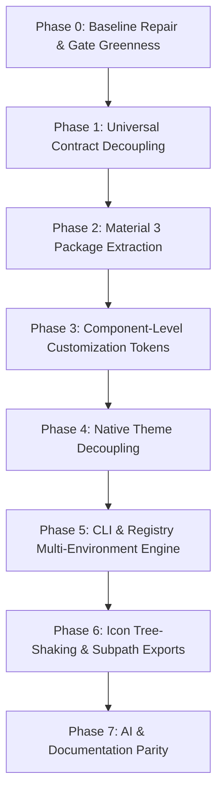

# Kern 0.1.0 Preview — Architecture, Repository & Migration Audit Report

**Date**: October 15, 2026  
**Auditor**: Antigravity (T3 Code)  
**Target Repository**: `/home/novexo/Desktop/Business/xoroh-monorepo/kern`  
**Git HEAD**: `4d203613eb35a29492287cf09bdcd67dd7862f7e` (`main`, ahead of `origin/main` by 21 commits)  
**Audit Authorization**: Investigation & recommendations only. Read-only audit; zero repository mutations, file moves, or package publishes executed.

---

## Executive Summary

This comprehensive audit evaluates the current state of the Kern repository against the target **Kern 0.1.0 Preview** architecture: *"One foundation. Every design system."* Kern is designed as an open-source design-system platform that provides production-ready components and blocks across Web and React Native, supports theme and token customization, enables component-level replacement and adaptation, and provides first-class AI-first workflows via MCP and the `kern` CLI.

### Key Audit Findings

1. **Working Tree State & Pre-Existing Work**:
   - The repository is at commit `4d203613` on branch `main`.
   - The working tree contains **311 unstaged modified files** and **13 untracked files/directories**.
   - These unstaged modifications represent an active, in-flight refactoring of token CSS variable prefixes from `--md-sys-*` to `--sys-*` across all web components, token generators, and tests, as well as the renaming of `themes/kern.json` to `themes/material-3.json`.
   - **All existing user and agent work has been strictly preserved.** No files have been reset, cleaned, stashed, or overwritten.

2. **Decoupling Status (Universal Engine vs. Material Design 3)**:
   - **M3 Coupling in Tokens**: `@xoroh/kern-tokens` is currently deeply coupled to Material Design 3. `resolve.ts` directly imports `themes/material-3.json`, derives `ColorRole` and `ShapeRole` from M3 JSON keys, hardcodes `extends: "material-3"` in `defineThemePreset`, and throws if any other base is specified. `seed-theme.ts` hardcodes M3 color math (secondary low-chroma mute, tertiary +60° rotation).
   - **M3 Coupling in Contracts**: Even `@xoroh/kern-contracts` (which is intended to be a platform-free, universal schema) contains `export const PROVIDER_ID = "m3"` and enforces `if (record.provider !== "m3") fail(...)` in `defineComponent` and `defineProvider`.
   - **Target Decoupling**: To support *"One foundation. Every design system"*, `@xoroh/kern-tokens` must become a schema-driven, universal token engine, while M3 roles, presets, and seed algorithms must move to an independent `@xoroh/kern-material-3` package. `@xoroh/kern-contracts` must support arbitrary registered design system providers.

3. **Component Customization Tokens (`--comp-*`)**:
   - The token generator (`scripts/gen-comp-css.mjs`) generates **exactly 234 component-level `--comp-*` variables** in `packages/kern-tokens/src/comp-tokens.css`.
   - **Zero web components consume `--comp-*` tokens** (`grep -rn "\-\-comp\-" packages/kern/src/` returns 0 hits). Web components bind directly to global `--sys-*` variables (e.g. `rounded-(--sys-shape-corner-full)`).
   - Consequently, developers currently cannot customize a specific component family (e.g. button corner radius or card background) without overriding the global system token for all components.

4. **Web vs. Native Architecture & Theme Resolution**:
   - **Web (`@xoroh/kern`)** is zero-runtime and CSS-driven: components consume CSS custom properties via Tailwind v4 and CVA without requiring a React ThemeProvider context.
   - **Native (`@xoroh/kern-native`)** is tightly coupled: **59 component files** directly invoke `resolveThemeDetails()` from `@xoroh/kern-tokens` as default parameters (e.g., `scheme: ResolvedTheme = resolveThemeDetails()`), bypassing context and pulling the full resolution engine into component bundles. While `KernThemeProvider` and `useKernScheme()` exist in `packages/kern-native/src/theme.tsx`, the components do not consume them by default.

5. **Internal UI Organization (`libs/ui/`) vs. Monorepo Tooling**:
   - The directory `libs/` **does not currently exist** in the repository.
   - Root `package.json` workspaces are configured strictly as `["apps/*", "packages/*"]`.
   - **12+ tooling scripts and CI workflows** hardcode paths to `packages/*`, including `scripts/build-order.mjs`, `scripts/check-layers.mjs`, `scripts/check-kern.mjs`, `scripts/check-dist-types.mjs`, `scripts/check-coverage.mjs`, `scripts/measure-elevation.mjs`, `scripts/check-consumption.mjs`, `scripts/verify-consumer.mjs`, `.github/workflows/ci.yml`, and `.github/CODEOWNERS`.
   - Moving internal source to `libs/ui/` is feasible and architecturally sound for internal modules, but requires a coordinated tooling update.

6. **CLI & Registry Status**:
   - `@xoroh/kern-cli` exists and provides working `kern init`, `kern add`, `kern list`, `kern diff`, and `kern upgrade` commands. All 26 CLI unit tests pass.
   - However, `kern init` currently only clones a static starter (`starters/web`) to a new directory and outputs `bun install`. It lacks package manager detection (npm, pnpm, yarn, Bun), framework detection (Next.js, Vite, TanStack Start, Expo), and monorepo workspace awareness (installing to app vs. shared UI package).

7. **AI-First & MCP Capabilities**:
   - `@xoroh/kern-mcp` is implemented with stdio protocol, exposing 11 discovery and installation tools (`kern_list_components`, `kern_plan_installation`, `get_tokens`, `list_themes`, etc.).
   - 2 tests currently fail in `zero-to-screen.test.ts` due to recent preset renames (`m3` vs `kern` alias and `extends: "kern"` rejection).

---

## Section A: Verified Current State

### A.1 Git and Working Tree Baseline

| Property | Verified Value | Evidence |
| :--- | :--- | :--- |
| **Current Branch** | `main` | `git branch --show-current` |
| **Commit HEAD** | `4d203613eb35a29492287cf09bdcd67dd7862f7e` | `git rev-parse HEAD` |
| **Remote Tracking** | Ahead of `origin/main` by 21 commits | `git status -b` |
| **Total Modified Files** | 311 files unstaged | `git status -s` |
| **Total Untracked Files** | 13 files/directories | `git status -s` |

#### Analysis of In-Flight Unstaged Modifications
The 311 modified files are concentrated in three areas:
1. **Token Prefix Refactoring (`--md-sys-` to `--sys-`)**:
   - 100+ web component files in `packages/kern/src/components/*.tsx` have been updated to replace `--md-sys-` with `--sys-` (e.g., `rounded-(--sys-shape-corner-full)` instead of `rounded-(--md-sys-shape-corner-full)`).
   - Test files in `packages/kern/src/components/*` have been updated to assert against `--sys-`.
   - Token source files (`packages/kern-tokens/src/tokens.json`, `comp-tokens.css`, `tokens.css`, `tailwind.css`) have been regenerated with the `--sys-` prefix.
2. **Preset Renaming (`kern.json` -> `material-3.json`)**:
   - `packages/kern-tokens/src/themes/kern.json` was renamed to `packages/kern-tokens/src/themes/material-3.json`.
   - `packages/kern-tokens/src/resolve.ts`, `tokens.ts`, and `material-3.ts` were updated to reference `material-3.json`.
3. **Untracked Planning and Audit Deliverables**:
   - `KERN_THEMING_AUDIT_REPORT.md` and `KERN_ICONS_AUDIT_REPORT.md` (root audit reports).
   - `docs/planning/AUDIT_REMEDIATION_REPORT.md` and `docs/planning/INDEPENDENT_COMPLETION_AUDIT.md`.
   - `docs/planning/XOROH_MIGRATION.md` (restored as an unexecuted planning document).
   - `apps/site/src/domains/playground/` (Theme Studio redesign).

### A.2 Prior Audit Findings Status Check

| Prior Finding | Status at Current Audit | Evidence & Verdict |
| :--- | :--- | :--- |
| **Unauthorized Parent Monorepo Migration Spike** | **CONTAINED & NEUTRALIZED** | Verified in `../xoroh-platform`: active branch is `development`, working tree is clean, canary branch `kern-canary-stage1-accounts` was never pushed and had 0 commits. Backup preserved in `/tmp/opencode/canary-backup/`. No product code in parent monorepo was modified. |
| **`XOROH_MIGRATION.md` Deletion** | **REMEDIATED** | Restored as an unexecuted planning document with a prominent `[!IMPORTANT]` banner stating that Phase P7 is blocked pending explicit owner authorization. |
| **`check:kern` Failure** | **STILL ACTIVE (Known)** | Fails with `ENOENT: no such file or directory, open '.../themes/kern.json'` because `scripts/check-kern.mjs:16` still references `kern.json` after the file was renamed to `material-3.json`. |
| **`icons:check` Failure** | **STILL ACTIVE (Known)** | Fails with 3 missing/uncurated icon names in `apps/site/src/domains/playground/playground.tsx` (`desktop_windows`, `check_circle`, `crop_square`). |
| **`typecheck` Failure in Web** | **STILL ACTIVE (Known)** | `tsc --noEmit` in `packages/kern` fails at `src/components/export-preservation.test.tsx:47` because `IconButton` is rendered without the required `icon` prop. |
| **`packages/mcp` Test Failure** | **STILL ACTIVE (Known)** | 2 tests fail in `zero-to-screen.test.ts` due to `getTokens("m3")` lookup error and `defineThemePreset` rejecting `extends: "kern"` (requires `"material-3"`). |
| **Package Unit Tests** | **PASSING** | All unit test suites pass across: `@xoroh/kern` (814 tests), `@xoroh/kern-primitives` (194 tests), `@xoroh/kern-tokens` (162 tests), `@xoroh/kern-contracts` (23 tests), `@xoroh/kern-cli` (26 tests), `@xoroh/kern-native` (95 tests), `@xoroh/kern-icons` (85 tests). |
| **Package Layering (`check:layers`)** | **PASSING** | Verified clean D-034 acyclic layering (`primitives -> tokens -> renderers`). |

---

## Section B: Current-to-Target Mapping

### B.1 Package and Directory Mapping Table

| Current Path | Target Path | Public npm Package? | Target Responsibilities | Declared Dependencies | Build & CI Changes Required | Rationale |
| :--- | :--- | :--- | :--- | :--- | :--- | :--- |
| `packages/kern-contracts` | `packages/kern-contracts` (or `libs/ui/contracts`) | **YES** (`@xoroh/kern-contracts`) | Universal metadata schemas, component/block manifests, registry types, validation functions. Multi-provider support (remove hardcoded `"m3"`). | Zero dependencies. Pure TypeScript schemas. | None. Already layer 0 in `check-layers.mjs`. | Core platform schemas must be universally consumable by CLI, MCP, registry generator, and consumers. |
| `packages/kern-tokens` (universal core) | `packages/kern-tokens` (or `libs/ui/design-tokens`) | **YES** (`@xoroh/kern-tokens`) | Universal token grammar (DTCG format), token graph, OKLCH/sRGB converters, CSS variable emission, abstract theme contract (`ThemeContract`, `ResolvedTheme`). | `@fontsource-variable/inter` (or decoupled), pure color math (`culori`). Zero M3 roles. | Extract M3 roles, seed algorithms, and M3 presets to `@xoroh/kern-material-3`. Update `check-contrast` and CSS generators. | Enables *"Every design system"*. The token engine must resolve themes from declared role manifests, not hardcoded M3 keys. |
| *New Package* | `packages/kern-material-3` | **YES** (`@xoroh/kern-material-3`) | Material Design 3 specific roles (58 color roles), `material-3.json`, M3 presets (`sharp`, `brand`, `compact`, `demo`), M3 tonal seed algorithm, M3 elevation dp ladder, M3 expressive shapes. | `@xoroh/kern-contracts`, `@xoroh/kern-tokens`. | Add to root `package.json` workspaces, `scripts/build-order.mjs`, `scripts/check-layers.mjs` (rank 1), CI test matrix. | Decouples M3 as a pluggable design system implementation on top of the universal token engine. |
| `packages/kern-primitives` | `libs/ui/primitives` (or `packages/kern-primitives`) | **Internal / Private** (or keep npm) | Unstyled UI behavior kernel: `useControllableState`, focus traps, overlay modality, presence, press handling, slot merge. | Zero dependencies; peer dependency on `react`. | If moved to `libs/`, update workspace globs, `check-primitives.mjs`, `check-consumption.mjs`. | Behavioral primitives contain no styling or design-system specifics. If kept internal, consumers get them via renderer bundling or CLI source vendoring. |
| `packages/kern` | `packages/kern` (or `libs/ui/react`) | **YES** (`@xoroh/kern`) | Web component implementations for React 18/19. Zero-runtime CSS custom properties. Consume `@base-ui/react` and `--comp-*` / `--sys-*` variables. | `@base-ui/react`, `@xoroh/kern-primitives`, `@xoroh/kern-tokens`, `cva`, `clsx`, `tailwind-merge`. | Wire `--comp-*` tokens into CVA classes. Fix `export-preservation.test.tsx`. | Primary React web component library. |
| `packages/kern-native` | `packages/kern-native` (or `libs/ui/native`) | **YES** (`@xoroh/kern-native`) | React Native component implementations for Expo & bare RN. Native SVG, animations, accessibility. Centralized theme context. | `@xoroh/kern-primitives`, `@xoroh/kern-tokens`, `react-native-svg`. Peer on `react`, `react-native`. | Refactor 59 components to read `useKernScheme()` from context instead of calling `resolveThemeDetails()` directly in default params. | Primary React Native component library. |
| `packages/kern/src/start/` & CLI blocks | `libs/ui/blocks` (source) + Registry | **Registry Assets** (not individual npm packages) | Production-ready composed UI blocks (TopAppBar, Sidebar, Scaffold, SearchBar, AuthForm, SettingsGrid). Distributed via CLI / Registry. | Composed from `@xoroh/kern` components and icons. | Register blocks in `packages/kern-contracts/src/block.ts` and CLI registry generator. | Blocks are template compositions that consumers customize heavily; registry distribution (`kern add <block>`) is superior to package imports. |
| `packages/kern-icons` | `packages/kern-icons` | **YES** (`@xoroh/kern-icons`) | 1,341 Material Symbols glyphs, affine-normalized 24x24 single-path SVGs for web and native. 42 semantic aliases. | Zero dependencies; peer dependencies on `react`, `react-native`, `react-native-svg`. | Implement subpath exports (`@xoroh/kern-icons/icons/*`) to resolve 1.8 MB bundle tree-shaking blocker. Fix 3 missing icons in check script. | Essential standalone asset package. |
| `packages/mcp` | `packages/mcp` | **YES** (`@xoroh/kern-mcp`) | AI agent discovery, component inspection, install planning, stdio MCP server. | `@modelcontextprotocol/sdk`, `@xoroh/kern-contracts`, `@xoroh/kern-cli`, `@xoroh/kern-icons`, `zod`. | Update tools to support multi-provider registry. Fix 2 failing tests in `zero-to-screen.test.ts`. | Core capability for AI-first developer workflows. |
| `packages/kern-cli` | `packages/kern-cli` | **YES** (`@xoroh/kern-cli`) | Terminal CLI (`kern`), `kern init`, `kern add`, `kern list`, `kern diff`, `kern upgrade`. Transactional receipt v2 engine. | `@xoroh/kern-contracts`, `typescript`. | Add package manager detection (Bun/pnpm/npm/yarn), framework adapters (Vite, Next, TanStack Start, Expo), monorepo app targeting. | Primary developer entrypoint for source-distributed components. |

### B.2 Monorepo Tooling Impact Analysis (`packages/` vs. `libs/`)

If internal packages or libraries are moved under `libs/ui/`, the following **12 repository tools and workflows** must be updated simultaneously:

1. **Root `package.json`**:
   - Change `"workspaces": ["apps/*", "packages/*"]` to `"workspaces": ["apps/*", "packages/*", "libs/**"]`.
   - Update script paths: `generate:tokens`, `generate:comp-tokens`, `generate:tones`, `generate:motion`, `icons:sync`, `check:contrast`, `typecheck`, `test`.
2. **`scripts/build-order.mjs`**:
   - Line 30: Currently scans only `resolve(ROOT, "packages")`. Must be updated to scan both `packages/` and `libs/` (or all workspace packages resolved from root package manifests).
3. **`scripts/check-layers.mjs`**:
   - Line 44: Hardcodes `const PKGS = join(ROOT, "packages")`. Must scan `libs/` as well.
4. **`scripts/check-kern.mjs`**:
   - Lines 688, 724, 756: Hardcode `packages/kern-tokens/scripts` and `packages/kern-tokens/src`. Must reference the new locations.
5. **`scripts/check-dist-types.mjs`**:
   - Lines 28–34: Hardcode `packages/kern/dist`, `packages/kern-native/dist`, `packages/kern-tokens/dist`.
6. **`scripts/check-dist-exports.mjs`**:
   - Line 28: `const patterns = ["packages/*", "apps/*"]` must include `"libs/*"`.
7. **`scripts/check-coverage.mjs`**:
   - Hardcodes `packages/kern/src/components`.
8. **`scripts/measure-elevation.mjs`**:
   - Lines 35–36: Hardcode `packages/kern/src/components` and `packages/kern-native/src/components`.
9. **`scripts/check-primitives.mjs`**:
   - Lines 183, 286: Hardcode `packages/kern-primitives`.
10. **`scripts/check-consumption.mjs`**:
    - Lines 55–57: Hardcode `packages/kern-native/src`, `packages/kern/src`, `packages/kern-primitives/dist`.
11. **`.github/workflows/ci.yml`**:
    - Lines 271–276: Package matrix hardcodes `packages/kern-tokens`, `packages/kern-primitives`, `packages/kern`, `packages/kern-icons`, `packages/kern-native`, `packages/mcp`.
12. **`.github/CODEOWNERS`**:
    - Lines 30–54: Hardcodes team ownership paths under `packages/*`.

> [!IMPORTANT]
> **Architectural Recommendation on `libs/ui/`**:  
> In Bun and pnpm workspaces, directory nesting under `libs/ui/*` adds structural clarity *only if* all tooling is designed for dynamic workspace globbing. However, because Kern's CI and quality gates rely heavily on exact path assertions in 12+ custom gate scripts, moving all packages into `libs/ui/` in a single leap creates high friction and immediate build breaks.  
> **Recommended approach**: Keep consumable npm packages under `packages/` (`@xoroh/kern`, `@xoroh/kern-native`, `@xoroh/kern-tokens`, `@xoroh/kern-material-3`, `@xoroh/kern-icons`, `@xoroh/kern-contracts`, `@xoroh/kern-cli`, `@xoroh/kern-mcp`). If internal behavioral primitives or block assets are converted to un-published internal libraries, introduce `libs/primitives` and `libs/blocks` with updated workspace globs in a dedicated, isolated PR.

---

## Section C: Architecture Decisions

### Decision Classification Matrix

| # | Major Architecture Decision | Status | Prior Audit Alignment / Contradiction | Evidence & Rationale |
|---|---|---|---|---|
| **ADR-01** | **Extract Material Design 3 into `@xoroh/kern-material-3`** | **RECOMMENDED (Requires Owner Approval)** | Aligns with target vision; refines ADR-P03 which assumed M3 was the sole provider forever. | Essential to fulfill *"One foundation. Every design system."* Kern cannot claim multi-design-system support if the token engine hardcodes M3 color roles and throws on non-M3 themes. |
| **ADR-02** | **Keep `@xoroh/kern-tokens` as Universal Token Engine** | **CONFIRMED** | Fully aligns with ADR-P04 and DTCG 2025.10 standards. | `@xoroh/kern-tokens` should contain universal token grammar, DTCG schemas, OKLCH converters, and the abstract theme engine without M3-specific assumptions. |
| **ADR-03** | **Decouple `@xoroh/kern-contracts` from Hardcoded `"m3"`** | **RECOMMENDED (Requires Owner Approval)** | Contradicts current code in `packages/kern-contracts/src/provider.ts` and `component.ts`. | Currently `PROVIDER_ID = "m3"` is hardcoded and `defineComponent` throws if `provider !== "m3"`. Contracts must allow any registered `ProviderRecord`. |
| **ADR-04** | **Wire Selective Component Tokens (`--comp-*`) into Web Components** | **RECOMMENDED (Requires Owner Approval)** | Resolves known gap (234 generated tokens with 0 consumers). | Wire useful tokens for Button, IconButton, FAB, Card, Input, Chip, Switch, and Field into CVA classes with fallbacks to system tokens. |
| **ADR-05** | **Decouple Native Components from Direct Token Engine Imports** | **RECOMMENDED (Requires Owner Approval)** | Replaces the fragile pattern where 59 native components independently call `resolveThemeDetails()`. | Standardize native components on `useKernScheme()` via `KernThemeProvider`, removing the runtime dependency on `@xoroh/kern-tokens` inside every leaf component. |
| **ADR-06** | **Implement Subpath Icon Exports in `@xoroh/kern-icons`** | **CONFIRMED** | Directly resolves the 1.8 MB bundle tree-shaking failure documented in `KERN_ICONS_AUDIT_REPORT.md`. | Provide `@xoroh/kern-icons/icons/<name>` subpath exports so consumers bundle only the icons they import. |
| **ADR-07** | **Extend `@xoroh/kern-cli` for Multi-PM, Framework & Monorepo Support** | **RECOMMENDED (Requires Owner Approval)** | Expands `kern init` and `kern add` beyond the current static `starters/web` clone. | Detect lockfiles (bun, pnpm, npm, yarn), framework conventions (Vite, Next, TanStack Start, Expo), and allow targeting shared packages in monorepos. |
| **ADR-08** | **Distribute Blocks via Registry, Not Individual npm Packages** | **CONFIRMED** | Aligns with ADR-P14 and modern component distribution practices (shadcn-style). | Blocks are compositions that developers heavily modify; publishing 50+ npm packages for blocks creates immense versioning overhead without developer benefit. |
| **ADR-09** | **Retain Phase P7 (Parent Monorepo Migration) as Strictly Blocked** | **CONFIRMED** | Enforces owner directive and audit remediation findings. | No migration of `xoroh-platform` may be executed during Kern 0.1.0 Preview development. |

---

## Section D: Gaps and Risks

### D.1 Technical Gaps

1. **Zero Consumption of Component Tokens (`--comp-*`)**:
   - **Current State**: 234 `--comp-*` tokens are generated in `comp-tokens.css`, but web components in `packages/kern/src/components/` consume 0 of them.
   - **Impact**: Theming is coarse-grained (all buttons and cards share the same global radii and fills). Developers cannot style buttons independently of other components using CSS variables.
   - **Fix**: Wire `--comp-*` tokens into the Tailwind/CVA definitions for core components with fallback to `--sys-*` (e.g., `var(--comp-button-container-shape, var(--sys-shape-corner-full))`).

2. **Native Runtime Coupling & Bundle Overhead**:
   - **Current State**: 59 native components import `resolveThemeDetails` directly from `@xoroh/kern-tokens` and invoke it as a default parameter value.
   - **Impact**: Every component duplicates resolution logic, and copying a native component via CLI vendors a runtime dependency on the M3 token resolution engine.
   - **Fix**: Standardize on `useKernScheme()` with context fallback to a static light scheme, eliminating per-component calls to `resolveThemeDetails()`.

3. **M3 Hardcoding in Universal Layers**:
   - **Current State**: `@xoroh/kern-contracts` and `@xoroh/kern-tokens` reject non-M3 provider IDs and theme extensions.
   - **Impact**: Blocks the platform vision of supporting other design systems or custom brand foundations.
   - **Fix**: Refactor `defineProvider` and `defineThemePreset` to accept registered provider IDs and schemas.

4. **CLI Framework & Workspace Inflexibility**:
   - **Current State**: `kern init` only copies `starters/web` and outputs `bun install`.
   - **Impact**: Cannot initialize in an existing Next.js, Vite, TanStack Start, or Expo project without overwriting project structure. Cannot detect pnpm or npm. Cannot direct components to `packages/ui` in a monorepo.
   - **Fix**: Add a framework and package-manager detection layer to `@xoroh/kern-cli` with interactive prompts or flag overrides.

5. **Icon Bundle Bloat (1.8 MB)**:
   - **Current State**: Importing `<Icon />` from `@xoroh/kern-icons` pulls the static 1,341-icon registry into the client bundle.
   - **Impact**: 1.8 MB unminified JavaScript loaded on web/native pages even if only 3 icons are used.
   - **Fix**: Generate subpath exports for per-icon imports alongside the dynamic `<Icon name="..." />` component.

### D.2 Baseline Gate Failures (Active Regressions)

1. **`check:kern` Failure**:
   - Fails because `scripts/check-kern.mjs` opens `themes/kern.json` (renamed to `material-3.json`).
2. **`icons:check` Failure**:
   - Fails due to 3 missing icon references in `apps/site/src/domains/playground/playground.tsx`.
3. **`tsc --noEmit` Failure in Web**:
   - Fails in `packages/kern/src/components/export-preservation.test.tsx:47` because `IconButton` is missing the required `icon` prop in a test invocation.
4. **`packages/mcp` Test Failures**:
   - Fails in `zero-to-screen.test.ts` (lines 98 and 144) due to stale `kern` vs `m3` theme base naming.

---

## Section E: Recommended Migration Sequence

To ensure safety, maintain repository integrity, and avoid breaking downstream applications, the migration must be executed in **7 discrete, dependency-ordered phases**. Each phase is independently reviewable and verifiable against explicit release gates.



---

### Phase 0: Baseline Repair & Gate Greenness (Prerequisite)

- **Objective**: Fix the four known baseline failures without making architectural changes, returning all gates to green.
- **Affected Files**:
  - `scripts/check-kern.mjs` (update `themes/kern.json` to `themes/material-3.json`).
  - `packages/kern/src/components/export-preservation.test.tsx` (add `icon={<span />}` to `IconButton` test call).
  - `apps/site/src/domains/playground/playground.tsx` or `config/kern-icon-set.txt` (resolve `desktop_windows`, `check_circle`, `crop_square`).
  - `packages/mcp/src/zero-to-screen.test.ts` (update `extends: "kern"` to `extends: "material-3"` and fix `m3` alias in `tools.ts`).
- **Prerequisites**: None.
- **Validation Gates**: `bun run check:kern`, `bun run icons:check`, `bun run typecheck`, `bun test packages/mcp`.
- **Owner Approval**: Not required (pure bugfix / test alignment).

---

### Phase 1: Universal Contract Decoupling

- **Objective**: Decouple `@xoroh/kern-contracts` so it supports arbitrary registered design system providers instead of enforcing `provider === "m3"`.
- **Affected Files**:
  - `packages/kern-contracts/src/provider.ts` (support generic `ProviderId = string`, export `M3_PROVIDER_ID = "m3"`).
  - `packages/kern-contracts/src/component.ts` (validate `record.provider` against registered providers, not hardcoded `"m3"`).
  - `packages/kern-contracts/src/schema.json` and unit tests.
- **Prerequisites**: Phase 0 green.
- **Validation Gates**: `bun run --filter @xoroh/kern-contracts test`, `bun run --filter @xoroh/kern-contracts typecheck`.
- **Owner Approval**: Required (contract schema evolution).

---

### Phase 2: Material Design 3 Package Extraction

- **Objective**: Create `@xoroh/kern-material-3` as an independent package. Move M3-specific color roles, `material-3.json`, M3 presets (`sharp`, `brand`, `compact`, `demo`), M3 seed theme algorithm, and M3 elevation tables into it. Keep universal token grammar, DTCG projection, and abstract theme resolution in `@xoroh/kern-tokens`.
- **Affected Files**:
  - Create `packages/kern-material-3/` with `package.json`, `tsconfig.json`, `src/index.ts`.
  - Move `packages/kern-tokens/src/themes/material-3.json` and presets into `packages/kern-material-3/src/`.
  - Move `seed-theme.ts`, `expressive-shapes.ts`, `kern-elevation.ts` to `@xoroh/kern-material-3`.
  - Update `packages/kern-tokens/src/resolve.ts` to accept a `DesignSystemManifest` parameter rather than statically importing M3.
  - Update root `package.json`, `scripts/build-order.mjs`, `scripts/check-layers.mjs`, `.github/workflows/ci.yml`.
- **Prerequisites**: Phase 1 complete.
- **Validation Gates**: `node scripts/check-layers.mjs`, `bun run build`, `bun test`.
- **Owner Approval**: Required (new package introduction and package boundary change).

---

### Phase 3: Component-Level Customization Tokens (`--comp-*`)

- **Objective**: Selectively wire useful `--comp-*` tokens into core web component families (Button, IconButton, FAB, Card, Input, Chip, Switch, Field) with strict fallbacks to system tokens.
- **Affected Files**:
  - `packages/kern/src/components/button.tsx` (wire `--comp-button-*` shape and height).
  - `packages/kern/src/components/icon-button.tsx` (wire `--comp-icon-button-*`).
  - `packages/kern/src/components/fab.tsx` (wire `--comp-fab-*`).
  - `packages/kern/src/components/card.tsx` (wire `--comp-card-*`).
  - `packages/kern/src/components/input.tsx` (wire `--comp-input-*`).
  - `packages/kern/src/components/chip.tsx` (wire `--comp-chip-*`).
  - `packages/kern/src/components/switch.tsx` (wire `--comp-switch-*`).
  - Add unit tests verifying that setting `--comp-button-container-shape` overrides rendered styles while preserving system defaults when unset.
- **Prerequisites**: Phase 2 complete.
- **Validation Gates**: `bun run --filter @xoroh/kern test`, visual regression / test assertions on token inheritance.
- **Owner Approval**: Recommended (CSS custom property contract addition).

---

### Phase 4: Native Theme Decoupling

- **Objective**: Refactor native components so they read from `useKernScheme()` via context instead of invoking `resolveThemeDetails()` inside 59 component function headers.
- **Affected Files**:
  - `packages/kern-native/src/theme.tsx` (ensure `useKernScheme()` has a fallback to static default scheme).
  - 59 component files in `packages/kern-native/src/components/*.tsx` (replace `= resolveThemeDetails()` with context hook).
  - Ensure zero native components require an active JS token generator when running with custom or static themes.
- **Prerequisites**: Phase 2 complete.
- **Validation Gates**: `bun run --filter @xoroh/kern-native test`, `bun run --filter @xoroh/kern-native typecheck`.
- **Owner Approval**: Recommended (native internal architecture refactoring).

---

### Phase 5: CLI & Registry Multi-Environment Engine

- **Objective**: Upgrade `@xoroh/kern-cli` to detect package managers (Bun, pnpm, npm, yarn), detect frameworks (Vite, Next.js, TanStack Start, Expo), and support monorepo app/package targeting.
- **Affected Files**:
  - `packages/kern-cli/src/init.ts` (implement PM detection via lockfiles; framework scaffolding templates).
  - `packages/kern-cli/src/add.ts` (support monorepo destination routing, e.g., installing components to shared UI package vs. app).
  - `packages/kern-cli/src/manifest.ts` and registry schemas.
- **Prerequisites**: Phases 1–4 complete.
- **Validation Gates**: `bun run --filter @xoroh/kern-cli test`, integration test matrix against clean fixture projects (Next.js, Vite, Expo, monorepo).
- **Owner Approval**: Required (CLI scope and developer experience sign-off).

---

### Phase 6: Icon Tree-Shaking & Subpath Exports

- **Objective**: Implement subpath exports in `@xoroh/kern-icons` so consumers can import individual icons (`@xoroh/kern-icons/icons/search`) without bundling the full 1,341-icon catalog (resolves 1.8 MB bundle issue).
- **Affected Files**:
  - `packages/kern-icons/tools/generate.ts` (emit individual icon modules).
  - `packages/kern-icons/package.json` (add subpath exports `./icons/*`).
  - Add bundler tree-shaking test.
- **Prerequisites**: Phase 0 complete.
- **Validation Gates**: `bun run icons:check`, bundle size verification (< 2 KB for single icon import).
- **Owner Approval**: Recommended (package export change).

---

### Phase 7: AI & Documentation Parity

- **Objective**: Update MCP server tools, component metadata manifests, `llms.txt`, and documentation to reflect the decoupled multi-design-system architecture and new CLI capabilities.
- **Affected Files**:
  - `packages/mcp/src/tools.ts`, `manifest.ts`, `maturity.ts`.
  - `docs/components.md`, `llms.txt`.
  - `apps/site/` documentation and preview routes.
- **Prerequisites**: Phases 1–6 complete.
- **Validation Gates**: `bun test packages/mcp`, `bun run check:docs`, `bun run check:llms`.
- **Owner Approval**: Required for 0.1.0 Preview release sign-off.

---

## Section F: Release Gates

To certify that Kern 0.1.0 Preview is production-ready, trustworthy, and architecturally decoupled, the following minimal release gates must pass:

```
┌────────────────────────────────────────────────────────────────────────┐
│                   KERN 0.1.0 PREVIEW RELEASE GATES                     │
├───────────────────────────────────┬────────────────────────────────────┤
│ 1. Engine Decoupling Gate         │ Universal engine resolves non-M3   │
│                                   │ conformance fixture with 0 M3 deps │
├───────────────────────────────────┼────────────────────────────────────┤
│ 2. M3 Implementation Gate         │ M3 validates as a registered       │
│                                   │ provider passing contrast & a11y   │
├───────────────────────────────────┼────────────────────────────────────┤
│ 3. Layer Acyclicity Gate          │ check:layers green; 0 upward or    │
│                                   │ renderer-to-renderer edges         │
├───────────────────────────────────┼────────────────────────────────────┤
│ 4. Component Customization Gate   │ --comp-* tokens demonstrably       │
│                                   │ override styles while keeping sys  │
├───────────────────────────────────┼────────────────────────────────────┤
│ 5. Native Context Gate            │ 0 native components import runtime │
│                                   │ resolveThemeDetails in leaf params │
├───────────────────────────────────┼────────────────────────────────────┤
│ 6. Icon Tree-Shaking Gate         │ Single-icon import bundles < 3 KB  │
│                                   │ (full catalog tree-shaken)         │
├───────────────────────────────────┼────────────────────────────────────┤
│ 7. CLI Transactional Gate         │ kern add / upgrade passes all      │
│                                   │ rollback, receipt, and PM fixtures │
├───────────────────────────────────┼────────────────────────────────────┤
│ 8. CI Full Clean Cold Gate        │ check:cold passes on clean clone   │
└───────────────────────────────────┴────────────────────────────────────┘
```

1. **Universal Engine Gate**: `@xoroh/kern-tokens` builds, types, and resolves an abstract non-M3 design system fixture with zero imports from `@xoroh/kern-material-3`.
2. **M3 Conformance Gate**: `@xoroh/kern-material-3` exports all 58 color roles, 4 presets, and seed algorithms, passing all 1,656 contrast checks (`check:contrast`).
3. **Layer Isolation Gate**: `node scripts/check-layers.mjs` exits with code 0, confirming zero upward edges, zero renderer-to-renderer imports, and no forbidden transitive dependencies.
4. **Component Customization Gate**: Automated tests prove that setting `--comp-button-container-shape` modifies the rendered button corner radius without mutating the global `--sys-shape-corner-full` token.
5. **Native Theme Decoupling Gate**: Grep audit confirms zero occurrences of `= resolveThemeDetails()` in `packages/kern-native/src/components/*.tsx`.
6. **Icon Tree-Shaking Gate**: Production build inspection confirms importing an icon from `@xoroh/kern-icons/icons/<name>` adds under 3 KB to a consumer bundle.
7. **CLI Integration Gate**: CLI test suite passes across Bun, pnpm, npm, and Yarn fixtures in standalone and monorepo configurations.
8. **Cold Build Gate**: `bun run check:cold` (clean clone, frozen lockfile, full build, type check, and export validation) exits with code 0.

---

## Section G: Decisions for the Owner

The following 5 decisions genuinely require owner direction before migration work begins:

1. **Authorization of `@xoroh/kern-material-3` Package Extraction**:
   - *Recommendation*: **Approve extraction**. Decoupling M3 from `@xoroh/kern-tokens` is the only way to deliver the platform promise *"One foundation. Every design system."* without carrying M3-specific assumptions into universal token pipelines.
2. **Workspace Location for Internal Libraries (`libs/` vs. `packages/`)**:
   - *Recommendation*: **Keep consumable npm packages in `packages/`** for 0.1.0 Preview. Delay introducing `libs/` until Phase 5, avoiding simultaneous rewrites of 12+ gate scripts during token and component decoupling.
3. **Scope of Component-Level Token Wiring (`--comp-*`)**:
   - *Recommendation*: **Approve selective wiring** across 8 high-impact component families (Button, IconButton, FAB, Card, Input, Chip, Switch, Field). Document the remaining generated `--comp-*` tokens as reserved.
4. **CLI Framework & Package Manager Scope for Preview**:
   - *Recommendation*: **Support Bun, pnpm, and npm** with explicit framework adapters for Vite + React, Next.js, TanStack Start, and Expo. Defer Yarn Berry and custom monorepo plugins to post-Preview.
5. **Confirmation of Phase P7 Hold**:
   - *Recommendation*: **Confirm Phase P7 remains strictly blocked**. No code or migration scripts should be run against `../xoroh-platform` during Kern 0.1.0 Preview development.

---

*End of Report.*
