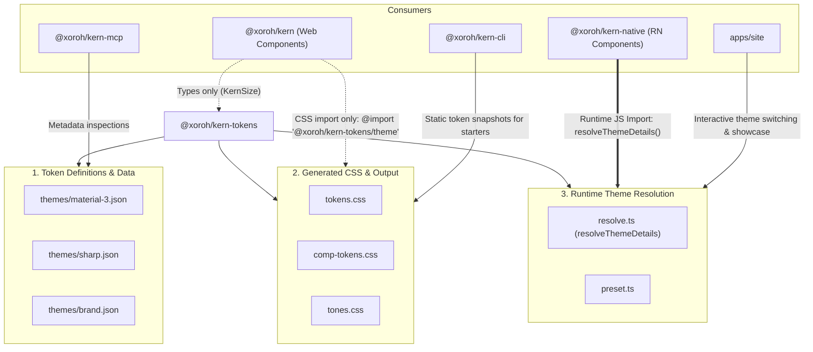
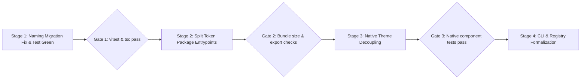

# Kern 0.1.0 Preview — Theming and Package-Boundary Comprehensive Audit

> **Audit Status**: Complete  
> **Repository HEAD**: `4d203613eb35a29492287cf09bdcd67dd7862f7e` (`main`)  
> **Working Tree Safeguard**: Preserved. No destructive commands, edits, or unauthorized migrations executed.

---

## 1. Executive Recommendation

### Core Finding
Kern currently exhibits an architectural split between web and native:
1. **Web (`@xoroh/kern`)** is **already runtime-independent**. It relies exclusively on CSS Custom Properties (`var(--sys-color-primary)`, `var(--sys-shape-corner-full)`) via Tailwind v4 and CVA. Components do **not** require a React Context or ThemeProvider.
2. **Native (`@xoroh/kern-native`)** is **tightly coupled** to `@xoroh/kern-tokens` at runtime. Components (`button.tsx`, `chip.tsx`, `dialog.tsx`, etc.) import `resolveThemeDetails` directly from `@xoroh/kern-tokens` to calculate styling values (hex colors, DP radius, typography).
3. **Theming Engine**: `@xoroh/kern-tokens` currently bundles two fundamentally distinct concerns:
   - **Static Token Specifications & Presets**: JSON definitions (`material-3.json`, `brand.json`, `sharp.json`), DTCG exports, and generated static CSS (`tokens.css`, `comp-tokens.css`).
   - **Runtime Theme Resolution Engine**: `resolveThemeDetails()`, scheme generation, tone matrix calculation, and React hooks.

### Recommended Architecture: Option A / C Hybrid ("Lean Static Foundations + Platform Theme Packages")
- **Keep `@xoroh/kern-tokens` as an ultra-lean, static-first public package** containing:
  - Token metadata, Design Token Community Group (DTCG) JSON schemas, and multi-preset JSON files (`material-3.json`, `sharp.json`, etc.).
  - Static CSS stylesheets (`tokens.css`, `comp-tokens.css`, `tones.css`).
  - Pure TypeScript type definitions (`ResolvedTheme`, `ColorScheme`, `KernSize`, `ThemeContract`).
- **Decouple Web and Native Component Runtime Dependencies**:
  - **Web components** remain 100% zero-runtime with zero JS theme context. They consume CSS variables. An optional `@xoroh/kern/theme` entrypoint (or `web-theme.ts`) provides helper utilities for dynamic CSS class switching or SSR theme hydration, but is never required by components.
  - **Native components** should consume an abstract theme interface (via context or optional default props) without directly importing `resolveThemeDetails()` inside every single component file. Runtime resolution logic belongs in an optional theme adapter/provider (`@xoroh/kern-native/theme`), allowing consumers to either use standard M3 or inject their own completely custom design system token values without bundling the M3 generator.
- **Copy-Paste (Registry/CLI) Parity**:
  - Web copy-paste is already flawless: components only require the consumer to have CSS variables defined in their stylesheet (which `kern init` drops in).
  - Native copy-paste should standardize on an open theme contract (`KernThemeContext` / `KernThemeScheme`), so copy-pasting a component does not force an npm dependency on `@xoroh/kern-tokens` if the consumer provides a standard M3 or custom theme context.

---

## 2. Naming Migration Status & Repository Safeguards (§8 Audit)

The 0.1.0 Preview naming migration renamed `themes/kern.json` to `themes/material-3.json`. A strictly scoped follow-up was authorized to update three production files:

| File | Status | Verification Detail |
| :--- | :--- | :--- |
| [`packages/kern-tokens/src/resolve.ts`](file:///home/novexo/Desktop/Business/xoroh-monorepo/kern/packages/kern-tokens/src/resolve.ts) | **Verified Complete** | Line 15 imports `./themes/material-3.json`. `loadPreset()` correctly resolves `"material-3"`. |
| [`packages/kern-tokens/src/tokens.ts`](file:///home/novexo/Desktop/Business/xoroh-monorepo/kern/packages/kern-tokens/src/tokens.ts) | **Verified Complete** | Line 8 imports `./themes/material-3.json`. Default export `material3` configured correctly. |
| [`packages/kern-tokens/src/material-3.ts`](file:///home/novexo/Desktop/Business/xoroh-monorepo/kern/packages/kern-tokens/src/material-3.ts) | **Verified Complete** | New file created. Exports typed `material3Theme` importing `./themes/material-3.json`. |

### Residual Stale References & Failures
Because the authorization was strictly limited to those three files, stale references to `./themes/kern.json` remain in test and script files:
1. **Failing Test**: [`packages/kern-tokens/src/tokens-css.test.ts`](file:///home/novexo/Desktop/Business/xoroh-monorepo/kern/packages/kern-tokens/src/tokens-css.test.ts#L5)
   - Still imports `./themes/kern.json`.
   - Results in `vitest` failure: `Cannot find module './themes/kern.json'`.
   - Results in `tsc --noEmit` build error: `TS2307: Cannot find module './themes/kern.json'`.
2. **Build & Validation Scripts**:
   - `packages/kern-tokens/scripts/check-contrast.mjs`: Reads `themes/kern.json`.
   - `packages/kern-tokens/scripts/gen-comp-css.mjs`: Reads `themes/kern.json`.
   - `packages/kern-tokens/scripts/gen-css.mjs`: Reads `themes/kern.json`.
   - `packages/kern-tokens/scripts/gen-dtcg.mjs`: Reads `themes/kern.json`.
   - `scripts/check-kern.mjs`: Reads `themes/kern.json`.

> **Note**: Per audit guidelines, these files have **not** been modified and remain preserved until explicitly scheduled in the migration plan.

---

## 3. Component Independence Findings: Web vs Native

We audited representative component implementations across buttons, inputs, dialogs, cards, chips, and switches:
- Web: [`packages/kern/src/components/button.tsx`](file:///home/novexo/Desktop/Business/xoroh-monorepo/kern/packages/kern/src/components/button.tsx), [`input.tsx`](file:///home/novexo/Desktop/Business/xoroh-monorepo/kern/packages/kern/src/components/input.tsx), [`dialog.tsx`](file:///home/novexo/Desktop/Business/xoroh-monorepo/kern/packages/kern/src/components/dialog.tsx), [`chip.tsx`](file:///home/novexo/Desktop/Business/xoroh-monorepo/kern/packages/kern/src/components/chip.tsx), [`switch.tsx`](file:///home/novexo/Desktop/Business/xoroh-monorepo/kern/packages/kern/src/components/switch.tsx)
- Native: [`packages/kern-native/src/components/button.tsx`](file:///home/novexo/Desktop/Business/xoroh-monorepo/kern/packages/kern-native/src/components/button.tsx), [`chip.tsx`](file:///home/novexo/Desktop/Business/xoroh-monorepo/kern/packages/kern-native/src/components/chip.tsx), [`dialog.tsx`](file:///home/novexo/Desktop/Business/xoroh-monorepo/kern/packages/kern-native/src/components/dialog.tsx), [`switch.tsx`](file:///home/novexo/Desktop/Business/xoroh-monorepo/kern/packages/kern-native/src/components/switch.tsx)

### Web (`@xoroh/kern`)

| Dimension | Actual Web Implementation |
| :--- | :--- |
| **How values are obtained** | Pure CSS variables via Tailwind classes and `cva()`: e.g. `bg-(--sys-color-primary)`, `text-(--sys-color-on-primary)`, `rounded-(--sys-shape-corner-full)`, `gap-2`. |
| **Requires Theme Provider?** | **No**. Components contain zero React context or provider hooks. |
| **Default styling without provider** | **Yes**, fully styled as long as CSS custom properties are loaded into the DOM (e.g. via `theme.css` or the user's `index.css`). |
| **Consumer customization** | High flexibility: consumers can override via `className`, override CSS variables in `:root` / `.dark`, or pass Tailwind utilities. |
| **Pulls in token package?** | **Negligible**. Only imports pure types in 5 components (e.g. `LoadingIndicatorStyle`, `KernSize` in `button.tsx`). Zero JS bundle runtime overhead. |

### Native (`@xoroh/kern-native`)

| Dimension | Actual Native Implementation |
| :--- | :--- |
| **How values are obtained** | Evaluates a JavaScript theme scheme object: `scheme.primary`, `scheme.onPrimary`, `scheme.surfaceContainerHigh`. |
| **Requires Theme Provider?** | **Soft dependency**. Uses `useKernScheme()` which checks `KernThemeContext`. If omitted, it falls back to a module-level constant: `const defaultScheme = resolveThemeDetails("light")`. |
| **Default styling without provider** | **Yes**, functions in light mode out of the box using `defaultScheme`. |
| **Consumer customization** | Can wrap root in `<KernThemeProvider scheme={customScheme}>`, but defining a custom scheme currently requires understanding the M3 40+ color role structure. |
| **Pulls in token package?** | **Heavy runtime coupling**. 65+ native component files directly import `resolveThemeDetails` and types from `@xoroh/kern-tokens` at the top of the file. Every native component bundles the token resolution engine. |

---

## 4. Token Package Dependency Map and Consumer Analysis

Tracing `@xoroh/kern-tokens` across the workspace reveals 7 distinct usage categories:



### Classification Breakdown

1. **Token Definitions & Data**:
   - `themes/material-3.json`, `themes/sharp.json`, `themes/brand.json`, `themes/compact.json`.
   - DTCG schema definitions (`src/tokens.json`).
2. **Generated CSS / Platform Artifacts**:
   - `src/tokens.css`, `src/comp-tokens.css`, `src/tones.css`, `src/tailwind.css`.
   - Consumed by `@xoroh/kern/theme.css`, `apps/site/src/app.css`, and CLI starters.
3. **Runtime Theme Resolution**:
   - `src/resolve.ts`, `src/pipeline.ts`, `src/preset.ts`.
   - Calculates 128 tone palettes, surface containers, contrast ratios, and dynamic color schemes.
4. **Component Styling**:
   - Web: Zero JS runtime dependency. Uses CSS variables.
   - Native: 65+ files import `resolveThemeDetails("light")` to construct style sheets and dynamic styles.
5. **Build-Time Tooling & Generators**:
   - `scripts/gen-css.mjs`, `scripts/gen-comp-css.mjs`, `scripts/gen-dtcg.mjs`.
6. **Documentation & Playground**:
   - `apps/site` uses dynamic theme resolution for interactive token previews and live scheme switching.
7. **Public Consumer API**:
   - Tokens can be consumed independently by designers, micro-frontends, or non-React web apps who only want M3 CSS variables (`@xoroh/kern-tokens/tokens.css`) without installing React or UI components.

---

## 5. Comparison of Package-Boundary Options

| Criterion | Option A: Standalone Public Tokens | Option B: Tokens Internal to Theme Package | Option C: Internal Foundation + Stable Theme API | Option A/C Hybrid (Recommended) |
| :--- | :--- | :--- | :--- | :--- |
| **Description** | Keep `@xoroh/kern-tokens` as standalone public package with all data, scripts, and runtime engine. | Merge tokens into an optional `@xoroh/kern-theme` package. Components import theme package. | Hide `@xoroh/kern-tokens` as private monorepo package; re-export small API via UI packages. | `@xoroh/kern-tokens` is a lean static/contract package. Runtime resolution is isolated in optional theme modules. |
| **Dependency Direction** | Circular tendency: tokens used by components, but tokens also define component token contracts. | Clean for apps, but heavy: pulling theme package pulls entire M3 engine into native components. | Restricts consumers: non-React consumers cannot consume pure CSS tokens without `@xoroh/kern`. | **Strict unidirectional**: Tokens -> Contracts -> Theme Adapters -> Components. Zero circularity. |
| **Public API Stability** | Low: Exposes unstable internal ASTs and M3 resolution details. | Medium: High churn in theme engine affects all consumers. | High: Small exposed surface. | **High**: Token JSON schema & CSS variable names are versioned; runtime engine evolves independently. |
| **Web Package Size** | Optimal (CSS only). | High if JS theme engine is imported. | Optimal. | **Optimal (0 KB JS bundle for web UI)**. |
| **Native Package Size** | Heavy (bundles M3 resolution in every component). | Heavy. | Heavy unless decoupled. | **Minimal**: Native components depend on a thin theme context interface, not the 128-tone generator. |
| **Copy-Paste (shadcn)** | Requires copy-pasting or installing `@xoroh/kern-tokens`. | Requires installing theme package. | Difficult: hard dependencies on core package. | **Excellent**: Web components are 100% pure CSS classes; Native uses standard context shape. |
| **Independent Consumers** | Excellent for CSS/Figma/DTCG consumers. | Poor (locked behind UI/theme package). | Poor. | **Excellent**: Pure CSS/DTCG tokens available independently. |

---

## 6. Web and Native Contract: Proposed Target Architecture

### The Platform Reality
- **Web** has a native, performant, dynamic cascading variable system: **CSS Custom Properties**. Dynamic theme switching (light/dark/contrast/custom brand) requires only toggling a class or data attribute (`<html class="dark" data-theme="sharp">`) on the root element.
- **React Native** does not have CSS custom properties or stylesheet inheritance. It requires JavaScript objects (`scheme.primary`) passed either through React Context or StyleSheet composition.

### The Unified Contract

```
                     ┌───────────────────────────────────────┐
                     │         @xoroh/kern-tokens            │
                     │  (Static M3/DTCG Tokens & CSS Vars)   │
                     └───────────────────┬───────────────────┘
                                         │
                 ┌───────────────────────┴───────────────────────┐
                 ▼                                               ▼
   ┌───────────────────────────┐                   ┌───────────────────────────┐
   │     Web Platform Path     │                   │   Native Platform Path    │
   │   (CSS Variable Engine)   │                   │   (JS Context / Object)   │
   ├───────────────────────────┤                   ├───────────────────────────┤
   │ Static CSS:               │                   │ Abstract Interface:       │
   │ --sys-color-primary       │                   │ KernThemeScheme           │
   │ --sys-shape-corner-full   │                   │ (primary, surface, etc.)  │
   ├───────────────────────────┤                   ├───────────────────────────┤
   │ Components:               │                   │ Components:               │
   │ @xoroh/kern               │                   │ @xoroh/kern-native        │
   │ (Zero runtime hooks)      │                   │ (Reads KernThemeContext   │
   │ (Pure CVA / Tailwind)     │                   │  or defaultScheme static) │
   └───────────────────────────┘                   └─────────────▲─────────────┘
                                                                 │ (optional injection)
                                                   ┌─────────────┴─────────────┐
                                                   │ @xoroh/kern-native/theme  │
                                                   │ (Optional M3 Runtime      │
                                                   │  resolveThemeDetails)     │
                                                   └───────────────────────────┘
```

1. **Token Identity Contract**:
   A canonical token name (`color.primary`, `shape.corner.full`, `elevation.level1`) maps to:
   - Web: `--sys-color-primary`, `--sys-shape-corner-full`, `--sys-elevation-1`.
   - Native: `theme.colors.primary`, `theme.shapes.cornerFull`, `theme.elevation[1]`.
2. **Decoupling Native Components from M3 Engine**:
   Instead of 65 components calling `resolveThemeDetails("light")`:
   - Define a static, pre-resolved `defaultMaterial3LightScheme` constant.
   - Native components consume `useKernScheme()`, which reads from context or defaults to the static object.
   - The heavy dynamic resolution engine (`resolveThemeDetails`, tone calculation) moves to `@xoroh/kern-tokens/runtime` or `@xoroh/kern-native/theme`. Consumers only bundle it if they dynamically generate themes from seed colors.

---

## 7. Impact Assessment Across the Monorepo

| Package / Artifact | Current State | Impact of Target Architecture | Migration Risk |
| :--- | :--- | :--- | :--- |
| **`@xoroh/kern` (Web)** | Already decoupled from theme runtime; uses CSS variables. | Minimal. Ensure no leftover types tie it to token internals. | **Very Low** (already conforms to target). |
| **`@xoroh/kern-native`** | 65+ components import `resolveThemeDetails` directly. | Refactor components to consume a lightweight context / static constant instead of resolution engine. | **Medium** (requires codemod across native components). |
| **`@xoroh/kern-tokens`** | Mixed static JSON, CSS generation, and dynamic resolution logic. Broken test on `kern.json`. | Split entrypoints: `@xoroh/kern-tokens` (CSS & static presets) vs `@xoroh/kern-tokens/runtime` (resolution engine). Fix stale test/scripts. | **Medium** (requires fixing naming migration leftovers). |
| **`@xoroh/kern-primitives`** | Headless primitives. Unstyled. | No change. Remains independent. | **Zero**. |
| **`@xoroh/kern-icons`** | Pure SVG / RN SVG components. | No change. Consumes `currentColor` on web and `color` prop on native. | **Zero**. |
| **`@xoroh/kern-cli`** | Drops starter CSS and token snapshots into new projects. | Uses static CSS tokens directly. Copy-paste components have zero package dependencies on web. | **Low**. |
| **`@xoroh/kern-mcp` & Registry** | Inspects tokens and component manifests. | Registry metadata clearly denotes CSS variable dependencies for web and context interface for native. | **Low**. |
| **Documentation & Playground**| Site playground dynamically generates schemes. | Site imports `@xoroh/kern-tokens/runtime` explicitly. | **Low**. |

---

## 8. Staged Implementation Plan & Validation Gates



### Stage 1: Stabilize Naming Migration & Restore Baseline
- **Scope**:
  - Update stale imports in `packages/kern-tokens/src/tokens-css.test.ts` from `kern.json` to `material-3.json`.
  - Update scripts in `packages/kern-tokens/scripts/` (`check-contrast.mjs`, `gen-css.mjs`, etc.) and `scripts/check-kern.mjs` to target `material-3.json`.
- **Validation Gate 1**:
  - `bun run --filter @xoroh/kern-tokens test` exits 0.
  - `bun run --filter @xoroh/kern-tokens typecheck` exits 0.
  - `bun run check:layers` exits 0.

### Stage 2: Separate Static Token Artifacts from Runtime Engine
- **Scope**:
  - Configure `package.json` exports in `@xoroh/kern-tokens`:
    - `.` -> Main static types and presets (`material-3`, `sharp`, `brand`).
    - `./theme` -> CSS tokens (`tokens.css`).
    - `./runtime` -> Dynamic theme resolution engine (`resolveThemeDetails`, `pipeline`).
  - Pre-build and export a lightweight static `defaultMaterial3LightScheme` and `defaultMaterial3DarkScheme`.
- **Validation Gate 2**:
  - Web package import analysis shows 0 KB runtime JS added by tokens.
  - Consumers importing `@xoroh/kern-tokens/theme` get pure CSS with no node/bundler warnings.

### Stage 3: Decouple `@xoroh/kern-native` Components
- **Scope**:
  - Centralize theme access in [`packages/kern-native/src/theme.tsx`](file:///home/novexo/Desktop/Business/xoroh-monorepo/kern/packages/kern-native/src/theme.tsx).
  - Update native components to use `useKernScheme()` backed by the static pre-resolved scheme rather than calling `resolveThemeDetails()` on module evaluation.
  - Keep `<KernThemeProvider>` for optional scheme overrides.
- **Validation Gate 3**:
  - All native component tests (`.rntest.tsx`) pass.
  - No component file in `packages/kern-native/src/components/` imports `resolveThemeDetails`.

### Stage 4: Registry, Copy-Paste, and Documentation Alignment
- **Scope**:
  - Update registry component manifests to document token dependencies:
    - Web: CSS variables list (`--sys-color-primary`, etc.).
    - Native: Theme contract requirements.
  - Verify `kern add <component>` works in an empty project without forcing full runtime theme packages.
- **Validation Gate 4**:
  - Run `scripts/verify-consumer.mjs` against both package-import and copy-paste sample consumers.
  - Zero drift reported across documentation and machine surfaces (MCP/llms.txt).

---

> **Report Conclusion**: The existing Kern repository is already halfway to the ideal architecture. Web is completely independent and copy-paste ready today. Implementing this staged plan will remove the remaining native runtime coupling, fix the naming migration residuals, and deliver a clean, multi-design-system, AI-first component ecosystem for 0.1.0 Preview.
