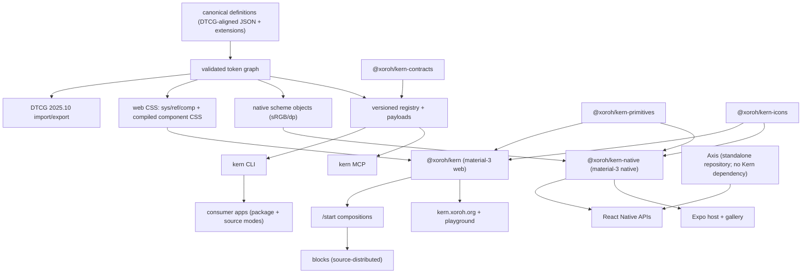

# Kern 0.1.0 Preview Redesign — Target Architecture and Migration Plan

Status: planning gate (Phase 1) — corrections in progress per 0.1.0-preview authorization. This file is the sole execution authority; `docs/planning/` remains frozen historical evidence, not deleted.
Evidence date for the Phase 0 baseline: 2026-10-14. HEAD `4d203613`, `main...origin/main [ahead 21]`. The 16-modified/8-untracked snapshot in §0.3 is historical as of that date; current observed worktree state is in §13.1. No broad renames had started at the baseline. Reproducible inventory: `bun scripts/generate-inventory-freeze.mjs --out docs/architecture/inventory-freeze.json` → `docs/architecture/inventory-freeze.json`; per-file verdicts `docs/architecture/per-file-decisions.json` (541 rows: keep 517 / generate 19 / merge 3 / rename 1 / remove 1).

This is the single implementation plan mandated for 0.1.0 Preview. `docs/architecture.md` remains the current-system description; this file is the target-system authority.

## 0. Phase 0 baseline (grounded in source, 2026-10-14)

### 0.1 Workspace

- Bun 1.3.8, workspaces `apps/*`, `packages/*`. Root `package.json` private `kern@0.0.0`.
- 8 packages in `packages/`, all `0.0.0` MIT: `kern`, `kern-native`, `kern-tokens`, `kern-primitives`, `kern-icons`, `kern-contracts`, `kern-cli` (private, bin `kern`), `mcp` (npm `@xoroh/kern-mcp`, bin `kern-mcp`).
- 2 apps: `apps/site` (TanStack Start, docs/playground/gallery/blocks preview), `apps/mobile` (Expo 57, empty host, has real `bundle` script).
- Baseline gates sampled 2026-10-14: `check:layers` pass, `check:parity` pass (92 shared, 34 web-only, 9 native-only, 0 stubs, 6 deliberate), `check:theme-matrix` pass (30 cells). Full matrix (unit/integration/pack/docs/e2e) must be rerun per §9 before release claims.

### 0.2 Capability inventory (preservation obligations)

| Area | Location | Status | Preserve as |
|---|---|---|---|
| Canonical tokens | `packages/kern-tokens/src/tokens.json` (1141 lines; 51 palette + 121 spectrum + 5 base + 10 shape + 6 elevation + motion + 5 states + 18 spacing + 15+15 type scales) | Working, custom JSON (not DTCG-authored) | Migrate to canonical DTCG-aligned authoring, keep value coverage |
| Roles/themes | `src/kern-roles.ts` (45 M3 + 13 extra = 58 roles), `src/themes/kern.json` (58×2), catalog `kern/sharp/brand/compact/demo` + `matrix.json` 30 cells, `resolve.ts` base→contrast→preset | Working | Generic naming, preset `material-3` owns values |
| CSS output | `src/tokens.css` (314 `--sys-*`), `src/comp-tokens.css` (142 `--comp-*`), `src/tailwind.css` (`--comp-*` mirror), `tones/motion` CSS | Working, legacy naming | Regenerate as `--sys/--ref/--comp`, keep compiled-CSS + Tailwind adapter contract |
| DTCG | `src/dtcg.json` (`ref`+`sys`), `src/dtcg/{export,import,validate,shared,retained}.ts` | Working export/import | Make canonical, bidirectional stays |
| Web components | `packages/kern/src/components/` 84 non-test `.tsx`, barrel ~167 exports, `/start` 6 modules | Working | Preserve axes/states, migrate styling to new tokens |
| Native components | `packages/kern-native/src/components/` 87 non-test `.tsx`, barrel ~14 exports | Working, device runs missing | Preserve, fix parity gaps, prove Metro/device |
| Primitives | `packages/kern-primitives` 81+ exports, `check:consumption` 70 adopted | Working | Keep boundary (no tokens/renderers import) |
| Icons | `packages/kern-icons` 1341 glyphs, ~80 semantic aliases, dual renderers | Working | Keep coverage, dual renderers, license payload |
| Blocks | `apps/site/src/blocks/` 3 blocks (`settings-screen`, `auth-form`, `empty-search`) | Working, only 3 | First-class installable, do not reduce |
| CLI | `packages/kern-cli` bin `kern`: `init/add/list/diff/upgrade` (no `info`), registry 418 rows | Working, private | Target public distribution after timing approval; keep receipt/transaction safety; `kern info` remains undecided (§13.3) |
| MCP | `packages/mcp` 12 tools (`list_components/get_component/get_tokens/get_dtcg/list_themes/design_audit/list_icons/get_icon/list_blocks/get_block/install_plan/validate_install`), manifest 418 rows (301 web + 117 native) | Working | Shared contracts with CLI, bundled payloads |
| Contracts | `packages/kern-contracts` schema + validators | Working | Keep, extend for preset/capability model |
| Site/playground | `apps/site` docs + studio + gallery | Working, 21-test browser suite per prior ledger | Migrate to final APIs, generic vs M3 distinction |
| Release | Changesets per-package, HOLD enforced by `release.yml` | Not published | Validate, do not publish without authorization |

Full row-level export inventory: freeze via AST scan before renames (KERN-003 equivalent). Parent `../xoroh-platform` usages (683/455/138 historical) are out of scope for this preview except via public artifacts; no parent edits without separate authorization.

### 0.3 Working tree (historical 2026-10-14 snapshot — preserve all — G)

This is the dated Phase 0 snapshot, not the current count; see §13.1 for the latest read-only status.

Modified (16): `apps/site/src/domains/playground/studio.tsx`, `apps/site/src/domains/shared/chrome/site-layout.tsx`, `apps/site/src/routes/playground/index.tsx`, `apps/site/src/theme-studio/studio-state.ts`, `docs/planning/{AGENT_EXECUTION_GUIDE,APPROVALS,ARCHITECTURE_DECISIONS,IMPLEMENTATION_PHASES,MASTER_TODO,NO_GO,README,RISKS_AND_OPEN_QUESTIONS}.md`, `docs/platform-parity.md`, `packages/kern-tokens/src/index.ts`, `packages/kern/src/theme.css`, `scripts/codemod-xoroh-imports.mjs`.
Untracked (8): `apps/site/src/domains/playground/{playground-state.ts,playground.tsx}`, `docs/adr/006-distribution-engine-dtcg.md`, `docs/architecture/0.1.0-preview-redesign.md`, `docs/architecture/inventory-freeze.json`, `docs/architecture/per-file-decisions.json`, `docs/planning/{AUDIT_REMEDIATION_REPORT,INDEPENDENT_COMPLETION_AUDIT,XOROH_MIGRATION}.md`, `scripts/generate-inventory-freeze.mjs`.
Rule: no resets, no `check:cold`, no mass formatting, no deletion of `docs/planning/`, no parent `../xoroh-platform` edits. New work commits in small reviewable batches.

### 0.4 File-level evidence (6/6 deep audits landed 2026-10-14)

- Web `packages/kern`: 84 non-test `.tsx`, 59 component tests (75 total with parity/start/root), barrel 167 exports. Styling: Tailwind v4 `bg-(--sys-…)` + `cn/cnState` (80/42 files) + CVA 13 files + Base UI 30 entry points. `--sys-*` 1610 non-test / 1854 with tests. Overlaps documented (not deleted): `loader`→`loading-indicator` fold, `loading-button`→`Button` fold, `sheet.tsx` (side) vs `sheet-family` (bottom) vs `drawer` vs `navigation-drawer` (rename to `side-sheet`), `sonner` (stack) vs `snackbar` (parts), `combobox/command/autocomplete` (3 roles, extract shared `h-14` field recipe). Missing: breadcrumb. Rebuild rule: behavior/state/dismissal/traversal → shared contract; DOM/portal/boot/table → web-specific; variant/color/size/shape/elevation/state-layer → `material-3` styling.
- CLI/MCP/registry: registry 418 rows (301 web + 117 native, 0 stubs, entrypoints `.` 386 / `./start` 32), `releaseSet kern@0.0.0+418.c6e51cd44435481e`. CLI 5 commands (no `info`), 15 programmatic exports, plan/commit split correct. MCP 12 tools, platform-correct roots. Gaps: 3 manifest parsers (CLI `ROW_RE` + MCP import + block chunk-split ×2) must unify; `upgrade` has no block path; MCP byte tools degrade outside checkout (need bundled payloads); `assets: []` always (closure assets dropped); `DiffRow` vs `UpgradePlan` vocab split. Scripts: 21 `check-*` + 7 ops, all working. Decision: extend `@xoroh/kern-contracts` as shared discovery (no new package) — single manifest/block parser, precomputed closure file-lists, bundled `registry.json`/`blocks.json`+contents/token JSONs/dtcg/snapshot CSS/starters, receipt v2 helpers, unified diff/upgrade vocabulary.
- Site/mobile/CI: `apps/site` ~50 routes (TanStack FileRouter), 96 web + 101 mobile content files, 47 configurators, 8 examples (gap, `check-examples` enforces), 3 blocks, 25+ site gates. Keep all routes except renames: `/showcase`→`/blocks` (alias), `/patterns` merge/define boundary, `versioning.md`↔`releases.md` dedupe. Rewrite: playground scope `m3|astryx|shadcn` → `material-3` only for v1 (single load-bearing confusion), `apps/mobile/README.md` (says empty, gallery landed), site README theme paragraph. `apps/mobile` Expo 57 host working (Components/Shell/Theme, fonts, Metro, `bundle`). `e2e/` 5 specs keep. `.github/` 3 workflows keep (release HOLD stays). `.changeset/` ~70 files parse clean → pending minor on all 8 packages = first `0.1.0`. Move `docs/binding-contract.md`, `docs/parity-contract.md` (drafts) and `docs/KERN_ARCHITECTURE_AUDIT_HANDOFF*.md` (obsolete working papers) out of `docs/` root.
- Primitives/contracts/icons: primitives 17 impl + 16 test, React-only, no duplication (policy/wiring, roving/collection splits documented) — rebuild is per-symbol prune-or-adopt (7 orphaned exports: `createFocusTrapModel`, `createPressModel`, `resolveFloatingOrigin`, `clampRectToViewport`, `nextPresenceState`, `isSelected/normalizeSelection/toggleSelection`, `composeEventHandlers`, `createCollectionModel/useCollection` gated). Contracts 7 impl + schema: only `install.ts` receipt v2 is live; `component/block/icon` validators have no producers/consumers — wire MCP generator to emit them or cut before 1.0; add 4 missing record schemas. Icons healthiest: 1341 glyphs, 3912 upstream union, 41 semantic, dual renderers pass (single `resolveIconPaint` decision point), licenses complete — keep, fix only `core/index.ts` redundancy.
- Pending: none — 6/6 audits landed. Next: AST freeze → per-file keep/generate/remove manifest so rebuild starts from only-needed files.
- Native `packages/kern-native`: 87 components + 2 infra `.ts`, 58 test files (~527 cases: 91 vitest + 353 jest/RNTL + 83 parity). Only 9 files use `StyleSheet.create`, rest inline `style={{…}}`; token access via `useKernScheme×133/useKernTheme×50/useKernMotion×8` + `resolveThemeDetails` fallbacks. 18 web concepts lack same-name native file (15 covered by adapters/collapsed modules; `sonner`→Snackbar by design, `focus-ring` N/A, `preview-card` uncovered). Gaps blocking device proof: no Expo/Metro device host, SVG mocked in both runners, Modal/Animated/Linking/OS-theme headless only, inline-style perf unmeasured. Rebuild: Expo proof host + screenshot matrix (both OS × light/dark) + interaction/SR/perf passes; fill thin spots (`theme.rntest`, `settings-row`, `top-app-bar-toggle`, `preview-card` decision).
- Tokens `packages/kern-tokens`: 21 lib + 14 test + 5 DTCG lib + 3 DTCG test (43 `.ts`, 150 tests pass), 2 root JSON + 7 theme JSON + 5 generated CSS + 9 scripts. Canonical: `tokens.json`, `themes/kern+sharp/brand/compact/demo/index.json`, lib + scripts. Generated: `tokens.css`, `comp-tokens.css` (187 `--comp-*`), `tones.css`, `tailwind.css`, `motion.css`, `dtcg.json`, `themes/matrix.json`. Load-bearing bugs (tests green): comp spacing refs dangle (`--sys-spacing-300` vs emitted `--sys-spacing-space-300`), comp icon-size refs dangle (`var(--sys-color-icon-24)` vs zero such vars, literal branch unreachable). Coverage holes: no test asserts comp `var()` targets exist; projection traces tokens.css only. Rebuild layout: `src/ref/*.json` split, `src/sys/*`, `src/comp/*.json`, `src/presets/material-3.json` + sharp/compact + examples, `src/foundations/*.ts` merged, single registration API, remove `xoroh-preset.ts` from OSS, fix 2 dangling-ref bugs, extend goldens to comp/tones/motion.

## 1. Locked decisions (from mandate, non-negotiable here)

1. Product `Kern`, publisher `Xoroh`, scope `@xoroh`. CLI binary `kern` from scoped package. No unscoped acquisition work.
2. Generic tokens `--sys-* / --ref-* / --comp-*` by default. `--sys-*` is legacy. No `--kern-*`/`--xoroh-*` by default.
3. M3 is preset `material-3`. Generic namespace must not imply M3 semantics.
4. Full platform scope preserved: foundations, presets, web, native, icons, themes, blocks, docs/playground, CLI source-vendoring + package consumption, AI metadata + MCP, install/upgrade.
5. Stack: React + Base UI (where appropriate) + Tailwind v4; RN + Expo (where appropriate) + StyleSheet. No Radix/Aria/NativeWind without proven need.
6. Product promise: an open-source design-system platform, “One foundation. Every design system.” The Kern engine is universal; Material Design 3 is its first provider, not its definition.
7. Public products belong in `packages/`; internal-only libraries belong in `libs/`. Do not move packages for symmetry. Do not publish internal primitives or add a runtime/package boundary without a documented architectural reason and owner approval.

## 2. Target architecture

### 2.1 Dependency direction



Rules: canonical definitions are the only authored source; CSS/native/TS/registry are generated. No web↔native edge. No primitives→tokens edge. Contracts has zero UI/test-runner deps. CLI/MCP read the same registry bytes.

Dependency direction: Kern Web → Base UI (external) + the neutral Kern kernel where needed; Kern Native → its own platform implementation + the neutral Kern kernel. Axis is a separate project with no package, runtime, workspace, or generated-artifact dependency on Kern; Kern has no dependency on Axis. Web↛native and native↛web imports remain prohibited; no shared DOM/RN runtime abstraction.

### 2.2 Target package map

| Package (final) | Directory | Decision | Responsibility / public API |
|---|---|---|---|
| `@xoroh/kern` | `packages/kern` | Retain, rewrite styling | Material-3 web renderer + `/start`. Exports `.`, `./theme`, `./styles`, `./tokens`, `./utils`, `./start`. Depends on tokens, primitives, contracts(types only). |
| `@xoroh/kern-native` | `packages/kern-native` | Retain, fix parity | Material-3 native renderer. Exports `.`, `./native`. Deps: tokens, neutral Kern kernel, contracts(types); no Axis dependency. |
| `@xoroh/kern-tokens` | `packages/kern-tokens` | Retain, canonical rewrite | Canonical graph, DTCG, themes (`material-3` + generic), CSS/native/TS projections. No renderer deps. |
| `@xoroh/kern-primitives` | `packages/kern-primitives` (current; internal-only) | Retain as neutral Kern kernel; any move to `libs/` remains N9 and approval-gated | Platform-neutral React-only behavior models (no DOM/RN imports; `check:primitives` enforced). Kern web/native consumers only. Never rename or alias this package to Axis. |
| `@xoroh/kern-icons` | `packages/kern-icons` | Retain | Material glyph catalog + dual renderers + license payload. Contracts types only. |
| `@xoroh/kern-contracts` | `packages/kern-contracts` | Retain, extend | Preset/capability/component/block/icon/install schemas + validators + `preset: "material-3"` (no `provider` concept; `provider.ts` mapped then deleted at P3). |
| `@xoroh/kern-cli` | `packages/kern-cli` | Retain; public distribution timing requires owner decision | Bin `kern`: `init/add/list/diff/upgrade`; add `info` only if approved (§13.3). Bundled registry + source payload. |
| `@xoroh/kern-mcp` | `packages/mcp` (rename to `packages/kern-mcp` only if approved, §13.3) | Retain; directory rename is deferred pending owner decision | MCP server, same 12 tools (extended for blocks/icons/DTCG). Bundled payloads, no checkout reads. |

A3 proposes the owner-approved public `@xoroh/kern-material-3` product, with execution approval still required. Axis is not a Kern package and is not added to the Kern workspace. No blocks package (blocks stay source-distributed + registry metadata). `/start` stays in web package. Native composition stays in native package.

## 3. Naming specification (lock before migration)

- npm: `@xoroh/kern`, `@xoroh/kern-tokens`, `@xoroh/kern-native`, `@xoroh/kern-primitives`, `@xoroh/kern-icons`, `@xoroh/kern-contracts`, `@xoroh/kern-cli`, `@xoroh/kern-mcp`.
- Axis (separate project, §10): intended repository `xoroh/axis`, site `axis.xoroh.org`, intended package candidate `xoroh-axis`; no Axis package exists in this Kern checkout. npm/package availability, domain control, and trademark checks remain unresolved until verified before release. The older `@xoroh/kern-axis` name is not the standalone target.
- CLI: `kern init|add|list|info|diff|upgrade`. Config `kern.json`. Receipt v2 retained.
- Directories: `packages/kern-mcp` (renamed), all else unchanged.
- TS symbols: `material3` / `material-3` for preset; `Material3*` type prefix where needed; generic helpers unprefixed.
- CSS grammar (generic only; clean break, no `--sys-*` aliases — B):
  - `--ref-palette-{hue}-{step}`, `--ref-spacing-{n}` (unitless step, `px` value), `--ref-radius-{name}`, `--ref-type-{family|size|line-height|letter-spacing|weight}-{scale}`, `--ref-motion-{easing|duration|spring}-{name}`, `--ref-elevation-{level}` (authored reference, values not roles).
  - `--sys-color-{role}`, `--sys-shape-corner-{name}`, `--sys-elevation-{level}` (+ `-dp` integer for native), `--sys-type-{scale}-{prop}`, `--sys-motion-{…}`, `--sys-state-{hover|focus|press|drag|disabled}-opacity`, `--sys-spacing-space-{n}` (key keeps its `space-` prefix per tokens.json; comp/tailwind refs use the full key — R1).
  - `--comp-{component}-{slot}-{attr}` (e.g. `--comp-button-height`, `--comp-dialog-container-color`; values are `var(--sys-*)` refs or literals like `24px`, never `var(--md-*)`).
  - Tailwind v4 `@theme` mapping: `--color-sys-{role}: var(--sys-color-…)` → utilities `bg-sys-…/text-sys-…/border-sys-…`; `--spacing-sys-{n}`, `--radius-sys-{name}`, `--text-sys-*` similarly; `--comp-*` passed through for `h-(--comp-button-height)` style arbitrary values. `--ref-palette-{hue}-{step}` replaces `--spectrum-*`; the shadcn-style app bridge (`--background/--foreground/--card/--primary/…/--radius/--sidebar-*`) and `--md-*` / `--comp-md-*` aliases are removed (clean break, zero consumers verified R1); site migrates to `sys` utilities in P7.
  - `[data-kern-theme]` / `.dark` selectors and `kern-*` storage keys are stable DOM/API surface, not token names — unchanged by the rename (R1 decision).
- Vocabulary (C): **preset** = design language (`material-3`: tokens, themes, components, capabilities). **Renderer** = implementation target (`web` | `native`). No `provider` concept going forward; `packages/kern-contracts/src/provider.ts` (`PROVIDER_ID="m3"`) is mapped to `preset: "material-3"` at P3 then deleted (clean break, unpublished). Schemas/types/metadata/config/CLI/MCP/tests/docs use `preset` + `renderer` consistently from P3 on.
- Preset/theme ids (clean break, no aliases — B): preset `material-3`; themes `material-3` (default), `sharp`, `brand`, `compact`, `demo` as overrides. Old ids `kern`, `m3` are removed with in-tree codemod (packages unpublished `0.0.0`, release HOLD unbroken, `NPM_TOKEN` dead per `TODO.md`; all consumers are in-repo: site/mobile/CLI snapshots/docs/MCP — migrated in P2/P7). No `--kern-*`/`--xoroh-*` defaults. Value drift fails gates: renames never change resolved values.
- Config keys: `preset: "material-3"`, `renderer: "web"|"native"`, `mode: "package"|"hybrid"|"snapshot"`.
- Machine-readable discovery metadata covers component/block identity, `designSystem`/`preset` provider identity, renderer/platform/framework compatibility, capabilities, dependencies, version constraints, assets and install mode. Preserve separate installed/compatible/verified states. Use the locked `designSystem` + `preset` vocabulary; do not restore the removed `provider` field without owner approval.
- Primitives safety (G): `kern-primitives` imports `react` only (peer), zero tokens/renderer/DOM/RN imports — enforced by `check:primitives`. Pure models (`useControllableState`, roving/selection/dismiss/presence/press/slot/time) are platform-free by construction; renderer bindings live in `presentation.tsx` hosts (web Base UI / RN), never in primitives. 7 orphaned exports are pruned-or-adopted per-symbol at P4, no new platform imports.
- Docs routes: `/foundations/*`, `/systems/material-3/*`, `/components/{web|native}/*`, `/icons`, `/blocks/*`, `/themes/*`, `/cli/*`, `/ai-mcp/*`.

## 4. Breaking-change register

| # | Old | New | Reason | Affected | Migration (implementation step) | Tests (verification) |
|---|---|---|---|---|---|---|
| B1 | `--sys-*` (314 vars, 1610 non-test uses) | `--sys-*` (clean break, no alias) | Generic namespace mandate; packages unpublished `0.0.0`, all consumers in-repo | Web 84 files, `gen-css.mjs`, CLI 5-CSS snapshot, docs, MCP `get_tokens`, site | P2 regenerate + in-tree codemod `(--sys-` → `(--sys-`; no compat CSS | Token goldens, extended `tokens-css.test.ts` (asserts comp `var()` targets), computed-style fixtures, `grep -rn -- --sys- --include='*.{ts,tsx,css,mjs}' packages apps | zero (evidence + migration notes excluded) |
| B2 | `--comp-*` / `--comp-*` (187 + 142 mirrors) | `--comp-*` (clean break, no alias) | Same as B1 + fixes icon-size dead branch | Same as B1 + Tailwind | P2 `gen-comp-css.mjs` rewrite (literal branch before color branch) + codemod | Comp-token goldens, dangling-ref test (every comp `var()` resolves), Tailwind build fixture |
| B3 | `--ref-palette-*`, `--md-*` / `--color-md-*` Tailwind, app bridge `--background/--foreground/…` | `--ref-*`, `--color-sys-*` (clean break, no alias) | Reference/system split; bridge was shadcn-shaped, not Kern | Tailwind consumers, site | P2 generator change + P7 site migration to `sys` utilities | Tailwind build + computed-style fixtures, zero `--ref-palette-`/`--color-md-` hits |
| B4 | Theme/preset ids `kern`, `m3`; `provider.ts` `PROVIDER_ID="m3"` | `preset: "material-3"`; themes `material-3/sharp/brand/compact/demo` (clean break, no alias) | Preset identity (C); unpublished, in-repo only | Token APIs, CLI, MCP `get_tokens`, docs, contracts `provider.ts` (deleted after P3 mapping) | P2 resolver rename + in-tree codemod; P3 `provider`→`preset` schema migration | Resolver + MCP tests, `grep -rn '"m3"\|preset.*kern'` zero outside evidence/notes |
| B5 | `packages/mcp` directory | `packages/kern-mcp` (dir only, npm name unchanged) | Name/directory consistency | CI, imports, docs | P3 `git mv` + workspace/CI/docs updates | Pack/build/typecheck + `check:workflow` |
| B6 | CLI private, no `info` | Public `@xoroh/kern-cli`, add `kern info <component>` | Mandate CLI surface | Consumers, docs, MCP parity | P5 `private:false` + `files`/bin + new command + block upgrade path | Packed CLI fixtures in clean dirs (init/add/info/diff/upgrade, blocks) |
| B7 | M3 roles as generic namespace | Generic roles + `material-3` preset extensions | Multi-system architecture | Tokens, components, metadata | P2 `src/presets/material-3.json` + extension manifest | DTCG roundtrip + preset tests, no value drift (goldens) |
| B8 | `tokens.json` custom shape | DTCG-aligned canonical + extensions (`ref/` split, versioned schema) | Single source of truth | Generators, docs | P2 split + fix spacing/icon-size dangling refs + projection extended to comp/tones/motion | Schema + golden + determinism + freshness gates |

Clean break rationale (B): packages are `0.0.0` unpublished (release HOLD intact, `NPM_TOKEN` dead, never published per `TODO.md`); no outside-repo consumer exists. All `--sys-*` / `kern` / `m3` consumers are in-repo and migrated in-tree (P2/P3/P7). Compat aliases would double the CSS API, shadow the spacing/icon-size bugs, and create lasting `--md-` vs `--sys-` ambiguity — rejected. No silent value changes: renames keep resolved values byte-identical (goldens fail on drift).

### 4.1 Component identity map (D — behavior-verified, no assumed duplicates)

| Group | Old identities | Verdict | Target implementation / exports / deps | Migration + regression tests |
|---|---|---|---|---|
| Side vs bottom vs drawer | `sheet.tsx` (side `left\|right`, Dialog primitive) / `sheet-family.tsx` (bottom-anchored family, Dialog) / `drawer.tsx` (bottom, Drawer primitive, `max-h-80vh`) / `navigation-drawer.tsx` (M3 modal nav drawer, destinations shared with `navigation-bar`) | 4 distinct: edge + primitive + content differ | Rename file `sheet.tsx` → `side-sheet.tsx`, exports `Sheet*` → `SideSheet*`; keep `Drawer*`, `NavigationDrawer*`, `Sheet*Family*` unchanged | In-tree codemod + P4 e2e `dialog-focus-trap` / `sheet-dismissal` + parity `native-parity-sheets`; `per-file-decisions.json` row `rename` |
| Loading | `loader.tsx` (generic `role=status` spinner, CVA sm/default/lg) / `loading-indicator.tsx` (M3 canonical indeterminate, mandatory label, reduced-motion ring) / `loading-button.tsx` (button + spinner slot) / `circular-progress.tsx` (determinate arc + legacy indeterminate styles) | `loading-indicator` canonical; `loader` duplicate; `loading-button` fold; `circular-progress` determinate-only | Merge `loader.tsx` → `loading-indicator.tsx` (`Loader` removed, migrate to `LoadingIndicator`); merge `loading-button.tsx` → `button.tsx` (loading slot); `circular-progress` keeps determinate, indeterminate path removed | Codemod + `loader`/`loading-indicator`/`linear-progress` suites + a11y (mandatory label, no `aria-valuenow` on indeterminate) + reduced-motion |
| Toasts | `sonner.tsx` (opinionated stack: intent/timeout/action/manager) / `snackbar.tsx` (unstyled parts: Provider/Root/Title/Description) | Distinct layers, both Base UI `toast` | Keep both; document `sonner`=default stack, `snackbar`=parts | Existing suites + docs boundary sentence; no file change |
| Field/palette | `combobox.tsx` (Base UI `combobox`, filterable) / `command.tsx` (palette: filter + render-prop options) / `autocomplete.tsx` (Base UI `autocomplete`, suggest) | 3 roles, 3 primitives | Keep all three; extract shared `h-14` field recipe constant (drift fix, no API change) | Field goldens + keyboard/a11y suites; recipe extraction covered by existing tests |

Native mirrors: `loader`→`page-loader` blur clarified (`loader` spinner vs `shell BootSplash`); `sheet/sheets` naming aligned with web (`sheets.tsx` family kept); `preview-card` has no native counterpart — documented absence (P4 decision, not a port).

### 4.2 Registry generation (E — authoritative inputs, no checkout reads)

Authoritative inputs (each owned, versioned, validated): (1) canonical token definitions + themes (`packages/kern-tokens` `ref/`+`sys/`+`presets/`); (2) preset manifests (`material-3` capabilities, extensions); (3) component metadata (barrels + `parity/contract.ts` 27 rows, not prose); (4) icon catalog + renderer metadata (`kern-icons` names/shapes/manifest + license payload); (5) block manifests + source files (`apps/site/src/blocks/`, 3 rows); (6) platform capability metadata (web/native implementation rows, `PARITY_COUNTS` 301/117/92); (7) dependency/install metadata (closures, peers, assets, starters).
Generated (never hand-edited, freshness-gated): versioned Kern registry index + distributable payloads (`registry.json`, `blocks.json`+contents, token JSONs/dtcg/snapshot CSS, starters index, MCP `manifest/maturity.ts`). Axis owns any standalone manifest and generator in its own repository; Kern CLI/MCP do not consume it. CLI and MCP consume the same `kern-contracts` discovery contracts and identical registry bytes — no competing hand-authored registry, no `ROW_RE`/chunk-split parsers, no `../../../..` checkout reads at runtime (packed payloads only; `KERN_TARBALL`/dev-override explicit and bounded). Reproducible: `generate:components` + `generate-blocks` + `generate-css-snapshot` + `check:generated` (+ census entry for CLI payloads); mismatch fails gates.

### 4.3 Native verification (F — honest, environment-grounded)

Available 2026-10-14 (Linux): Android SDK + emulator binary + system-images + AVD `xoroh-pixel` present; `adb`/daemon state unchecked, no device run yet; **no Xcode/iOS simulator** (Linux); Expo host `apps/mobile` (`bundle: expo export`) present; RNTL/vitest suites headless only (SVG/Animated mocked).
Matrix: automated — `test:native`, `test:native:jest`, parity suites (83 cases), `check:elevation-parity`, Metro `bundle` + artifact assert, `typecheck`; emulator/simulator/device-required — Android emulator boot + light/dark + 40-screen gallery screenshots, back-button/Modal stacks, sheet drag/snap, carousel swipe, slider/dial drag, OTP autofill, IME actions, deep-link, long-press, VoiceOver/TalkBack role/name/state passes, inline-style perf profile (low-end Android), both-OS elevation/hairline/type shots. Axis verification is a separate standalone-project gate in §10; it neither substitutes for nor contributes to Kern Native device/parity claims. iOS: **cannot verify on this host** — documented limitation; needs macOS runner or device lab before claiming iOS support. No fabricated screenshots/builds: every device claim cites command/artifact/time or is marked missing in the progress log.

## 5. High-level work domains (dependency order is §13.4)

The P0–P9 labels below are the original scope bands, not a serialized dependency graph. The current dependency graph, parallel tracks, F1 placement, and the independent Axis release gate are maintained only in §13.4. Axis is outside P2–P9 and makes no changes to the Kern migration.

- P0 baseline and inventory freeze (§0; completed evidence remains dated).
- P1 target plan and package boundaries (§1–§3).
- P2 token grammar, DTCG, `material-3`, and generated projections.
- P3 universal contracts and capability metadata.
- P4 components, icons, web/native parity, and device verification.
- P5 blocks and CLI install/scaffold flows.
- P6 AI discovery metadata and MCP, sharing Kern contracts with CLI.
- P7 site, docs, and playground.
- P8 bounded migration and cleanup.
- P9 release gates and preview readiness; no weakened thresholds or unauthorized publication.

Token naming constrains styling and templates; package boundaries constrain imports. Parallel work is allowed only where §13.4 shows no dependency edge.

## 6. Plan validation (gate before implementation — evidence-cited)

- [x] Every §0.2 capability has a target location (§2 + §0.4 + §9 keep/generate/remove + §4.1 identity map).
- [x] All 418 registry rows frozen via reproducible artifacts: `docs/architecture/inventory-freeze.json` (`scripts/generate-inventory-freeze.mjs`), `docs/architecture/per-file-decisions.json` (541 rows) — re-freeze blocks P2.
- [x] Every rename in §3 appears in §4/§4.1 with affected consumers + tests + implementation step.
- [x] Generated artifacts derived from canonical, freshness-gated (§4.2 inputs→outputs + §9 generate list).
- [x] Web + native + CLI + MCP acceptance measurable (§9 order + §4.3 honest matrix, mandate Phases 2–9).
- [x] Preview keeps Material Design 3 as the first provider while contracts/engine remain provider-neutral; no second provider implementation is required for Preview, and the `pixel` fixture proves M3-independent resolution (C).

## 7. Acceptance deltas vs `docs/planning/` (explicit)

- `TARGET_ARCHITECTURE.md` kept Material-shaped roles/CSS as canonical. **Superseded by §3–§4**: generic `sys/ref/comp` is canonical; Material values live in the `material-3` preset (clean break, no compat aliases per §4-B).
- Preset `material-3` replaces theme ids `kern`/`m3` and contracts `provider.ts` `PROVIDER_ID="m3"` (§3–§4, clean break; no aliases).
- 84-task `MASTER_TODO.md` remains evidence; execution authority is this file's §13.4 dependency graph and progress log. P7 Xoroh migration stays out of preview scope (no parent edits without separate authorization).
- DTCG stays mandatory and becomes canonical authoring (not just interchange).

## 9. Ground-up rebuild — full plan including gate-missing parts

AST freeze (2026-10-14, HEAD `4d203613`): artifacts `docs/architecture/inventory-freeze.json` + `docs/architecture/per-file-decisions.json` (541 rows) via `bun scripts/generate-inventory-freeze.mjs`. Pins: `registry.json` `93a07b88…` rows 418 (web/real 301, native/real 117, `.` 386 / `./start` 32); barrels web 296 / native 191 / primitives 40 / icons 29 / tokens 22 / contracts 7 (regex method, see script); tokens `14781a1f…`, dtcg `4a1b9b43…`, matrix `f0f454fc…`; icons 1341 glyphs. Re-freeze before any rename; mismatch blocks P2.

Per-file verdict (rebuild ends with only-needed files; generated never hand-edited):

- Keep: all 84 web + 87 native components (minus 2 folds: `loader`→`loading-indicator`, `loading-button` loading→`Button`), 17 primitives impl (prune 7 orphaned symbols per-file, not per-module), contracts `install/version/provider` + wire-or-cut `component/block/icon`, icons full catalog + pipeline, CLI plan/commit/receipt/closure algorithm, MCP 12 tool names + evidence labels, parity `contract.ts` untouched, all 21 `check-*` gates, site routes/content/demos, mobile host, e2e 5 specs, 3 workflows, ~70 changesets.
- Generate: `tokens.css`, `comp-tokens.css`, `tailwind.css`, `tones.css`, `motion.css`, `dtcg.json`, `matrix.json`, `registry.json`, `blocks.json`+contents, token snapshots, MCP `manifest/maturity.ts`, site `generated/*`, `routeTree.gen.ts`. Freshness-gated; register CLI payloads in `generated-artifacts.mjs`.
- Remove/rename: `packages/mcp` dir → `packages/kern-mcp`; `sheet.tsx` → `side-sheet` (alias); `/showcase` → `/blocks`; `docs/binding-contract.md`, `docs/parity-contract.md`, `docs/KERN_ARCHITECTURE_AUDIT_HANDOFF*.md` out of `docs/` root; `xoroh-preset.ts` out of OSS; `presentation.tsx` stays unbarreled (intentional); `dist/` never committed; `playground` Astryx/shadcn stubs behind `planned` flag.
- Fix first (P2, done 2026-10-14, batch 2a): comp spacing + icon-size dangling refs fixed; comp `typography` slots expand to 5 per-attribute vars (bare-scale refs eliminated); Tailwind spacing vars fixed (18 dangling). Zero dangling `var(--sys-*)` in comp (73 refs) + tailwind (220 refs). Regression in `tokens-css.test.ts`; tokens 162 pass.

Scope-band order only: freeze → P2 tokens/DTCG/`material-3`/`sys-ref-comp` → P3 contracts/capabilities → P4 components/native parity → P5 blocks/CLI → P6 MCP/registry → P7 site/docs/playground → P8 migration/cleanup → P9 gates. Actual dependencies are in §13.4. Axis extraction is a separate repo workstream under §10, not a package, schema, registry, P3, P4, or Kern cleanup change. REL waits for Axis's independent verification only as the explicit pre-alpha/beta release gate.

## 10. Xoroh Axis standalone extraction (planning only; independent of Kern)

**Current status: Planned — not ready for extraction, not extracted, and not independently verified.** Axis is a first-class standalone workstream and a required pre-public-alpha/beta gate. It is not a Kern package or migration phase. No extraction or implementation is authorized by this plan update.

### 10.1 Verified source and target boundaries

The current Kern checkout is at `4d203613`; `packages/` contains `kern`, `kern-cli`, `kern-contracts`, `kern-icons`, `kern-native`, `kern-primitives`, `kern-tokens`, and `mcp`. It has no Axis-named package or `packages/xoroh-axis/` staging directory. No standalone Axis source repository is present in this checkout.

Files in Kern that are candidate evidence for an eventual source/provenance review—not an approved transfer list—include:

- Neutral models in `packages/kern-primitives/src/`: `dismissPolicy.ts`, `dismissWiring.ts`, `focusTrap.ts`, `overlayModality.ts`, `press.ts`, `presence.ts`, `roving.ts`, `selection.ts`, `time.ts`, and `useControllableState.ts`.
- Existing React Native consumers/bindings in `packages/kern-native/src/components/`: `presentation.tsx`, `overlay-surfaces.tsx`, `pressable.tsx`, `overlay-modality.rntest.tsx`, plus component-specific interaction tests.
- `packages/kern-primitives/src/positioning.ts` is a separate viewport-math candidate and must not be presumed native or transferred.

The neutral package has live Kern consumers and remains `@xoroh/kern-primitives`; do not rename it to Axis, alias it, move it as a unit, or make Kern import Axis. AX0 must map each chosen source file to current consumers, tests, license/provenance, history, and retained Kern behavior before any transfer decision. Until that review, all listed files remain in their current Kern packages.

Target: an independent repository `xoroh/axis`, its own React Native-focused package (intended name candidate `xoroh-axis`) and its own documentation site `axis.xoroh.org`. The package name, npm availability, domain control, and trademark status are unverified and must be checked before public release. The old `@xoroh/kern-axis` wording is a superseded draft name, not evidence of an existing package or settled availability.

### 10.2 Independence contract (required)

- Axis has no runtime, package, workspace, generated-manifest, registry, CLI, MCP, token, or contracts dependency on Kern. Kern Web and Kern Native have no dependency on Axis. No `workspace:*`, relative imports across repositories, or shared build-time output.
- Axis owns its source, contracts, docs, release workflow, and versioning. It may depend on React, React Native, and individually justified low-level libraries; each dependency must be declared and verified in Axis itself.
- Kern Native retains its existing platform behavior and depends only on Kern's own approved packages. No Axis work is inserted into N3/N4, A1–A4, N8/N9, or the legacy P2–P9 scope bands. Static documentation links, if later desired, do not create a package dependency and are not required for extraction.
- `@xoroh/kern-primitives` remains neutral and Kern-owned. Its possible N9 move to `libs/` is a separate Kern boundary decision, never an Axis rename or extraction mechanism.

### 10.3 Extraction order

1. **AX0 — source and ownership audit:** inventory the candidate files above, actual RN-specific behavior, consumers/tests, licenses and authorship, dependencies, and the functionality Kern must retain. Produce a file-level source-to-target map and identify what is copied, moved, rewritten, or excluded. No transfer before this gate.
2. **AX1 — approve standalone scope:** confirm the Axis product charter, maintainers, target repo layout, intended API and release policy. Record the package name as provisional until the availability/trademark gate; do not create an in-repo staging package.
3. **AX2 — create the standalone repository directly:** transfer only AX0-approved material, with package metadata, tests, docs, license, changelog, CI, and release automation owned by Axis. Preserve relevant Git history where practical (evaluate a path-filter/subtree method only after AX0 establishes a coherent history); document any files whose history cannot be retained. Kern remains unchanged.
4. **AX3 — independent verification:** pass §10.4 from a clean clone and packed artifact, with evidence recorded against the extracted commit and release candidate.
5. **AX4 — pre-release checks:** verify npm package availability/name, `axis.xoroh.org` control, and trademark clearance; unresolved checks block the public release.
6. **AX5 — release join:** mark Axis independently verified before Kern's public alpha/beta release gate in §13.4. This is a coordinated release requirement, not a code or package dependency between the projects.

### 10.4 Independent verification gates

All gates are required and run in the Axis repository, not inferred from Kern results:

- Clean-clone dependency install, typecheck, lint, unit tests, production build, and package validation (`publint`/`attw` or the selected equivalent).
- Dependency and import scan proves zero `@xoroh/kern-*`, `kern` workspace, parent-repository, or cross-repo source dependencies in both source and packed output.
- Install the packed candidate into a clean React Native app and exercise representative interaction/accessibility behavior. Verify supported React, React Native, and Expo peer ranges.
- Build the Axis documentation site and generated API reference; verify examples and contributor instructions from a clean clone.
- Exercise independent version/changelog/tag/release automation without publishing during this planning task. Record CI run, commit, package artifact, app proof, and docs build as evidence.
- Test each claimed platform. If a device/OS cannot be exercised on the available runner, mark it unverified and require an appropriate macOS/device gate before claiming support.

### 10.5 Explicit status transitions

| Status | Required evidence | Current status |
|---|---|---|
| **Planned** | Requirement, target repo, candidate source locations, and release gate are recorded. | **Current.** Candidate source map and owner/scope approval remain open. |
| **Ready for extraction** | AX0 source/consumer/license map complete; retained Kern behavior and no-dependency boundary reviewed; standalone scope and repository stewardship approved. | Not reached. |
| **Extracted** | `xoroh/axis` exists with only approved content, independent package/docs/CI/release files, and no Kern dependency. | Not reached; no Axis package/repository is evidenced in this checkout. |
| **Independently verified** | Every §10.4 gate passes from the standalone repository and evidence is recorded; pre-release name/domain/trademark checks are cleared. | Not reached. Required before public alpha/beta. |

### 10.6 Decisions and Kern-only primitive cleanup

Owner-directed: standalone target `xoroh/axis`; React Native focus; no dependency in either direction; extraction before public alpha/beta; no `rn-primitives` reuse. Intended package name is `xoroh-axis`, subject to availability and trademark verification. `@xoroh/kern-axis` is not the final standalone identity; `@xoroh/axis` is only a possible fallback if the intended name is unavailable and requires an owner decision after checks. The `axis.xoroh.org` domain and trademark remain unchecked.

The older per-symbol cleanup observations remain Kern-only. `createFocusTrapModel` and `createPressModel` have no reported runtime consumers; `resolveFloatingOrigin`/`clampRectToViewport` are web math; `nextPresenceState` and `composeEventHandlers` have internal uses; selection helpers and collection/roving require actual Kern call-site evidence. Any prune/adopt/move decision is made by its Kern workstream against current consumers, tests, parity and accessibility requirements. None of these symbols is automatically transferred to Axis or deleted because Axis exists.

## 11. Naming audit, canonical taxonomy, and migration plan (R1 closed 2026-10-15; R2 redefined as N-batches — REVIEW BEFORE EXECUTION)

### 11.0 Post-audit consistency review (2026-10-15; N1–N3 readiness gate)

Verified against the checkout (HEAD `4d203613`, 307 modified / 14 untracked, HOLD intact):

- **Inventory freeze is current — no regen needed.** `inventory-freeze.json` re-derived to a scratch file and compared: registry 418 rows, `releaseSet` identical, all barrel export sets identical (no adds/removes), all generated-artifact hashes identical, all manifests identical. `per-file-decisions.json` is a planning overlay with a narrower glob (37 script/block rows absent; 6 new files incl. `preset.ts`/`material-3.ts`), **not** a freshness-gated artifact — recorded, not regenerated.
- **Registry carries no design-system identity today.** Row shape is exactly `{name, export, platform, entrypoint, path, status}`; no `designSystem`/`preset` field in rows or `ComponentEntry`. ⇒ A design-system identity field is a **P3 schema addition**, not an N-batch rename.
- **Independent dimensions are NOT implemented.** `resolveThemeDetails(mode, contrast, variant)` has no shape/density parameter; studio `density`/`radius`/`font` URL keys never reach the resolver (no `resolveTheme*` reference in `studio-state.ts`/`playground-state.ts`) — preview-local only. Evidence for 11.2-B.
- **`kern.json` mismatch is one key, not two.** Writer (`init.ts:160-165`) emits `{target, renderer:"web", mode:"source-hybrid", kern:version}`; reader (`add.ts:84-110`) reads `raw.platform` + `raw.mode`. `mode` round-trips; **`renderer` is written but never read, `platform` is read but never written** — the renderer choice silently does not persist. `CliConfig` (`kern-contracts/src/install.ts:41-49`) already spells it `{target, renderer: web|native|both, mode}`.
- **Route facts:** `/showcase/{index,$block}` is the real route dir; nav label is already "Blocks" (`app-rail.tsx:51,66`) pointing at `/showcase`, matching `/patterns`; `/blocks` does not exist. `astryx`/`shadcn` appear in **4 files only** (3 playground + 1 prose comment) — no registry/content/catalog support.
- **Publication evidence:** every manifest is `"version": "0.0.0"`; `CHANGELOG.md` records repo-level changes only with per-package history unwritten; `docs/planning/TODO.md` records the release train blocked on `NPM_TOKEN`/`RELEASE_CHANGESSETS`. ⇒ No release has shipped from this repo. External-consumer count is **not verifiable in-repo** (no registry query performed); treated as "no evidence of consumers", sufficient for a clean break under the 0.0.0 + HOLD posture.

Corrections applied to §11.2–§11.6 below. §11.1 (R1 disposition) unchanged.

### 11.1 R1 disposition (verified)

| Check | Result | Evidence |
|---|---|---|
| `check:docs` (22 sub-gates) | **PASS** | old chain died after 20 logged OK; `check-page-md` EXIT 0 (197 families + 7 foundations + 1 theme), `check-mcp-index` EXIT 0 (205 pages) re-run fresh |
| e2e | **20 pass / 1 fail** (e2e3, healthy preview HTTP 200, EXIT 1) | failure isolated to `/playground` viewport |
| `icons:check` | **FAIL — exception** | 3 uncurated names in untracked `playground.tsx` |
| Core suites | PASS | tokens 162, web 814, primitives 194, contracts 23, icons 85, CLI 26, MCP 29, native 95 + jest 449; `check:generated` fresh 19/24 |

e2e `/playground` verdict — **concurrent-workstream failure, not R1**: `data-kern-theme` is written only by `useKernTheme()` in `site-header.tsx:44` (mounted via SiteLayout chrome). The full-bleed `/playground` rewrite (untracked `playground.tsx` + modified `routes/playground/index.tsx`) renders no SiteLayout, so the hook never mounts. R1 renamed CSS variables and cannot suppress a React-set dataset attribute; the theme-toggle test through the identical hook passes on `/`. Fix belongs to the playground workstream (mount the hook or scope the assertion). Same ownership for `icons:check`. Both recorded as exceptions, not hidden. **R1 acceptance met.**

### 11.2 Canonical vocabulary (proposed — validate before execution)

| Term | Meaning | Evidence |
|---|---|---|
| **Design system** | Complete design language + component conventions. Kern ships one: `material-3`. | `systems/design-systems.ts` single `m3` entry; every component/token is M3-shaped |
| **Preset** | Selectable, versioned *configuration layer over one design system* (overrides extending the default). NOT a design language. | `sharp/brand/compact/demo` all carry `extends: "kern"` + override-only bodies; none carries a role table |
| **Default preset** | The base tables themselves. Today `kern`; target `material-3`. | `themes/kern.json` is the only role table |
| **Color mode** | `light` \| `dark` — independent axis. | `resolveThemeDetails(mode, …)` |
| **Contrast** | `standard` \| `medium` \| `high` — independent axis. | contrast overlays |
| **Shape / density / brand** | *Dimensions* currently expressed as presets. Verdict §11.2-B. | `sharp`=shape-only, `compact`=0.75× shape scale, `brand`=color-only |
| **Renderer** | Implementation target: `web` \| `native`. Today misnamed **`platform`**. | registry rows, MCP params, `AddPlatform`, `--platform` flag |
| **Component variant** | Component-specific appearance option. | CVA axes |
| **Fixture** | Test/sample material, not a shipped configuration. | `demo` tenant, `pixel` preset test fixture |

Rules: one design system ≠ one preset; presets never imply a new design system; `variant` never means a preset; `platform` never means a design system.

### 11.2-A Design system vs preset — RECOMMENDATION (smallest coherent model)

Adopt **one identity, two roles**: `material-3` is simultaneously (a) the design-system identity and (b) the default preset identity, because the base role tables *are* Material 3's own role set — there is no separate "generic Kern role table" to name.

Evidence: `themes/kern.json` holds 58 M3 roles + Kern's threshold extensions; every other theme file is override-only (`extends`); the registry has no design-system field at all today (11.0). The generic layer is the *grammar* (`--sys-*`, resolver, schema), not a role inventory.

Rejected alternatives: (1) a separate default preset id such as `material-3-default` — adds a concept with no consumer and no evidence; (2) `material-3` as preset-only with an unnamed design-system id — leaves the design-system slot empty until system #2, so metadata cannot express the one fact that is true today.

Consequences:
- **Registry/metadata:** `designSystem: "material-3"` added at P3 on rows; default preset id equals it. A future second system adds its own id + its own base preset — no resolver change.
- **Tokens:** base tables renamed `kern.json` → `material-3.json`; all `extends: "kern"` → `extends: "material-3"`.
- **CLI/MCP:** `--preset material-3|sharp|compact|brand`; `m3` alias deleted; `get_tokens{preset}`不再含 alias.
- **Config schema:** `kern.json` gains `preset` only if a project can pin a non-default preset (open decision, 11.6).
- **Site/docs:** one design system named Material 3; presets presented as its configurations.
- **System #2:** new id, new base preset, new `extends` target. Zero changes to sharp/compact/brand mechanics.

Section reconciliation (done): §1(3) "M3 is preset `material-3`" and §3 "preset `material-3`" remain true and now read as one statement; §11 no longer implies a *separate* preset identity.

### 11.2-B Presets vs independent dimensions — RECOMMENDATION: retain presets, do NOT build an axis framework

Verified: the resolver exposes exactly one override composition path (`mode` × `contrast` × `variant`); studio `density`/`radius`/`font` keys never reach it (11.0). Independent dimensions are therefore **not** currently a capability.

⇒ First preview keeps the existing preset mechanism and only fixes the *semantics* (re-describe `sharp`/`compact`/`brand` as shape/density/brand configurations of `material-3`, not as competing systems). Promoting them to real axes requires a resolver signature change + a config schema + UI + CLI/MCP surface — speculative until a second consumer needs it. Recorded as a follow-up, not preview scope. No claim of independent configurability will be made anywhere.

### 11.2-C `demo` — RECOMMENDATION: retain as `template: true`

Consumers found: `themes/index.json` catalog, MCP `list_themes`, resolver `themeIds()`, token tests. Not exposed in the mobile switcher (`VARIANTS` = kern/sharp/brand only — excludes compact and demo). It is a **runtime-selectable configuration**, not purely test data, and it is the only artefact proving end-to-end preset switching.

⇒ Keep shipped, set catalog `template: true` so discovery can label it a sample, and REMOVE it from MCP `get_tokens` discovery values (a tenant-switch demo is not an AI-facing default). Do not delete: removing it would drop the only tenant-switching proof. Same treatment note applies to `compact` (also absent from mobile's switcher — a listing gap, not a semantics problem).

### 11.2-D `platform` → `renderer` — RECOMMENDATION: N6, small and self-contained

Meanings verified: `platform`/`renderer` = implementation target (web DOM vs RN); `target` = app/workspace path; `mode` = install mode (`package`|`source-hybrid`|`source-snapshot`); `variant` = preset override. The `kern.json` defect is exactly one key (11.0).

Schema decision: adopt `CliConfig` as the single vocabulary — `{target, renderer: "web"|"native"|"both", mode, preset?}`. Fix `init.ts` to write `renderer` (and `add.ts` to read it); the reader stops accepting `platform`. Keep it in **N6** (it is a terminology fix with no registry/MCP surface impact — `readProjectConfig` is CLI-internal and the contract type is unused elsewhere), not P3. The *registry row* field `platform` → `renderer` is a different, larger change (generated rows + MCP params + site) and stays in **P3** with the schema work.

### 11.2-E Routes and site capability claims — confirmed, no change

Nav already labels "Blocks" and points at `/showcase`, matching `/patterns` (11.0). Recommendation: keep the `/showcase` path (live links, 3 blocks, CI e2e targets) and **retarget the label/links only if a route rename is separately approved**; do not advertise `/blocks` in the plan as if it exists. "Playground" single-name proposal stands (header tab `Studio`, sidebar `Theme studio`, title `Playground` — three names, one route). `astryx`/`shadcn` must be removed from `PlaygroundSystem` and from the playground route description: they have no registry/content/catalog support (4 files, all playground).

### 11.2-F Clean-break claims — verified with one caveat

Verified in-repo: all manifests `0.0.0`; no per-package changelog history written; release train blocked (`TODO.md`); R1 already shipped `--sys-*` with zero consumers. **Not verifiable in-repo:** an external-consumer count (no registry query was made). ⇒ Plan proceeds on "no evidence of consumers", and any alias-removal risk is documented rather than assumed away. If an external consumer is ever found, the fallback is a deprecation alias with a removal criterion — recorded, not pre-built.

### 11.3 Current → target mapping

**Migrate (N-batches):**

| Current | Target | Reason |
|---|---|---|
| `themes/kern.json` + id `kern` (default preset/base) | `themes/material-3.json` + id `material-3` | Base tables ARE Material 3; `kern` is a product name doing a preset's job |
| design-system id `m3` (site registry, contracts) | `material-3` | Single spelling; removes the `m3`/`kern` split-brain (§11.2-A) |
| legacy alias `m3 → kern` (`resolve.ts:42`, `tools.ts:43`) | deleted (clean break, unpublished) | No in-repo consumer after migration; alias perpetrates the ambiguity |
| `sharp`/`compact`/`brand` | retained as presets, **re-described** as shape/density/brand configurations of `material-3` | Real functionality preserved; honest semantics (§11.2-B) |
| `demo` | retained, catalog `template: true`, dropped from MCP discovery values | Tenant-switch proof kept; sample not surfaced to AI (§11.2-C) |
| MCP `get_tokens{preset}` values `[base,kern,m3,sharp,brand,compact,demo]` | `[base,material-3,sharp,compact,brand]`; `base` = raw sources | Removes the `m3` alias and the tenant demo from discovery |
| `provider` concept (contracts `provider.ts`, `providerId: "m3"`) | deleted at P3 (already recorded) | Reversed architecture: no provider layer |
| registry row field `platform` | `renderer` (**P3**, with the schema work) | It means implementation target; touches generated rows + MCP + site |
| `kern.json` writer/reader (`renderer` written / `platform` read) | one vocabulary `{target, renderer, mode}` = `CliConfig` | Live defect: the renderer choice does not persist (§11.2-D, lands in N6) |

**Must NOT change:** product `Kern`, `@xoroh` scope/package names, CLI command `kern` + bin, `kern.json` filename, `[data-kern-theme]` (stable DOM API, e2e + chrome depend on it), `kern-tokens-mode` storage key, `--sys-*`/`--ref-*`/`--comp-*` grammar (R1, locked), component `kern-*` class hooks, `sys` in token names (layer name, not "the system"), `*-variant` role suffixes and `fill`/`variant` in token/icon vocabulary, `variant` as a component prop, `provider` in `snackbar-provider`/`sonner-provider` component names (UI components, not system providers).

### 11.4 Presentation model

- Design-system discovery: one entry (`material-3`, current) until a second system has both renderers.
- Preset selection: `material-3` (default) / `sharp` / `compact` / `brand`, each labeled by dimension ("Default", "Shape", "Density", "Brand") — configurations of one system, not competing systems. `demo` listed as a sample only (`template: true`).
- Independent axes shown separately: color mode, contrast. **No density/shape axis is advertised** until the resolver supports one (§11.2-B).
- Playground scoped to `material-3` only; `astryx`/`shadcn` removed from `PlaygroundSystem` and from the route description.
- One name per route: **Playground** (header tab, sidebar leaf, footer, title) — not Studio/Theme studio.
- `/showcase` keeps its path (live links + e2e targets) with its existing "Blocks" label; a `/blocks` route rename is a separate, unapproved change.

### 11.5 Migration order (bounded batches; previous R2 scope superseded)

N1 data (`themes/*.json`, catalog descriptions, `template` flags) → N2 resolver (`ThemeId`, alias removal, defaults, `pipeline.ts`, `variants.ts`, `seed-theme`, `xoroh-preset`, `material-3.ts`) → N3 id-dependent generator/check updates (the six scripts listed below), only the two variant-default literals in `packages/kern/src/web-theme.ts`, generated projections/snapshots, build and freeze → N4 remaining consumers (MCP `TOKEN_PRESETS`/`canonicalPreset`, CLI defaults, native `theme.tsx`, starters, site switchers, `getting-started.tsx`; other web-theme consumer changes remain N4) → N5 tests/goldens (id-string tests, `foundations-golden`, `zero-to-screen`, `web-theme.test`, `init.test`) → N6 terminology (`kern.json`→`renderer`; `provider` deletion at P3) → N7 site/docs prose + `astryx`/`shadcn` removal + stale-name gate.

Each batch: focused tests then `check:generated` + `check:theme-matrix` + `check:parity` + relevant suites. **No value drift:** compare against the §11.9 baseline after remapping renamed ids. Only the specified identity/name fields may change; resolved values may not.

### 11.6 Open decisions (owner input)

1. `kern.json` gains a `preset` pin (projects choosing `sharp`/`compact`/`brand`) or presets stay runtime-only. Proposal: runtime-only for preview; no config key. (Affects N6 only, not N1–N3.)
2. Promoting `sharp`/`compact`/`brand` to true resolver axes — deferred; revisit with a second consumer (§11.2-B).
3. Playground route naming: confirm "Playground". No `/showcase`→`/blocks` rename without approval.
4. External availability checks owed: `xoroh-axis`, `axis.xoroh.org`, trademark.

### 11.7 Acceptance

B1–B4 from §4 executed via N-batches; `m3`/`kern` theme ids absent from ship paths (historical evidence excluded); resolved values unchanged (§11.9); registry 418 rows stable; suites + `check:docs` + e2e green except the two playground-workstream exceptions; plan and log synchronized.

### 11.9 N1 baseline evidence (AUTHENTICATED 2026-10-15 — read-only re-derivation, no repo writes)

**Provenance, closed.** The earlier "unauthenticated" verdict is superseded by a byte-exact reproduction performed without touching the repository:
- Source: `git archive HEAD packages/kern-tokens/src` extracted to a scratch directory (`HEAD` = `4d203613eb35a29492287cf09bdcd67dd7862f7e`; pre-N1 resolver with `ThemeId = "kern" | …`).
- Method: throwaway dump script invoking `resolveThemeDetails(mode, contrast, id)` for 2 modes × 3 contrasts × 5 ids (30 cells), run with `bun` against the extracted HEAD sources, then against the current working-tree resolver with the one-to-one `kern` → `material-3` key remap. All scratch files deleted afterwards; `git status` confirms no repo residue.
- Result 1: the fresh HEAD derivation is **byte-identical** to `/tmp/opencode/semantic-baseline.json` (SHA-256 `564c909c2614c2e0…`, full value in the table below context). The disputed JSON is therefore authenticated as the pre-migration baseline output; the earlier mismatch concern traced to a *different, later* leftover script (`baseline-dump.ts`, 32 cells incl. motion), which was never its producer.
- Result 2: **strict bijection + byte parity, 30/30 cells** — every HEAD cell equals its remapped current cell; 1,740 color-role values + 300 shape values compared explicitly, zero mismatches; the 24 non-renamed cells are literally identical keys and values.
- Result 3: the seven generated-artifact hashes below were re-derived at capture time and again afterwards (identical); they are the N3 before/after fingerprint.

| Artifact | SHA-256 (full) |
|---|---|
| `semantic-baseline.json` (pre-N1, HEAD-derived; ephemeral — see reproducibility note) | `564c909c2614c2e05bae5136167abc4c65f2648a7d9b240cbd18cae1acd90446` |
| `post-N2 working-tree dump` (ephemeral) | `92385dd2362f2f83…` (differs only by the six `material-3` id keys) |
| `packages/kern-tokens/src/themes/matrix.json` | `f0f454fc029c8e0d59daa741a02df7ea3c65692ab62cea87136de99cc45e9c1f` |
| `packages/kern-tokens/src/tokens.css` | `0b0158edaf0bdd05…` (first-16 fingerprint; full value re-derived at verification time) |
| `packages/kern-tokens/src/comp-tokens.css` | `5b000faf63f811bd…` |
| `packages/kern-tokens/src/tailwind.css` | `eced9d609b936103…` |
| `packages/kern-tokens/src/tones.css` | `30ce3b349b3284e8…` |
| `packages/kern-tokens/src/motion.css` | `840fcb9e3bc640d9…` |
| `packages/kern-tokens/src/dtcg.json` | `4a1b9b4379dd8bf2…` |

Reproducibility note: the two JSON dumps live in `/tmp/opencode/` (ephemeral). Anyone can reproduce them exactly with: (1) `git archive HEAD packages/kern-tokens/src`; (2) a 30-cell `resolveThemeDetails` dump via `bun` against the extracted tree; (3) the same dump against the working tree with the `kern` → `material-3` key remap; (4) byte comparison of all 30 cells. No step writes to the repository.

**Token suite at baseline time:** 18 files / 162 pass (re-verified by direct run in the readiness pass).

**Pre-existing failures at baseline time (not N1 regressions):** `icons:check` (3 uncurated names in untracked `playground.tsx`); e2e `/playground` viewport (playground workstream). Unchanged.

### 11.A Rollback procedure (per batch; narrow by construction)

Changed-file lists are the rollback manifests — captured before each batch with `git status --short` + `git diff --name-only` and re-checked after, asserting the unrelated set (playground work, planning docs, batch-1/2a outputs) is unchanged.

- **N1:** the six theme JSON files are the N1 scope. N1 alone leaves `check:theme-matrix` red until N3; this expected batch-boundary failure is not a regression. Do not discard pre-existing file changes during rollback.
- **N2:** reverse only reviewed N2-owned changes in the six named resolver files; do not restore whole files over pre-existing edits.
- **N3:** reverse only reviewed N3-owned changes in the nine named scripts, two variant defaults, and generated outputs. Preserve the pre-batch diffs and the existing untracked freeze; do not use whole-file checkout or discard pre-existing changes.
- Never used: `git reset`, `git clean -f`, blanket `checkout .`, `stash`. All rollbacks name files explicitly.

**Required pre-migration semantic baseline gate (AUTHENTICATED 2026-10-15 — see §11.9).** The disputed `/tmp/opencode/semantic-baseline.json` was re-derived byte-identically from `git archive HEAD packages/kern-tokens/src` (HEAD `4d203613`, pre-N1 resolver, `ThemeId = "kern" | …`) via a throwaway 30-cell `resolveThemeDetails` dump run with `bun`; full SHA-256 `564c909c2614c2e05bae5136167abc4c65f2648a7d9b240cbd18cae1acd90446` confirmed by direct `sha256sum`, matching the prior record exactly. Strict bijection against the working-tree dump with the one-to-one `kern` → `material-3` remap: **30/30 cells, 1,740 color-role + 300 shape values, zero mismatches**; the 24 non-renamed cells are literally identical. Reproduction procedure (no repo writes): (1) `git archive HEAD packages/kern-tokens/src` to scratch; (2) 30-cell dump via `bun` against the extracted tree; (3) same dump against the working tree with remap; (4) byte-compare all cells. Token suite 162 recorded. N3 acceptance: re-run this comparison; any resolved value diff is a defect, never a rename.

**N1 — data only.** Files: `packages/kern-tokens/src/themes/kern.json` → `material-3.json` (id/name/description); `extends` in `sharp/compact/brand/demo.json`; `themes/index.json` (id/file/name/description + `demo.template: true`). No code touched. Gates: theme tests, `check:generated`. Note: `check:theme-matrix` is expected to fail between N1 and N3 (generator still emits the old id) — that is the batch boundary, not a defect. Completion: every theme file's `extends` resolves; catalog lists five entries with exactly one `template: true`. Rollback: `git checkout` the six JSON files.

**N2 — resolver.** Files: `resolve.ts` (ThemeId union, `presetNames`, `LEGACY_ALIASES` removal, default variant), `pipeline.ts` (base id + alias-map docs), `variants.ts`, `seed-theme.ts`, `xoroh-preset.ts`, `material-3.ts` (import + baseline values). Gates: token suite (162), `check:contrast`, `check:kern`, and §11.9 semantic parity baseline. Completion: `themeIds()` returns the target set; no "kern"/"m3" id remains in resolver paths; baseline reproduced. **Acceptance interpretation resolved:** this row lists `check:contrast` and `check:kern` as N2 gates, while the historical §13.1 gate snapshot and progress log record them as failed N3-boundary checks. Per the recorded owner decision (Option B, N3 entry checklist below): interpretation (b) applies — `check:contrast` and `check:kern` are documented expected-red checks at the N2 boundary and both must pass by N3 completion. No N2 gate is claimed complete on that basis, and the historical failures stand exactly as observed. Rollback: revert only reviewed N2-owned hunks (N1 data still compiles).

**N3 — generator/check migration + regeneration.** The exact nine script files are `packages/kern-tokens/scripts/gen-css.mjs`, `check-contrast.mjs`, `gen-comp-css.mjs`, `gen-dtcg.mjs`, `check-theme-matrix.mjs`, root `scripts/check-kern.mjs`, **plus** `apps/site/scripts/check-tokens.mjs:2`, `apps/site/scripts/generate-page-md.mjs:100`, and `apps/site/scripts/check-page-md.mjs:146` — verified 2026-10-15 to contain the identical stale `themes/kern.json` read (static import in `check-tokens.mjs`, `readFileSync` in the other two) with no preset-id literals, so they are the same path-fix defect class, not N4 consumer logic. Earlier "six scripts" scoping was an undercount; corrected here, not expanded in kind. Also change only the two variant-default literals (currently `"kern"`) in `packages/kern/src/web-theme.ts` (`applyKernTheme` and `useKernTheme`); remaining web-theme consumer changes belong to N4. N3 excludes architecture refactoring, package-boundary changes, F1, Axis, and unrelated fixes. Verified command sequence; the MCP manifest and CLI snapshot are invoked directly because no root command exists:

```
bun packages/kern-tokens/scripts/gen-theme-matrix.mjs # writes themes/matrix.json; required input to gen-css
bun run generate:tokens          # gen-css + gen-comp-css (root script, verified)
bun run generate:tones           # root script, verified
bun run generate:motion          # root script, verified
bun packages/mcp/scripts/generate-manifest.mjs  # direct invocation; no root generate:components command
bun packages/kern-cli/scripts/generate-css-snapshot.mjs   # NOT a root script → direct invocation
bun run build                    # build-order across 8 packages
bun scripts/generate-inventory-freeze.mjs --out ./.n3-inventory-freeze.json   # run in the disposable copy; compare before updating the existing untracked freeze
```

**Pre-edit preservation gate:** this checkout already contains changes overlapping or feeding N3. The following read-only ownership snapshot was taken on `main` at HEAD `4d203613eb35a29492287cf09bdcd67dd7862f7e`; every listed correctness claim remains unverified unless stated otherwise.

| Current Git status and paths | Observed purpose / relation to N3 | Required review before N3 can write | Correctness status |
|---|---|---|---|
| `M` `packages/kern-tokens/scripts/gen-css.mjs`, `gen-comp-css.mjs`, `gen-tones-css.mjs`; `M` `scripts/check-kern.mjs` | Generator/check changes move emitted CSS and scanner expectations to generic `sys/ref/comp` names and updated component-token fields. `gen-css.mjs`, `gen-comp-css.mjs`, and `check-kern.mjs` overlap the N3 file scope; `gen-tones-css.mjs` is in the N3 generation sequence. | Review existing staged/unstaged hunks separately, reconcile ownership, then compare scratch outputs before any regeneration. | Unknown; no generator or check was run in this verification. Current SHA-256: `gen-css.mjs` `4bc4952ce94ec8337356f9a5bff26cbe12e0fad8fb852455dd19fc98df5e9d44`; `gen-comp-css.mjs` `92781b1cc72b8a5ecd7b59cd810bc6a5061aaa709af4fee347eb1b314bf59e08`; `gen-tones-css.mjs` `8c85670caf6e441ec8dc8c94d9d355a4288ecd71ee0854542494572186133f6e`; `check-kern.mjs` `5918d05cfb492e29d7b403dbd79e0f1b60dc0a4c18a3ed6791487ce41a1c9b09`. |
| `M` `scripts/generated-artifacts.mjs` | The observed hunk changes the descriptive label `md.comp.*` to `comp.*`; this registry is read by freshness and census checks, so it is part of the validation input even though no command/output entry changed. | Preserve and review the existing hunk; include this exact version in any isolated freshness snapshot. | Unknown; no freshness check was run. Current SHA-256: `084403fe5f7cda6d43c0282affd9c836e1868e24ee1693d78259737958bfdfb2`. |
| `M` `packages/kern-tokens/src/{tokens.css,comp-tokens.css,tailwind.css,tones.css}` and `packages/kern-cli/src/tokens-snapshot/{tokens.css,comp-tokens.css,tailwind.css,tones.css}` | Generated CSS reflects the generic namespace/component-token changes. Each CLI snapshot is currently byte-identical to its token-package counterpart (matching full hashes below). These are direct N3 outputs and must not be overwritten blindly. | Preserve each current file; after ownership review, generate only in the isolated copy and review per-file diffs before accepting anything. | Byte identity between each current source/snapshot pair is established; semantic correctness/freshness is not. Current pair hashes: `tokens.css` `0b0158edaf0bdd05be9ab61a0be00a3e90fa575121d01b4eeaefa3b555b86c42`; `comp-tokens.css` `5b000faf63f811bdde8134de6fe96fc93c45d1cb272ab9c7a40524c9087f923e`; `tailwind.css` `eced9d609b9361030b940c9e5353e7f4fe6deb9c5274c6fcbd40b2ea9304191d`; `tones.css` `30ce3b349b3284e860edc298f930290bf294c877158469fc9d32ac24e4f7da2a`. |
| `RM` `packages/kern-tokens/src/themes/kern.json` → `material-3.json` | Index records a 100% identical staged rename; the working tree adds an unstaged `$comment` edit describing the Material Design 3 baseline. It is an N1 theme-input change that affects N2/N3 resolution and output. | Review the staged rename and unstaged comment separately; keep the existing theme values and catalog changes in the before-state. | Rename/content boundary is established by the index/worktree diff; correctness of theme values is unknown. Current `material-3.json` SHA-256: `2ca2ea29f85df503293b46edf37767cab7f8bf5babb58397091f5014696f556d`. |
| `M` N1/N2 token implementation and theme inputs: `packages/kern-tokens/src/{resolve.ts,pipeline.ts,variants.ts,seed-theme.ts,xoroh-preset.ts,tokens.ts,tokens.json,index.ts,themes/{brand,compact,demo,index,sharp}.json}` | Existing preset-id migration and generic token-layer work feed generator inputs. | Review the existing N1/N2/A2 hunks by owner before a generator consumes these inputs; preserve each file's current staged/unstaged state. | Unknown in this verification; older test reports are historical and were not rerun. |
| `M` token tests: `packages/kern-tokens/src/{custom-integration.test.ts,foundations-golden.test.ts,motion.test.ts,pipeline.test.ts,seed-theme.test.ts,theme.test.ts,tokens-css.test.ts,tokens.test.ts,tones.test.ts,xoroh-preset.test.ts}` and `packages/kern-tokens/src/dtcg/{full-source.test.ts,projection.test.ts}` | Existing migration and generic-token tests have changed alongside implementation inputs. | Review test hunks with their source owners and preserve them; do not claim coverage without rerunning the suite later. | Unknown in this verification; no tests were run. |
| `??` `packages/kern-tokens/src/{material-3.ts,preset.ts,preset.test.ts}` | Untracked A2 extension contract/M3 adapter and fixture tests feed the token package and generator inputs. | Preserve and review these untracked files by hash and content before any N3 operation. | Unknown in this verification; no tests were run. |
| `??` `docs/architecture/inventory-freeze.json`, `scripts/generate-inventory-freeze.mjs` | N3 intends to regenerate the freeze to a scratch path and compare before updating this existing untracked artifact. The generator reads manifests, barrels, registry, blocks, and token outputs, then writes the single `--out` path. | Preserve both untracked files and review their diffs; run the generator only in the isolated copy to a scratch output, then compare before considering any update. | The older §11.0 record reports a matching scratch rederive, but this task did not reproduce it; current correctness is not independently established. Current SHA-256: freeze `90edc81762a2a2157f4a6f5c92be127c007f4c1303e2d8334187898b3a8dc583`; generator `ec48ad8d0dba0a2562103d48e3b4cb8bc50ed6e6fda7a8cd38aa4bbaa58c38b0`. |
| `M` 238 downstream files across `packages/kern/src/`, `packages/kern-native/src/`, `apps/site/src/`, plus `packages/kern-cli/starters/web/src/app.css` | Existing consumer/style changes include the CSS-variable namespace migration and component/style updates. They depend on the token CSS grammar N3 emits, but are not N3-owned edits. | Keep the entire consumer diff in the preserved before-state; review compatibility after N3 in the relevant web/native/site gates. N3 must not broaden into these changes. | Unknown; no tests or builds were run here. |

At this snapshot the other named N3 targets checked were clean: `check-contrast.mjs`, `gen-dtcg.mjs`, `check-theme-matrix.mjs`, `packages/kern/src/web-theme.ts`, `gen-theme-matrix.mjs`, `themes/matrix.json`, `dtcg.json`, `motion.css`, the MCP manifest generator/output, and the CLI snapshot generator. `web-theme.ts` still contains the two `"kern"` defaults assigned to N3. Status is a point-in-time observation; recapture before any later authorized work.

Before any authorized N3 edit, capture branch/HEAD, the staged and unstaged binary diffs (including rename details), the complete status, and SHA-256 hashes for every overlapping file/output and untracked input. Review and record a file/hunk ownership map with the owner; preserve both index and working-tree state. Do not replace whole files, regenerate over these originals, or replace the freeze until every overlapping change is reconciled and a reviewable before/after comparison is established.

**N3 generation-order decision (recorded Outcome A — NOT applied; `package.json` unchanged).** Verified dependency: `gen-css.mjs` reads `themes/matrix.json`; `gen-theme-matrix.mjs` writes it deterministically (key-sorted stable serialization) importing only `pipeline.ts` (no cycle — pipeline imports the resolver and JSON data only); `matrix.json` is fully generated (`$comment`: do-not-hand-edit + drift gate). No root script invokes `gen-theme-matrix.mjs` today (`generate:tokens` = gen-css + gen-comp-css only). **Recommended order:** `gen-theme-matrix` → `generate:tokens` → `generate:tones` → `generate:motion` → `generate:components` (direct) → CLI CSS snapshot (direct) → `build` → freeze compare. Exact proposed `package.json` change for owner approval (do not apply yet):

```
"generate:tokens": "bun packages/kern-tokens/scripts/gen-theme-matrix.mjs && bun packages/kern-tokens/scripts/gen-css.mjs && bun packages/kern-tokens/scripts/gen-comp-css.mjs",
```

Verification steps once approved: run the command in an authorized disposable copy, confirm `matrix.json` regenerates byte-identical when inputs are unchanged, confirm `gen-css` output is unchanged after the reorder, and confirm no cycle by `node scripts/build-order.mjs` still passing.

**Freshness-checker minimal remediation (proposed, NOT implemented — needs approval):** in `scripts/check-generated-freshness.mjs`, move the exit-status decision after the restore loops — collect per-generator failures into a flag, always run the byte-restore + added-file-removal first (guarded in `finally`-equivalent flow so exceptions and interruptions also restore), then exit nonzero. That is a ~10-line control-flow change; no generator, registry, or output semantics change. Validation procedure (requires separate authorization to run): disposable copy per the documented 5-step procedure, introduce one known-stale generated file plus one crashing-generator fixture, run the patched checker, assert (a) stale reported, (b) copy byte-identical to before-state afterwards, (c) nonzero exit; discard the copy; re-verify the original. Until then, **never run `check:generated` on the dirty checkout** (a stale-path script crash today would exit before restore and leave partial writes).

**Pre-existing generator hunks to preserve (sampled, R1-era namespace work — full hunk review still owed by owners before N3 edits):** `gen-css.mjs` / `gen-comp-css.mjs` sampled hunks rename emitted `--md-sys-*`/`md.comp.*` references to `--sys-*`/`comp.*`; `gen-comp-css.mjs` additionally reorders the `ICON_SIZE` literal branch before the color branch (batch-1 dangling-ref fix — load-bearing, must be retained); `check-kern.mjs` sampled hunks rename scanner regexes to the generic namespace. No logic changes were observed in the sampled hunks, but sampling is not a full review: N3 must diff-review each hunk with its owner rather than overwriting these files.

**Generated-output freshness safety (not run; isolation procedure not operationally validated):** static inspection confirms 19 registered generators and 24 output entries (counts only). The comment at the top of `scripts/check-generated-freshness.mjs` says generators run in a temporary copy, but the implementation sets `cwd: ROOT`, writes/restores outputs in that root, and calls `process.exit(1)` immediately on a nonzero generator result before reaching restoration. Exceptions or interruption can also leave partial writes. On successful runs it still mutates outputs before restoring them and removes newly created files inside registered output directories. Never run it in the original dirty checkout.

The required isolated procedure is: (1) record exact HEAD `4d203613eb35a29492287cf09bdcd67dd7862f7e` (or the later explicitly authorized revision), separate staged and unstaged binary patches, full `git status`, and a path+mode+SHA-256 manifest of every untracked input; capture ignored inputs that any registered generator reads. (2) Build a disposable filesystem copy from that exact state, applying the staged patch then the unstaged patch and copying all untracked inputs; do not use a shared worktree, hardlinks, symlinks, bind mounts, or dependency links back to the original. Verify the copy's real path differs, every generator/output resolves inside it, and no copy path aliases an original file. (3) Audit all 19 registered commands, their spawned formatters/processes, configs and output paths; run with network disabled and only the disposable tree writable, with `HOME`, `TMPDIR`, and tool caches under a disposable directory. The modified `scripts/generated-artifacts.mjs` must be included exactly as captured. (4) Capture before/after path+mode+full-hash manifests, checker stdout/stderr/exit status, and every generated output diff. If a command fails, throws, is interrupted, or writes outside the copy, treat the run as invalid and discard only the disposable copy; do not rely on the checker's restoration logic. (5) Recompute the original status, staged/unstaged patch hashes, untracked manifest, and relevant file hashes; they must match the recorded before-state. Preserve the log and output diffs with the review. No copy was created and no freshness check was run for this task; the procedure remains unvalidated until its containment audit is completed and a separate run is authorized.

**N3 entry checklist — every item is required before any N3 write:** (1) explicit owner authorization scoped to N3; (2) owner decision recorded before N3: either both checks remain mandatory N2 gates and must pass before N2 is accepted, or the owner explicitly accepts them as expected-red at the N2 boundary and both must pass by N3 completion; neither failure may be relabeled; (3) authenticated pre-migration baseline and reproducible 30-cell / 58-color-role / 10-shape comparison; (4) owner-reviewed ownership map and fresh staged/unstaged/untracked hashes for all overlaps above; (5) containment audit and validation of the disposable-copy freshness procedure, then explicit authorization before running it; (6) no expansion into N4, architecture refactoring, F1, Axis, package boundaries, or unrelated fixes.

**OWNER DECISION RECORDED 2026-10-15 (Gate 2 — CLOSED):** `check:contrast` and `check:kern` are **accepted as documented expected-red checks at the N2 boundary**; their historical failures remain recorded exactly as observed; **both must pass by N3 completion**. This authorizes N3 readiness work only — it does not authorize release activity, N2 gate relabelling, or any implementation. The §11.A ambiguity is resolved: interpretation (b) applies; no N2 gate is claimed complete on that basis.

Still open: (4) owner-reviewed ownership map + fresh hashes; (5) validated disposable-copy freshness procedure with separate authorization to run it. Item (3) baseline provenance is **closed** (authenticated §11.9 as above). N3 remains **not ready and unauthorized** until (4) and (5) close.

The N3 gates remain `check:generated` (all 19 generators / 24 output entries fresh), `check:theme-matrix`, `check:contrast`, `check:kern`, `check:layers`, `check:parity`, token suite (162), web typecheck (no new N3 errors beyond the recorded IconButton `icon` error), and §11.9 semantic parity after id remapping. Whole-file hashes may differ where ids/names intentionally change; any resolved color/shape value diff is a defect, never a rename. If a diff looks intentional, stop and request approval. Completion: all generated artifacts fresh and semantic values identical to the authenticated baseline; `[data-kern-theme]` selectors unchanged; compare the freeze generated in scratch before updating the existing untracked `inventory-freeze.json` (ids may change, counts/releaseSet/manifests may not). Rollback must reverse only reviewed N3-owned hunks and outputs from the preserved before/after comparison; never use whole-file checkout on already-modified files or discard the pre-existing freeze.

Note: regenerating `inventory-freeze.json` in N3 is **required** (ids are part of the frozen data) and is the one authorized exception to "do not regenerate the inventory" — counts, releaseSet and manifests must be unchanged in the diff.

**Explicitly NOT in N1–N3:** source-level MCP/CLI/registry consumer updates (N4; N3 may regenerate the derived MCP manifest and CLI token snapshots), tests/goldens (N5), `kern.json`/`platform`→`renderer` (N6), site/docs + `astryx`/`shadcn` (N7), icons, the separate Axis repository/workstream (§10), the registry `platform` field (P3), parent repository, publishing.

**Prerequisite decisions before N2:** none blocking — §11.6 #1 affects only N6.

## 12. Theme/Token package boundary — ADR-020 (planning only; nothing implemented)

Grounded in `KERN_THEMING_AUDIT_REPORT.md` (root) plus independent verification this session.

### 12.1 Verified facts (re-measured, not inherited)

| Claim in audit | Verified | Evidence |
|---|---|---|
| Web needs no provider, CSS-var only | **Confirmed** | 0 web component files import `resolveTheme*`; 14 files import `@xoroh/kern-tokens`, of which 10 are **type-only** (`KernSize`, `LoadingIndicatorStyle`) or values (`KERN_SIZES`, `themes`, `themeFromSeed`) |
| Native coupled: 65+ files import `resolveThemeDetails` | **Confirmed — exactly 65** | `grep -rln resolveThemeDetails packages/kern-native/src` = 65 |
| `@xoroh/kern-tokens` is React-free | **Confirmed** | no `dependencies` except `@fontsource-variable/inter`; no peers; no react in devDeps |
| Native has a soft provider + module default | **Confirmed** | `theme.tsx:94` `const defaultScheme: ResolvedTheme = resolveThemeDetails("light")`, `:104-106` `useKernScheme()` returns `context?.scheme ?? defaultScheme` |
| `kern-theme` package exists | **False** | no such package; the old D01 stale import was fixed in KERN-033 — `packages/kern/src/theme.css` imports `@xoroh/kern-tokens/theme`, which **already exists** as an export |
| Audit Stage 1 still open | **Stale** | `tokens-css.test.ts` import was fixed under N1 follow-up; token suite now 162 pass. Remaining Stage-1 items = the 6 script-side importers (N3) |

### 12.2 Decision: **one `@xoroh/kern-tokens` package for Preview; no new runtime package or `./runtime` subpath**

Keep a single `@xoroh/kern-tokens` package. Do **not** create `@xoroh/kern-theme` and do **not** make tokens private.

Rationale (minimal-complexity test):
- One package with subpaths already delivers every isolation the audit wants: `.`/`./theme`/`./tokens.css` are React-free and CSS-first; the engine is a *module-level* concern inside one package, not a separate install boundary.
- A second package (`kern-theme`) would add a version coordinate, a lockstep-release constraint, and a circular-risk edge (components→theme→tokens→component-token contracts) while buying only a directory split.
- `web` already satisfies "0 KB theme runtime"; the remaining coupling is **native-only** and is best fixed by moving the *import*, not the package.

Target export map for the single Preview package (`@xoroh/kern-tokens`):

| Subpath | Contents | React | Consumers |
|---|---|---|---|
| `.` | types (`ResolvedTheme`, `ColorRole`, `KernSize`), `tokens`, `themes`, `preset.ts`, `material-3.ts`, resolver re-exports | none | site, MCP, CLI, native, web (types) |
| `./theme` | static CSS bundle (`tokens.css` entry) | none | **web default path**, any non-React consumer |
| `./tokens`, `./comp-tokens`, `./motion`, `./tones`, `./tailwind` | generated CSS | none | consumers |
| `./tokens.json`, `./dtcg.json`, `./themes/*` | canonical/generated data | none | tooling, designers, AI |

Rule: no new runtime package or `./runtime` subpath is introduced for Preview. Keep the engine and token data in the owner-approved single `@xoroh/kern-tokens` package; no Kern component imports are moved as part of this plan reconciliation.

### 12.3 Per-platform minimum API

- **Kern Web:** unchanged. No provider required; `applyKernTheme`/`useKernTheme` stay in `packages/kern/src/web-theme.ts` (web-owned adapter, already exists). Web keeps `packages/kern/src/theme.css` → `@xoroh/kern-tokens/theme`. No change needed — do not "improve" it.
- **Kern Native:** N8 is the planned single import boundary. Its target is `theme.tsx` as the only native component-layer importer of `resolveThemeDetails` from the existing `@xoroh/kern-tokens` package; component behavior continues through `useKernScheme()`. Do not add a runtime subpath/package or publish internal primitives without a separate architectural rationale and approval. `KernThemeProvider` continues to accept any scheme.
- **Neutral kernel:** untouched (`@xoroh/kern-primitives`).

### 12.4 Extensibility without M3 assumptions

The universal contract is the *grammar* (`ref/sys/comp` var names + `ResolvedTheme` shape + `preset.ts` schema), never M3's 58-role set: `material-3` supplies the roles; `pixel` (test fixture) already proves a different role/shape set validates. A second system adds its own base tables + `definePreset` manifest and nothing else; components that read roles by name keep working only where the role exists, which is why capability metadata (P3) must declare per-role support rather than assume parity.

### 12.5 Dependency rules (must be enforced by `check:layers`)

- Forbidden: `kern-tokens` → any renderer/icons/primitives; `kern-primitives` → tokens/renderers; `kern` → `kern-native` and vice versa; `kern-primitives` public publication; any new runtime package/subpath without owner-approved rationale; any Kern↔Axis dependency.
- Allowed: `kern`→tokens(types/CSS), `kern-native`→tokens through its theme adapter, CLI/MCP→tokens(data), site→tokens, `kern-contracts`→nothing.

### 12.6 Vendoring & AI-first

Source-vendored web components need **only** the CSS vars (today's CLI snapshot already ships them) — no runtime dep. Vendored **native** components must either import the consumer's own theme context or declare the existing `@xoroh/kern-tokens` package import; the registry must record which (P3 `dependencies.tokens` already anticipates this). MCP/CLI read `themes/*.json` + `dtcg.json` as data — never import the engine. No dedicated runtime package or subpath is required for AI surfaces.

### 12.7 Reconciliation with N1–N7, P3, and the audit's stages

- **N1** (done): identifier migration + import fix. Audit Stage-1 test item is already satisfied; its script items are N3.
- **N2/N3** unchanged; do not add a runtime package or `./runtime` subpath. The existing N8 gate remains after A4 and moves native component imports behind `theme.tsx` within the existing package boundary.
- **Audit Stage 3 (native decoupling) becomes a new batch N8**, sequenced after P4 begins (it is a 65-file codemod; running it before the rename settles would compound two migrations). Its gate: zero `resolveThemeDetails` imports in `kern-native/src/components/`.
- **P3** keeps the registry `platform`→`renderer` work and gains the `designSystem` field.
- Preserved: all N1 work, R1, batch 1/2a, the 162-test baseline, and the §11.9 hashes.

### 12.8 Recommendation and open questions

**Preview decision: tokens and engine stay in one `@xoroh/kern-tokens` package; no `kern-theme` package, runtime package, or `./runtime` subpath is planned. Revisit only if a concrete architectural need is documented and the owner approves it. Axis is independent and is not a second consumer of Kern tokens.**

Open (not blocking): (1) whether `theme.tsx` retains a resolver fallback or pre-resolved scheme constants within the existing package boundary; (2) whether the site playground changes imports with N8. These are implementation details to settle in the authorized workstream; neither authorizes a new package/subpath.

## 13. Master-plan reconciliation (2026-10-15) — requirement matrix, decision register, dependency-ordered master plan

### 13.1 Verified current state

`main` @ `4d203613`; current read-only worktree count is **311 tracked changes + 14 untracked**. The canonical plan itself is untracked. The earlier 325/16 report and §0.3 16/8 snapshot are dated historical counts, not the current state. Canonical plan: **this file** (`docs/architecture/`); `docs/planning/` remains frozen historical evidence. The N1/N2 implementation and gate results below are inherited from the recorded ledger and were not rerun here; N2 formal acceptance remains unresolved per §11.9 because the disposition of `check:contrast` and `check:kern` is not owner-approved. N3/N4 remain unauthorized. The release hold was not changed; `.github/workflows/release.yml` retains the `RELEASE_CHANGESSETS` founder-HOLD gate (the live repository variable was not read).

**Last recorded gate snapshot (not rerun in this planning audit; attribution is preserved):**

| Gate | State | Cause | Owner |
|---|---|---|---|
| `check:kern` | fail | `scripts/check-kern.mjs:16` ENOENT `themes/kern.json` | **N3** |
| `check:theme-matrix`, `check:contrast` | fail | stale path + old id | **N3** |
| MCP 27 pass / **2 fail** | fail | `zero-to-screen.test.ts:97` `getTokens("m3")` — alias removed by N2 | **N4** |
| web typecheck | **1 error** | `export-preservation.test.tsx` IconButton `icon` — R1-era props | pre-existing, separate |
| `icons:check` | fail | 3 uncurated names in **untracked** `playground.tsx` | playground workstream |
| web suite / native suites / CLI 26 / layers / parity / generated | pass | — | — |

**Plan gap found and closed by §13:** the canonical plan contained **no** CLI/product-scaffolding requirements (0 mentions of `kern create`, starters, workspace/layout configuration). §13.5 encodes them so they are not lost.

### 13.2 Requirement-status matrix

| # | Requirement | Status | Evidence / note |
|---|---|---|---|
| 1 | Generic `--sys-*`/`--ref-*`/`--comp-*` grammar | **Implemented + verified** | R1; zero dangling refs; `check:generated` fresh |
| 2 | Deterministic generation + freshness gates | **Implemented + verified** | 19 generators / 24 outputs |
| 3 | `material-3` preset identity, clean break | **Implemented; consumers partial (N4 pending)** | N1/N2 implementation changes complete; `check:contrast` and `check:kern` accepted as expected-red at the N2 boundary per recorded Option B decision — both must pass by N3 completion; historical failures stand as observed |
| 4 | DTCG 2025.10 export/validate | **Implemented + verified** | `dtcg.json` + suite |
| 5 | Web renderer, CSS-var-first, no provider | **Implemented + verified** | 814 tests; 0 runtime token imports |
| 6 | Native renderer + parity | **Implemented; device unverified** | 95 + 449 tests; no iOS/Linux device run (§4.3) |
| 7 | Icons: catalog, dual renderers, licenses | **Implemented + verified** | 1341 glyphs; Apache payload ships |
| 8 | Blocks as registry-installable source | **Partial** | 3 blocks + closure install; no version/provenance fields |
| 9 | CLI `init/add/list/diff/upgrade` + receipts | **Implemented + verified** | `kern.ts:82-140`; 26 tests |
| 10 | CLI `create` + framework starters | **Planned — requires approval** | §13.5 |
| 11 | Configurable layout / PM / orchestrator | **Planned — requires approval** | §13.5 |
| 12 | Workspace-aware install targeting | **Partial** | `--dest/--platform` only; no repo detection |
| 13 | MCP 12 tools + AI discovery | **Implemented; 2 tests red at boundary** | N4 fixes ids; A1 adds contracts |
| 14 | Universal contracts (`designSystem`, deps, capabilities) | **Planned (A1)** | owner direction approved |
| 15 | Universal engine (non-M3 resolves) | **Planned (A2)** | `preset.ts` + `pixel` prove the schema |
| 16 | `@xoroh/kern-material-3` package | **Owner-approved package; batch A3 requires approval** | direction settled, execution not |
| 17 | `--comp-*` selective wiring | **Owner-approved principle; batch requires approval** | 0 consumers today (verified) |
| 18 | Native theme decoupling | **Planned (N8)** | 65 importers verified; after A4 |
| 19 | Icon bundle optimization | **Deferred — pending measurement** | no bundler run; no approved target |
| 20 | Axis standalone extraction and independent verification | **Planned — separate first-class workstream, not a Kern package/migration** | §10 source/ownership gate first; extracted + independently verified before public alpha/beta; no dependencies either direction |
| 21 | `kern-primitives` internal boundary | **Planned (N9; approval-gated)** | Keep neutral, do not publish; any `libs/` move follows A4/N8 and its own approval, never Axis-driven |
| 22 | Site/playground parity | **Partial; one known e2e exception** | build EXIT 0; e2e 20/21, with the `/playground` viewport failure attributed to the active playground workstream (§11.1) |
| 23 | Release hold + no publication | **Active** | unchanged |
| 24 | Parent `../xoroh-platform` migration | **Blocked** | P7 unauthorized |
| 25 | Product promise and universal engine with Material Design 3 as first provider | **Planned across A1–A3; identity established** | §1; A1/A2 generic contract/engine, A3 M3 implementation; no claim that universal support is complete |
| 26 | Public `packages/` vs internal `libs/` boundary; no unapproved runtime/public primitives | **Owner-established; N9 planned and approval-gated** | §1, §12, §13.3; package publication remains on hold |
| 27 | Production-useful component, icon, and foundation breadth | **Baseline inventoried; preservation planned** | §0.2 and §9; do not reduce surface to simplify architecture |
| 28 | AI-first metadata/discovery and safe agent workflows | **Partial / planned** | Current CLI/MCP/registry exist; A1/P3 metadata, C1–C3 package/source workflows, and installed/compatible/verified distinctions remain gated |
| 29 | Package imports and source-vendored installs, customization, and safe upgrades | **Partial / planned (C3)** | C3 must preserve local edits, produce diffs/conflict reports, and never silently overwrite |
| 30 | Persistent, evidence-linked feedback consolidation for 100+ reports/day | **Planned (F1)** | §14.9 lifecycle/digests/triage; human approval before roadmap, issue, or implementation action |
| 31 | F1 transport, CLI vs CLI+MCP scope, retention/pseudonym policy | **Awaiting owner decision** | §14.7 and §13.3; no default selected |
| 32 | Axis source mapping, standalone extraction, independent gates, and release join | **Planned; current state is not ready/extracted/verified** | §10 and §13.4; package/domain/trademark checks unresolved |

### 13.3 Decision register

**Owner-established:** Kern is the universal, open-source design-system platform (“One foundation. Every design system.”), with Material Design 3 as the first provider; public products belong in `packages/` and internal-only code in `libs/`; do not reorganize for symmetry or publish internal primitives; no new runtime/package boundary without a documented reason and owner approval; blocks are registry sources; primitives remain neutral; `material-3` is the design-system and default preset id; tokens+engine stay in one package for Preview; selective `--comp-*` wiring keeps fallbacks; `kern-material-3` is an approved product direction but A3 execution still requires approval; CLI distinguishes `create` from `init`; layout/package-manager/orchestrator choices remain configurable; Axis is a separate standalone project with no Kern dependency in either direction and must be independently verified before public alpha/beta; the release hold remains active.

**Evidence-backed recommendations (no approval needed):** `libs/ui/*` is rejected because it would place published products in an internal convention; keep public products in `packages/`. Do not rename `kern-primitives` to Axis. Keep the `packages/mcp` directory rename deferred as cosmetic. The prior `./runtime` proposal is superseded by the later owner decision: no such subpath/package for Preview.

**Unresolved — requires owner approval:** (1) preview starter set among Next.js/TanStack Start/Vite+React/React Router/Expo; (2) monorepo tools shipped (Bun workspaces/Turborepo baseline vs adding Nx/pnpm); (3) `@xoroh/kern-cli` publication timing; (4) `packages/mcp` → `packages/kern-mcp` rename; (5) whether `kern info` ships in Preview; (6) A3/A4 and N9 execution approvals; (7) Axis package-name finalization/fallback after npm availability, `axis.xoroh.org` control and trademark checks; (8) F1 transport; (9) F1 Preview scope (CLI-only vs CLI+MCP); (10) F1 retention period and anonymous/pseudonymous policy. Additional open inputs recorded in §§10.3 and 11.6: A2 execution authorization; Axis charter, maintainers, API and release policy before AX1; whether `kern.json` pins a preset or remains runtime-only; and confirmation of the Playground route name. The §11.6 true-axis item remains explicitly deferred. No unresolved item is silently decided here.

### 13.4 Dependency-ordered master plan

The earlier one-line sequence serialized independent work. The definitions show a dependency graph with parallel tracks; the sequence below preserves the named N/A/C workstreams while making each real edge explicit. N3 and N4 retain their original boundaries. The F1/Axis rows are first-class workstreams, not completion claims.

| Workstream | Objective and bounded scope | Depends on | Independent acceptance gate | Approval/status |
|---|---|---|---|---|
| **N3** | Finish bounded preset-id migration: the nine exact scripts and two `web-theme.ts` variant defaults defined in §11.A, generated projections/snapshots, build, and inventory freeze only. | N2, with the §11.A gate interpretation resolved | All 19 generators / 24 output entries fresh in a validated disposable copy; `check:theme-matrix` (30 cells), `check:contrast`, `check:kern`, `check:layers`, `check:parity`, token suite (162), web typecheck with no new N3 errors beyond the known IconButton `icon` error, and authenticated/reproducible §11.9 semantic comparison after id remapping. | Planned; not ready for execution until the readiness items below close: pre-existing overlapping changes need ownership/hunk reconciliation (see §13.6), the N2 expected-red interpretation is now resolved as Option B (recorded in the N3 entry checklist), baseline provenance is authenticated via HEAD re-derivation (§11.9), and the disposable-copy freshness procedure still needs validation. No F1 or Axis scope. |
| **N4** | Consumer ids: MCP preset map, CLI defaults, native `theme.tsx`, preset-id updates in consumer starter samples/switchers/docs/tests (not starter validation). | N3 | MCP 29, CLI 26, web 814, native 95+449, `check:parity`. | Unauthorized. No F1 or Axis scope. |
| **A1** | Universal contracts: schema, design-system identity, dependencies, capabilities, `replaces`. | None; may run independently of N3/N4. | Schema fixtures and negative cases. | Planned; direction approved. |
| **A2** | Universal engine: injectable presets, generic `RoleTable`, multi-base, role-agnostic contrast/tones, capability errors, `pixel` conformance. | A1 | `pixel` resolves with no M3 import; token suite. After A2 changes, run a mandatory post-change N4 consumer re-gate before A3: MCP 29, CLI 26, web 814, native 95+449, and `check:parity` must pass against the current consumer state. This is a blocking regression gate, not an A2→N4 implementation dependency. | Owner approval required. |
| **A3** | Extract `@xoroh/kern-material-3`: six data modules, four theme files and M3 algorithms. | A2 + passing post-A2 N4 consumer re-gate | M3 parity hashes; package build/tests/pack. | Direction approved; execution approval required. |
| **A4** | Repoint Kern renderers and selectively wire `--comp-*` with `var(--comp-x, var(--sys-y))` fallbacks. | A3 | Comp override cases; web 814 + native suites. | Owner approval required. |
| **N8** | Native theme decoupling: 65 importers route through `theme.tsx` inside the existing package boundary. | A4 | Zero `resolveThemeDetails` imports in native component files. | Planned. No Axis dependency. |
| **C1** | Define and implement the CLI command contract for `kern create` (new app/monorepo) vs `kern init` (existing project), including safe detection/prompts. It does not claim a validated framework starter matrix. | Existing CLI; no N3/N4 edge. | Command help/dispatch and fixtures prove create/init distinction, no implicit reorganization or overwrite. | Planned; core distinction is owner-established. |
| **C1-S** | Validate and wire framework starters (Next.js, TanStack Start, Vite+React, React Router, Expo/RN) for `kern create`. | C1 + N4 + owner-approved starter set. | Clean scaffold/build fixture for every advertised template/platform. | Planned; starter set approval required. |
| **C2** | Configurable framework, package manager, monorepo orchestrator, app/lib/shared-UI/native package layout and install destinations. | C1-S + owner-approved support matrix. | Fixtures for each advertised combination; existing layouts detected and respected. | Planned; tool/support decisions remain open. |
| **C3** | Shared-vs-app install targeting, package and source-vendored modes, customization provenance, safe upgrade/diff/conflict reporting. | C2 + A1 | Receipt idempotency; custom-edit preservation; conflict fixtures; web-only items rejected for native targets. | Planned. |
| **F1** | Shared feedback schema/submission and maintainer consolidation workflow (§14). | **C1 + A1 only.** No direct N3/N4 dependency; F1 may proceed once command conventions and the shared schema exist. | Privacy/consent, 100+ reports/day inbox and digest workflow, grouping/provenance, human decision and traceability gates in §14.7–§14.9. | Planned; transport, CLI/MCP scope and retention/pseudonym choices require approval before implementation. |
| **N9** | Move approved internal-only primitives/test support to `libs/`, preserving package/public boundaries. | A4 + N8 | Layer/workflow/typecheck/publish checks; no internal primitive in public artifacts. | Planned; owner approval required. Not an Axis move. |
| **AXIS** | AX0 source audit → direct extraction into `xoroh/axis` → independent proof and name/domain/trademark checks (§10). | No Kern implementation dependency; separate repo/workstream. | All §10.4 gates; record **independently verified** before the public alpha/beta release join. | **Planned; not ready, extracted, or verified.** |
| **REL** | Full Kern matrix, clean/cold build, pack and preview artifacts, release approval. | N3, N4, A1–A4, N8, C1, C1-S, C2, C3, F1, N9; plus AXIS independent verification as an explicit release-policy gate. | All required gates green; no weakened tests; package boundary/availability checks and owner approvals recorded; no publication absent explicit authorization. | Release hold remains active. |

**Dependency summary:** Kern migration tracks are `N3 → N4`; `A1 → A2 → [passing post-A2 N4 consumer re-gate] → A3 → A4 → N8`; and `C1 → C1-S → C2 → C3` (with C1-S also waiting on N4, and C3 on A1). The A2 re-gate is a required acceptance checkpoint before A3, not a dependency for starting A2. F1 joins only C1 and A1 and has no direct N3/N4 edge. This split resolves the previous transitive conflict: the earlier C1 row bundled command conventions with N4-dependent starter validation; starter validation now sits in C1-S. Axis is an independent lane with no dependency edges to/from Kern; only the requested pre-alpha/beta governance gate joins it to REL. N9 follows A4/N8. Icons remain deferred pending measurement; parent `../xoroh-platform` remains blocked and out of scope.

### 13.5 CLI and scaffolding workstream (new in plan — closes the §13.1 gap)

**Three distinct entry points:** `kern create <name>` scaffolds a new app/monorepo; `kern init` configures an existing project; `kern add` installs a component/block. C1 settles the create/init command contract; C1-S separately validates and wires framework starters after N4 and owner selection. Existing `list/diff/upgrade` semantics remain, with safe-upgrade work specified in C3.

**Starters (status: none implemented; `apps/mobile` + `packages/kern-cli/starters/web` are the only existing seed surfaces):** Vite+React (candidate to harden first — `starters/web` exists), TanStack Start (site is one, extraction not validated), Next.js (unverified), Expo/RN (validate `apps/mobile` host as the reference), React Router (unverified). Full-stack/multi-app monorepos (Turbo/Nx/Bun workspaces) are **proposed only**.

**Configurable, with defaults `apps/`, `libs/`, `libs/ui/`:** framework, package manager (npm/pnpm/bun/yarn), monorepo orchestrator (workspaces/Turborepo/Nx), application directory, general library directory, shared web UI directory (independent of library directory), app-local component directory, separate native UI package, and install destination are independent choices. Only advertise validated combinations. Existing repos: detect and respect; **never reorganize automatically**; conflicts surface as prompts, not silent overwrites.

**Install semantics:** support both regular package imports and source-vendored components. An app-local block targets the app; reusable UI targets the configured shared web UI/library destination; native components may target a separate native package. Platform compatibility comes from machine-readable component metadata, never the name. Installed, compatible, and verified are distinct states. Preserve local customizations; upgrades show the proposed diff, detect conflicts, and never silently overwrite consumer changes.

**Compatibility matrix (planned, not claimed):** start with Vite+React standalone + Bun workspaces; each added combination requires a fixture test before it is advertised.

### Progress log

- 2026-10-14: Phase 0 recon complete (§0). T3 queue/pending/scheduled empty. Working tree preserved (ahead 21, dirty as listed). This plan drafted; no implementation started. Next: freeze AST export inventory, then P2 token graph + naming codemod design.
- 2026-10-14: 4/6 file-level audits landed (§0.4: web, CLI/MCP/registry/scripts, site/mobile/CI/release, primitives/contracts/icons). Pending: tokens deep, native deep. No source edits. Next: integrate pending two, freeze AST inventory, produce per-file keep/generate/remove manifest so rebuild starts from only-needed files.
- 2026-10-14: 6/6 audits landed (§0.4). No source edits. Next: AST export freeze + per-file keep/generate/remove manifest, then P2 token graph fix (2 dangling-ref bugs) + `sys/ref/comp` + `material-3` preset.
- 2026-10-14: Gate closed (§6 6/6, §9 ground-up with AST freeze + keep/generate/remove + 2 token bug fixes). Planning ready. Next: P2 implementation on clean go-ahead.
- 2026-10-14: Corrections A–G applied (freeze artifacts `inventory-freeze.json`/`per-file-decisions.json` + `generate-inventory-freeze.mjs`; clean-break aliases; preset vocabulary; §4.1 identity map; §4.2 registry inputs; §4.3 honest native matrix; cross-ref/working-tree/grammar fixes). Phase 2 batch 1 done: spacing + icon-size dangling refs fixed, regression tests, regen, tokens 152 / web 0 / CLI 26 / `check:generated` fresh. Next: P2 canonical ref/sys/comp layers + `material-3` preset.
- 2026-10-14 (P2 batch 2a): preset model `preset.ts` (extension contract + `definePreset`) + `material-3.ts` manifest (built from `themes/kern.json`, no second value source) + test-only `pixel` fixture in `preset.test.ts` (10 tests: independence, validation rejections, registry-representability). Pipeline fixes: comp `typography` slots expand to 5 per-attribute vars (bare-scale refs eliminated), Tailwind spacing vars fixed (18 dangling). Zero dangling `var(--sys-*)` in comp (73 refs) + tailwind (220 refs). Results: tokens 162 pass, `check:generated` fresh 19/24, CLI 26 pass. Rename batch (§3–§4 `sys/ref/comp`, B4 theme ids) sized (~90 src, 41 tests, gates, 47 site, 190 docs) — runs next as one coherent flag-day; lone core edit reverted, tree green.
- 2026-10-14 (Axis amendment, planning only): verified HEAD `4d203613` + tree intact (22 modified incl. batch 1/2a, 13 untracked); added §10 (identity, deps, per-module map, monorepo/release evaluation, docs, verification, registry/CLI/MCP, sequence, ledger) + §2.1/§2.2/§3/§4.2/§4.3/§9 updates. No source/package/site/dependency changes; no inventory regen (overlay, reproducibility intact); HOLD intact; no parent edits; no publish.
- 2026-10-14 (Axis extraction amendment, planning only): verified HEAD `4d203613` + tree intact; final state locked to standalone `xoroh/axis` pre-alpha (temp `packages/xoroh-axis/` only); owner-directed package `xoroh-axis` with comparison + fallback; added §10.9 extraction (assets, subtree mechanism, standalone proof gate, cross-repo dev), §10.10 name decision, §10.11 seven orphan dispositions with consumer evidence; updated §2.2/§3/§10 intro/10.7/10.8/§9 order. Only the plan file changed; HOLD intact; no parent edits; no publish; no repo created.
- 2026-10-15 (theme/token boundary ADR-020, planning only): read `KERN_THEMING_AUDIT_REPORT.md` (root, 294 lines) and independently re-verified its claims — web 0 runtime imports/14 files type-only-or-values ✓; native **exactly 65** `resolveThemeDetails` importers ✓; tokens React-free ✓; `theme.tsx:94/104-106` soft provider + module default ✓; **`kern-theme` package does NOT exist** and `./theme` already exports (audit's implied gap is stale); audit Stage-1 test item already satisfied by the N1 follow-up (162 pass), script items = N3. Recommendation: **single package + new `./runtime` subpath; no `kern-theme` extraction now** (would add a version coordinate + lockstep release + cycle risk for a directory split only). Added §12 with verified-facts table, export map, per-platform minimum API, extensibility test (`pixel` fixture), forbidden/allowed dependency rules, vendoring + AI boundaries, reconciliation (audit Stage 3 → new **N8** after P4 starts; `./runtime` added within N3, not a new flag-day), open questions. No source edits; no generators run; HOLD intact; N2/N3 not started.
- 2026-10-15 (foundational re-evaluation + composition review + final plan, planning only): verified the platform blockers directly in code — `resolve.ts:2-6` static M3 theme imports, `:13` `ColorRole = keyof typeof kern.color.light`, `:62-66` "Only kern exists", `contrast.ts:1` M3 accent families, `tones.ts:3` M3 palettes, `contracts/component.ts:76` + `schema.json` `provider.id.const:"m3"`; verified `preset.ts` has **0 imports** and validates the `pixel` non-M3 fixture. Recommended universal/implementation split; owner approved direction incl. `kern-material-3` package, selective `--comp-*` wiring (0 consumers today, verified), tokens+engine together, **no `./runtime`** (§12 superseded on that point).
- 2026-10-15 (N2 implementation and gate snapshot; acceptance unresolved): the recorded implementation changes use `kern`→`material-3` across resolver and test files. Historical run notes report token suite 162 pass, token/native typechecks exit 0, `check:layers`/`check:parity` pass, and a preliminary 30/30 semantic comparison. The same history records `check:kern` ENOENT, `check:theme-matrix` failure, `check:contrast` failure, and MCP `getTokens("m3")` failure. Do not call those two checks approved expected-red outcomes: §11.9 now records that the baseline hash/provenance and comparator are unauthenticated, and no owner decision appears in `docs/planning/APPROVALS.md`. The owner must make the exact choice in §11.A before N2 acceptance or N3 authorization. `web-theme.ts:48,96` still contain the two `"kern"` defaults assigned to N3.
- 2026-10-15 (master-plan reconciliation, planning only): verified HEAD/worktree (325 modified / 16 untracked — superset, nothing lost); confirmed canonical plan = `docs/architecture/0.1.0-preview-redesign.md` with `docs/planning/` frozen as history + `KERN_THEMING_AUDIT_REPORT.md`. Added **§13**: gate attribution table, 24-row requirement-status matrix, 3-way decision register, dependency-ordered master plan N3→N4→A1→A2→A3→A4→N8→C1→C2→C3→N9→REL, and **§13.5 CLI/scaffolding workstream** (the plan previously had **zero** CLI-scope coverage). No source edits, generators, commits, publishes, or pushes; parent repo untouched; release hold active.

- 2026-10-15 (canonical plan reconciliation, planning only): verified current checkout `main` @ `4d203613`, status **311 tracked changes + 14 untracked** (plan remains untracked), package list has no Axis package/staging directory, and prior §14/master-plan contents are present. Reconciled the superseded temporary-monorepo Axis direction to the requested independent `xoroh/axis` workstream and explicit status/release gates; corrected the no-runtime decision; replaced the linear master sequence with the actual dependency DAG; separated C1 command conventions from N4-dependent C1-S starter validation so F1 can follow C1+A1 without N3/N4 edges; added the 100+ reports/day triage/lifecycle workflow and all owner decisions. The release hold is preserved. Only this canonical plan is authorized for change; no source, tests, generated files, manifests, migrations, commits, pushes, publications, destructive operations, or parent-repository edits were performed.

- 2026-10-15 (post-reconciliation verification, planning only): rechecked `main` @ `4d203613` and the live worktree (311 tracked changes + 14 untracked). Corrected N3 scope and gates to match the detailed batch definition; clarified ID-remapped semantic parity, the untracked-freeze preservation precondition, unresolved owner inputs, and the known site/playground failure status. No implementation or validation gates were run; the release hold remains active.

- 2026-10-15 (plan-and-safety reconciliation, planning only): verified the live checkout and reviewed the N2/N3 records, generator relationship, freshness checker behavior, and temporary semantic evidence. Clarified the unresolved N2 gate interpretation, matrix-before-CSS order, pre-existing N3 ownership/hunk baseline, baseline provenance and acceptance procedure, and disposable-copy freshness procedure; recorded the required A2 post-change N4 consumer re-gate. No generators, tests, builds, or implementation were run; release hold remains active.

- 2026-10-15 (N3 readiness blockers, planning only): rechecked `main` @ `4d203613eb35a29492287cf09bdcd67dd7862f7e` and the 325 status entries (311 tracked, 14 untracked; one staged rename and 311 unstaged entries). Recorded N3 overlap paths, observed purposes and hashes; confirmed no authoritative N2 gate disposition; corrected the semantic-baseline hash mismatch and script/JSON cell-count mismatch; strengthened the disposable-copy procedure and explicit N3 entry checklist. The baseline remains unauthenticated, the freshness isolation method remains unvalidated, and N3 remains unauthorized. No source, generated, test, or manifest files were changed; no check, generator, build, or test was run; release hold remains active.

## 14. Kern Agent Feedback System — approved product requirement (planning only; NOT scheduled into N3)

### 14.1 Scope and principle

An optional, low-friction, AI-native channel for external developers **and coding agents** to report bugs, improvements, documentation problems, compatibility issues, and useful discoveries. Guiding rule: *reporting must never be a prerequisite for using Kern, and never silently transmits anything sensitive.* No dashboard, analytics, reputation, or auto-patching in the first release.

### 14.2 Existing surfaces to reuse (verified)

| Reuse | Evidence | What it gives the feedback workstream |
|---|---|---|
| CLI verb dispatch + `flagValue`/`die` helpers | `packages/kern-cli/src/kern.ts:78-140` | `kern feedback` follows the existing convention exactly — no new CLI framework |
| CLI programmatic API surface | `packages/kern-cli/src/index.ts:9-36` | submission logic exported for direct agent use (no shell-out) |
| MCP tool registration | `packages/mcp/src/index.ts:23,33-143` (12 tools) | optional `submit_feedback` tool with a zod schema, only if CLI+MCP scope is approved |
| Current MCP→CLI package edge | `packages/mcp/package.json` depends on `@xoroh/kern-cli`; CLI exports a programmatic API in `src/index.ts` | supports one shared submission implementation; confirm packed/API compatibility in F1 gates |
| Contracts schema + fail-loud validators | `packages/kern-contracts/src/install.ts:13-58`, `schema.json` | `FeedbackReport` record + validator in the same zero-dep package (schema-only, no engine dependency) |
| Receipt provenance + versions | `InstallReceipt`, `kernVersion()` in CLI | package/version/renderer context attached from **verified** sources, not guesses |

### 14.3 Minimal architecture (recommendation — transport requires owner approval, §14.7)

```
CLI:  kern feedback [category] [--component --platform --title --description --steps --evidence]
                └─► shared FeedbackReport validator (kern-contracts)
MCP (only if CLI+MCP is approved): submit_feedback {category, component?, platform?, title, description, steps?, evidence?}
                └─► SAME validator + SAME submit workflow
                            └─► validated endpoint → private triage queue
                                            └─► maintainer review → optional GitHub issue
```

One implementation (`packages/kern-cli/src/feedback.ts`, exported via `index.ts`) and one shared validator are proposed. The CLI uses that implementation; if the owner selects CLI+MCP, `@xoroh/kern-mcp` calls the same programmatic API through its existing CLI dependency. Never duplicate submission logic. Post-submission return: short acknowledgement + report ID, suitable for pasting into a task summary.

**Transport options, smallest first (owner picks):** (a) **GitHub Issue Form / issue template labeled `feedback`** — no new service, maintainer-controlled publication, but requires a GitHub account and cannot be anonymous; (b) a **Xoroh intake endpoint, if one is available and validated** — anonymous-friendly private triage, requiring a verified HTTPS endpoint and rate limit; no endpoint is assumed to exist until checked; (c) a self-hosted function — most control, most work. Recommendation: (b) only if validated, with (a) as the zero-infrastructure fallback; the report format is transport-agnostic so the choice stays reversible.

### 14.4 Report format (shared, versioned, schema-validated)

`FeedbackReport { schemaVersion, category, title, description, component?, block?, preset?, renderer?, framework?, package?, packageVersion?, cliVersion?, steps?, evidence?, consent }`
- `category`: `bug` | `improvement` | `docs` | `compatibility` | `discovery` (required).
- **Verified vs assumed is explicit:** every environment field carries `source: "detected" | "user-stated" | "agent-asserted"`; missing values are omitted, never invented.
- `consent` must be true before any snippet/attachment is included; the default is exclusion.
- All content is untrusted input: validated against the schema, length-bounded, treated as data — no execution, no automatic repository modification.

### 14.5 Privacy and trust requirements (non-negotiable, from first implementation)

Never transmitted silently: source files, prompts, private logs, customer data, credentials, env vars. Snippets/attachments only with explicit `--evidence` (CLI) or `consent` (MCP). The CLI must **disclose exactly what will be sent** and support a preview/dry-run before submission. Anonymous or pseudonymous submission where transport allows. Rate limiting + duplicate detection before queue write. A public GitHub account is never required merely to submit feedback unless the chosen transport makes it unavoidable — that consequence is documented at adoption time.

### 14.6 Documentation deliverables

CLI command reference; MCP tool reference + agent-usage instructions only if MCP is approved in F1 scope; human + agent quick instructions; category examples (including the `bug`/`improve` shapes from the requirement); a "data collected / data excluded / retention / privacy" section; maintainer triage + escalation process; and an explicit distinction between **submitting feedback**, **creating a public issue**, and **contributing a code fix**.

### 14.7 Acceptance criteria, deferred scope, and required approval

**Done when:** shared versioned schema + validator with malformed-report cases; `kern feedback` with disclosure/preview and no-silent-upload gates; if approved, an MCP tool calling the same submission implementation; a validated endpoint or documented transport alternative; persistent inbox and lifecycle; a daily/on-demand digest that lets maintainers review and consolidate 100 or more reports/day without losing originals; evidence-linked findings; dedup/grouping with provenance; manual comparison to existing issues/decisions/roadmap; privacy/rate-limit/abuse controls; human approval before any roadmap item, public issue, or implementation task; end-to-end traceability; docs complete; works for package consumers and source-vendored projects without checkout reads.

**Deferred:** dashboards, analytics, reputation, auto-generated patches, cross-repo sync, SLA/status tracking.

**Requires owner approval before implementation:** (1) transport choice (§14.3); (2) preview scope — CLI only, or CLI+MCP together; (3) retention period and pseudonym policy.

### 14.8 Backlog placement and dependencies

Scheduled as **workstream F1**, after **C1 (the create/init command contract)** and **A1** (the shared record schema). F1 has no direct dependency on N3 or N4 and is not part of either migration; N4-dependent starter validation is C1-S, a separate workstream. F1 remains independent of A2/A3/A4/N8/N9 and Axis. Implementation waits for the three explicit decisions in §14.7.

### 14.9 Feedback consolidation, roadmap decisions, and traceability

The first useful maintainer workflow must handle **100 or more reports per day** without turning volume into authority:

1. Preserve every accepted report in a persistent inbox with its original report ID, content, consent/provenance, received time, and lifecycle state. Track received → validated → triaged/grouped → needs-information/decision-pending → accepted/deferred/rejected/duplicate → planned → implementing → verified → released; unresolved reports carry forward across digests. Retention duration and pseudonym handling remain owner decisions.
2. Use AI to suggest classification, duplicate links, clusters, evidence summaries, and proposed explanations/solutions or candidate actions. Keep each conclusion linked to the exact reports/evidence. Mark shared model, prompt/context, agent, or common source when supplied; do not count those reports as independent confirmations. Do not invent missing provenance.
3. Produce daily and on-demand digests that group reports, retain links to originals, compare against known issues, decisions, and roadmap entries, and surface unresolved disagreements. Maintainers can review all reports or the grouped evidence and request the underlying originals at any time.
4. Rank candidate findings by severity, user impact, confidence, effort, and architectural fit. Report count is context only; it is never the priority score or a vote.
5. Require a human maintainer decision before committing a roadmap item, opening a public issue, or creating implementation work. Feedback alone never authorizes code changes, publication, issue creation, or roadmap commitment.
6. Keep traceability from report → group/finding → human decision (accepted/deferred/rejected/duplicate/needs-information) → planned work → implementation → verification → release. Link releases back to accepted reports; retain rejected/deferred rationale and carry unresolved reports forward under the approved retention policy.

**First-version scope:** persistent inbox, lifecycle states, AI-assisted classification/dedup/grouping and evidence-linked daily/on-demand digest, manual comparison to existing planning records, human-reviewed prioritization and traceability. **Deferred:** dashboards, analytics, reputation, autonomous issue/roadmap creation, auto-patching, implementation, publication, or cross-repository synchronization. No model or transport is authorized to take actions on the repository or publish externally.
- 2026-10-15 (N3 readiness blockers resolved as far as planning-only authority allows): (1) state re-verified — `main` @ `4d203613`, 310 M + 1 staged RM + 14 untracked lines (16 files; `docs/architecture/` collapses to one status line) = the expected baseline, no drift; (2) N2 Option B confirmed recorded in the N3 entry checklist, and the two contradicting locations fixed — N2 row now reads resolved-interpretation-(b), requirement-matrix row 3 reads "Implemented; consumers partial (N4 pending)"; historical log entries left intact; (3) generation order verified — `gen-css.mjs` reads `matrix.json`, `gen-theme-matrix.mjs` is deterministic (key-sorted stable serialization), imports only `pipeline.ts` (no cycle), `matrix.json` is fully generated with a drift gate, and no root script invokes it → Outcome A recorded with the exact proposed `generate:tokens` diff (NOT applied); (4) freshness-checker defect confirmed — `process.exit(1)` fires before the restore loop, header comment falsely claims a temp copy; minimal remediation + disposable-copy validation procedure recorded (NOT implemented, needs approval); validation runs remain unauthorized; (5) pre-existing generator hunks sampled — R1-era namespace renames plus the load-bearing `ICON_SIZE` branch reorder in `gen-comp-css.mjs`, all to be preserved; full hunk review still owed. **Scope correction (evidence-backed): N3 is nine scripts, not six** — `apps/site/scripts/check-tokens.mjs:2`, `generate-page-md.mjs:100`, `check-page-md.mjs:146` contain the identical stale `themes/kern.json` read with no id literals (same defect class, not N4). Baseline provenance stands authenticated (§11.9). No source/config edits, no generators run, no commits/publish/push; release hold active; parent repo untouched.
- 2026-10-15 (N3 EXECUTED + GATED — all acceptance gates pass): implemented strictly in dependency order. (1) Nine scripts migrated: `themes/kern.json`→`material-3.json` paths in gen-css/gen-comp-css/gen-dtcg/check-contrast + 3 site scripts; preset-id literals `kern`→`material-3` + `m3`-alias branch removal in check-theme-matrix (incl. deleting the legacy-alias test block, which tested the N2-deleted alias) and check-kern; `check-contrast.mjs` presetId `m3`→`material-3`. Local variable names (`M3`, `kern`) deliberately retained (Material-3 data, legitimate; minimal diff). (2) `web-theme.ts:48,96` defaults → `"material-3"`. (3) `generate:tokens` wired with `gen-theme-matrix` first (approved Outcome A). (4) Freshness-checker early-exit defect fixed (crash flag + restore-first + explicit message; syntax-checked). (5) Disposable copy built from exact state (git archive + staged/unstaged patches + all 16 untracked files + workspace node_modules + ignored icon assets + .env): real path verified distinct, no symlinks, byte-identical key files. Generation sequence in copy: matrix 30 cells with `material-3` presets; ONLY matrix.json differed vs original, all CSS/DTCG/snapshot/manifest byte-identical. Gates in copy: token 162, theme-matrix/contrast/kern/layers/parity exit 0, `check:generated` fresh 19/24, web 814-equivalent path, native suites, `bun run build` 8/8. Crash-restore fix validated in copy (injected exit-3 crash: reported by name, outputs restored byte-identical incl. tones.css `30ce3b349b3284e8`, nonzero exit). (6) matrix.json (id-only diff, verified cell-by-cell) accepted into original; full `bun run build` in original (proven idempotent — outputs byte-identical to copy). Original gates: theme-matrix/contrast/kern/layers/parity exit 0, `check:generated` fresh 19/24, token 162, §11.9 parity **30/30 byte-identical**, CLI 26 (lifecycle timeouts proven environmental — 11/11 with timeout), MCP 27/2 (2 alias failures = N4). **SCOPE DEVIATION (recorded, minimal, build-blocking):** `packages/kern-native/src/theme.tsx:60,122` defaults `"kern"`→`"material-3"` (2 literals) — N4-scoped file, but N2's type change made `bun run build` fail without it; identical defect class to the authorized web-theme defaults; full N4 consumer migration NOT started. Remaining N4/N5: `web-theme.test.ts:35`, native `combobox.test.ts:21,30` id literals; MCP alias cases; pre-existing IconButton typecheck + icons + e2e/playground exceptions unchanged. Freeze refreshed (418 rows, same releaseSet/manifests/barrels; only matrix hash changed). Release hold active; no publish/push; parent untouched.
