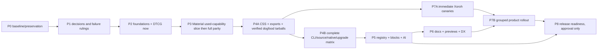

# Implementation phases and dependencies

Status: execution roadmap, not implemented. The phase number is a workstream id, **not** a rule to delay Xoroh migration until after documentation. Task dependencies in [MASTER_TODO.md](MASTER_TODO.md) are authoritative; authorized independent tasks may run earlier than their phase's aggregate exit.

Early P7A prerequisites are actual capabilities used by the canary, not every ornamental component or complete CLI. Foundations/DTCG and packed public stylesheet/provider/icon APIs **must** pass before the canary. Missing product-used behavior cannot be waived by the graph. License/security investigation and docs/test fixture authoring can start early in parallel with stable inputs; implementation authorization remains mandatory.

## P0 — Baseline and preservation (`KERN-001`–006)

**Objective/why:** establish an executable intake snapshot without discarding substantial user work or repeating audits. **Scope:** ownership, two-audit/source reconciliation, complete export/behavior/parent import inputs, bounded current commands, coherent task/decision ledger. **Prerequisite:** read root AGENTS/docs/kern skills and this plan; confirm user implementation permission before any non-plan writes.

**Likely files:** planning docs, existing audit/reference docs, read-only source/manifests/parent inputs. **Deliverables:** hashes/dirty-owner map, source-grounded inventory/verification ledger, task dependency/link checks, approved next owners.

**Verification/acceptance:** rerun safe checks from CURRENT_STATE, no unrelated diff/reset/generator writes; each historical versus WT/HEAD assertion labeled; parent scan scope recorded; all plan references/task ids resolve. **Parallel:** read-only inventory/parent/verification research on distinct domains. **Sequential:** ownership before mutable checks; coordinator reconciles final ledger once.

**Risk/recovery:** live site/user changes invalidate snapshot; stop conflicting reads/writes, recapture evidence, preserve all versions. **Exit/DoD:** accepted intake with no unexplained ownership collision and current baseline; no requirement for the entire pre-existing tree to become clean by force.

## P1 — Decisions and migration design (`KERN-007`–016)

**Objective:** approve architectural defaults and resolve confirmed tooling/design contradictions before changes harden in packages. **Prerequisite:** P0 accepted. **Scope:** contracts/provider schema/export/CSS/source/icon/CLI/migration design, default theme ruling, initial SearchBar/coverage/prose/mobile-gate fixes. **Files:** docs/adr/architecture/release policy/skills, generator and gate tests, MCP manifest test, mobile package/CI, package contracts specs.

**Deliverables:** approved ADRs and change-routing updates; negative tests for gating mistakes; approved visual baseline/Xoroh preset policy; script/CI names that actually exist; documented early migration/artifact rollback plan. **Verification:** existing MCP/coverage/kern gates repaired without hiding real UI findings; new false-positive tests; owner visual/namespace/package approvals.

**Parallel:** independent gate fixes and design specs once ownership is explicit. **Sequential:** theme value ruling before golden snapshots; contracts/schema and naming approval before consumers encode them. **Risks/recovery:** old audit recommendations overengineering; stay Material-only and bounded. Undo only authorized edits via reviewed follow-up if schema/default rejected, not user's changes.

**Exit/DoD:** decisions ADR-P01–20 have accepted implementation defaults/approvals and red tooling classification issues assigned/fixed; no claim all UI gates pass while design discrepancies remain.

## P2 — Foundations and DTCG (`KERN-017`–023)

**Objective:** authoritative versioned token graph plus tested interchange **now**, with output compatibility. **Prerequisites:** P1 schema/theme ruling. **Files:** kern-tokens canonical/schema/resolver/pipeline/adapters/generators/tests/theme goldens; web/native theme integration tests.

**Deliverables:** full foundation snapshots, schema/ref resolver, DTCG exporter/importer with diagnostic/loss policy, canonical dark elevation and ordinary CSS projections, all 30 context cells, approved Xoroh theme conversion. **Verification:** token suite/contrast/matrix, all-foundation DTCG semantic roundtrip and malformed refs/composites, web/native value/type/CSS goldens.

**Parallel:** importer/exporter fixture work after graph schema freeze; host fixtures after stable resolver contract. **Sequential:** approved goldens → graph → adapter/projection migration → host parity. **Risks/recovery:** silent rounding/unit/theme precedence change; gate diffs and preserve old APIs until compared. Keep a reviewed output mapping/adapter rollback, never edit generated files to mask drift.

**Exit/DoD:** required foundation checks green, no unapproved rendered/type/CSS change, DTCG input/output actually tested. No DTCG deferral to another major release.

## P3 — Material components/icons (`KERN-024`–032)

**Objective:** explicit provider metadata and preserved capabilities over separate renderer implementations. **Prerequisites:** contracts/schema design + P2 foundations; immutable component inventory. **Files:** contracts new package, renderer public exports/components/parity/bindings, icons core/render/tools/metadata, public in-repo deviation ledger, generated manifest/docs.

**Deliverables:** pure contracts package, additive provider metadata, per-export/variant fixtures; design/elevation/state parser rulings; field/overlay/navigation/start behaviors; native host/device proof; Material icon a11y/alias/fill/meaning tests, licensing inputs/bundle measurements; reconciled gap matrix.

**Verification:** source/renderer/native dual runner suites, parity/layers/primitives/design/elevation/icon gates and negative metadata fixtures. **Parallel:** family fixes, icon renderer work and metadata/contract authoring with separate file owners. **Sequential:** foundation outputs first; design/elevation rulings before visual golden changes; generator run after component owners finish.

**Risk/recovery:** false parity counts or accidental feature removal; compare every public export/axis and actual Xoroh usage. Preserve compatibility aliases with tests; local rollback by restoring this change's provider metadata/value adapter, never blanket source checkout.

**Exit/DoD:** full phase requires all capabilities classified/tested; **used slice exit** can unlock P4A/P7A once canary-specific contract/icon/theme tests pass. Remaining required component work continues before release.

## P4 — Distribution/install (`KERN-033`–047)

**Objective:** artifacts usable outside checkout, safe source/native/block installs/upgrades. **Prerequisites:** relevant P2/P3 public APIs and registry schema design. **Files:** web/token CSS generators and manifests, contracts/CLI build/bin/templates/config/resolver/transaction/receipt/upgrade, registry source build, CI/consumer fixtures, native Metro/font assets.

**P4A early migration slice:** compiled public CSS (`033`), exports/peer/runtime identity (`042`), standalone/workspace packed package style/type tests (`043`/`044`), native packed Metro/host checks (`046`). Produce integrity-pinned dogfood artifacts. CLI publication is not needed for Xoroh package canary.

**P4B full exit:** independently packaged CLI, app-scoped init/config, complete cross-package/static asset/platform closure, atomic preflight receipts, full snapshot semantics, source-backed and package-backed blocks, native source install and customization-safe diff/upgrade; all real consumer matrix fixtures.

**Verification:** public exports/pack/dist/preflight plus new tarball web/RN both layouts, package/hybrid/snapshot, source import leak detection, late conflict/path traversal/receipt upgrade negative tests and rendered computed CSS. **Parallel:** CSS/artifacts, CLI pure graph/receipts, native fixtures, consumer matrix runners once inputs stable. **Sequential:** graph/receipt schema before transactions/upgrades; build/pack before install; native exports before Metro evidence.

**Risk/recovery:** writes to customized files and duplicate native modules; transactions/staging and explicit old artifact pins. Fixtures run in disposable directories, not deleting user's checkout. **Exit/DoD:** every advertised delivery/platform/layout builds and renders from artifacts, no hidden checkout path, failed mutations byte-preserve files.

## P5 — Registry/blocks/AI (`KERN-048`–056)

**Objective:** one accurate schema/payload across human docs/CLI/MCP and real dependency-aware workflows. **Prerequisites:** contracts and installation resolver; metadata authoring can begin earlier after schema design. **Files:** registry generator/payload, MCP tools/source reader/protocol/tests, site machine output consumers and block metadata.

**Deliverables:** schema-versioned export/props/capability/dependency manifest; correct `/start` and native source; bundled tokens/themes/source; icons/blocks/install discovery; deterministic no-write install plan/evidence validation; stdio/CLI agreement.

**Verification:** MCP tests/types, spawned packed server without checkout, registry path/exposure tests, full three-block closure fixtures, schema malformed/version negative tests, no fake validation reports. **Parallel:** discovery families and machine docs after common payload freeze. **Sequential:** source/import correctness before metadata assertions; CLI resolver before install planner proof.

**Risk/recovery:** inaccurate AI instructions and untrusted payload mutation; schema version compat adapters, safe hash/path/error behavior and tools read-only. **Exit/DoD:** all advertised queries/plans work independently and metadata matches real artifacts; unavailable evidence clearly marked.

## P6 — Docs/previews/DX (`KERN-057`–063)

**Objective:** complete runnable guidance and real preview/behavior evidence, no second docs framework. **Prerequisites:** stable relevant P2–P5 API artifacts; docs can be authored alongside implementation rather than deferred. **Files:** apps/site docs/content/routes/examples/machine outputs, apps/mobile gallery, package READMEs/skills/contributor/support docs, E2E.

**Deliverables:** both layout/platform/mode install recipes, full component/foundation/icon examples and honest parity notes, actual screenshot regression/a11y measurement, working RN gallery/Metro host, source customization/upgrades guidance, synchronized skills/machine metadata. Community/help polish `063` is P2 priority, not required platform work.

**Verification:** docs/gallery/snippets/type/build + machine output links/schema + Playwright screenshot assertions and mobile host. **Parallel:** page families after registry freeze, native examples independently; honor concurrent site owner. **Sequential:** artifact API verified before code snippets claim success; approved screenshot baselines before gating.

**Risk/recovery:** demos diverge or overwrite redesign; assign app/site owner, keep block source/previews identical, regenerate only with permission. **Exit/DoD:** required recipes compile/render, all advertised capabilities discoverable and docs truth claims measured; machine surfaces consistent.

## P7 — Xoroh migration (`KERN-064`–075)

> [!IMPORTANT]
> **Phase status: Unexecuted planning phase. All P7 tasks remain BLOCKED pending explicit owner authorization.**
> No product applications or parent monorepo packages may be migrated without separate, explicit written authorization from the repository owner.

**Objective:** real product adoption and feedback, not optional after launch. **P7A prerequisites:** approved P2 theme/DTCG, tested product-used P3 slice, P4A dogfood artifacts and parent approval. **P7B prerequisites:** canaries plus complete relevant P4/P5/P6 paths and owner rollout windows. **Files:** parent aliases/package pins/styles/Metro/fonts/theme/shell adapters/domain consumers/CI/tests; upstream sanitized generic regressions. Separate authorization required for parent edits.

**Deliverables:** full bound usage/callsite mapping; compatibility/codemod adapters; preserved theme/storage/icon meaning; canary accounts/shared flows and native desk messaging/sheets; grouped web/native rollout; no private generic source leaks; nonempty product acceptance/rollback/feedback evidence.

**Verification:** actual parent build/test targets after inspection (mobile currently lacks test/bundle scripts), added migration scenarios + types/Metro device/screen readers and screenshots. **Parallel:** web/native adapters after theme/icon contracts, rollout groups only on independent owners; avoid shared domain library migrating beneath unready apps. **Sequential:** baseline → adapters/artifacts → canary → approval → group rollout → rollback rehearsal.

**Risk/recovery:** private shells/Gorhom/domain helpers not OSS direct equivalents, default visuals differ; retain Xoroh-owned wrappers, prior pins/config and staged private packages until accepted. Stop on product regression, rehearse reviewed rollback changes, never reset parent dirty state.

**Exit/DoD:** every used generic capability mapped/public/tested, all scoped apps/product scenarios accepted and feedback upstream-owned; compilation or import count zero alone insufficient.

## P8 — Release readiness (`KERN-076`–084)

**Objective:** complete verified Preview candidate and explicit owner gate, not publication automatically. **Prerequisites:** required P0–P7 deliverables, except licensing/security can investigate early. **Files:** CI/gate scripts, licenses/NOTICE/SBOM/artifact manifests, changesets/release notes/version compatibility docs, governance/security/support and approval ledger.

**Deliverables:** full immutable candidate matrix, upstream asset/IP/security review, screenshot/a11y evidence, content/hash/range/receipt compatibility, changeset preview in disposable clone, truthful limitations/upgrade notes, rollback drill, namespace/support/signoff.

**Verification:** [QUALITY_AND_RELEASE_GATES.md](QUALITY_AND_RELEASE_GATES.md) on actual artifacts; no nonexistent commands/empty suites; signed NO-GO checklist. **Parallel:** legal/security/artifact/docs review on immutable candidate; any candidate source change invalidates affected gate evidence. **Sequential:** gate completion → owner acceptance → separate authorized version/publish operation.

**Risk/recovery:** HOLD accidentally bypassed, private data/licenses missing, release pressure; keep release variables disabled and no publication credentials/tool operations until explicit owner action. **Exit/DoD:** release ready and authorized decision recorded. This planning mission ends before this implementation phase, and does not authorize executing it.

## Task counts

84 tasks: phase counts P0=6, P1=10, P2=7, P3=9, P4=15, P5=9, P6=7, P7=12, P8=9. Priority counts: critical P0=58, required P1=25, optional polish P2=1. Phase/priority share labels intentionally; read their field names. All tasks are unstarted **execution tasks**, even where this plan already inspected evidence; refresh/approval/implementation deliverables still require ownership and verification.
