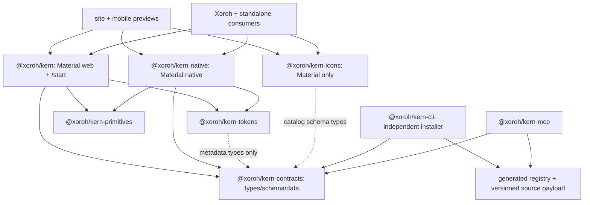
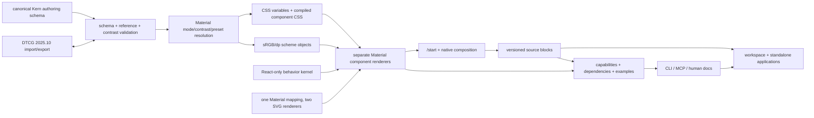

# Target architecture

Status: recommended specification; not implemented. Decision authority: [ARCHITECTURE_DECISIONS.md](ARCHITECTURE_DECISIONS.md).

## Boundaries and package graph

Keep `@xoroh/kern`, `kern-native`, `kern-tokens`, `kern-primitives`, `kern-icons`, `kern-mcp`, `kern-cli`. The UI pair is explicitly the Material 3 (`m3`) provider, not a neutral runtime facade. Add `@xoroh/kern-contracts` because both renderers, tokens/theme validation, CLI, MCP and registry generator need one versioned platform-free metadata shape. No provider service locator, plugin runtime, or extra composition package.

Arrows below mean **depends on**. Metadata is consumed without importing renderer execution code.

There is **no** primitives → tokens edge, no web ↔ native edge, no foundation → UI edge. Contracts ships no React, DOM, RN, CSS, framework test runner, or UI implementation dependencies. Renderer contract adapters/tests remain under `parity/` and renderer test directories; do not publish Vitest/Jest as contract runtime requirements.

## Responsibilities and public contract

| Owner | Keeps/changes | Public surface and invariants |
|---|---|---|
| tokens | Reference values, Material role definitions, theme catalog/resolver, validation/projections/DTCG adapters | Preserve `resolveThemeDetails`, `resolveTheme`, `tokens`, `themes`, theme ids/legacy `m3`; add versioned DTCG APIs and schema artifacts. No platform renderer dependency. |
| contracts (new) | Provider/component/block/icon/install metadata types, JSON schema, validators and version coordinates | `providerId: "m3"`, renderer/capability/entrypoint/dependency records. Generated parity instance remains one source, not duplicated data. |
| primitives | Unstyled behavior infrastructure | Existing 81 exports remain; adoption ledger is evidence, not a demand to force unused models into components. |
| web | Base UI integration, Tailwind/CVA authored styles, DOM theme adapter, components and `/start` | Existing barrels/subpaths remain; additive `providerManifest`, `./styles` compiled CSS. `./theme` compatible token/animation entry, no removed package import. |
| native | RN renderer/style maps, theme/font APIs and native composition | Existing `.`/`./native` maintained. No Expo lock-in; host loads fonts, navigation/gesture services injected. Add metadata, tested Metro assets. |
| icons | Fixed Material asset catalog, aliases, names, deterministic resolution, renderer conditions | One `Icon` API; preserve qualified/kebab/snake/semantic aliases. Existing registration extension remains compatible but no extra icon sets are implemented or advertised as supported. |
| registry build | Derive exports/props, merge authored semantics, close file/npm/asset graph | Emit versioned JSON + integrity-addressed payload from source, not regex-parsed site TypeScript at consumer runtime. Site is a preview consumer of the same bytes. |
| CLI | Init/config, discover/plan/add/diff/upgrade/validate, transactional file operations | Independent bin/package; web and native source/package modes, workspace selection, dry-run by default for upgrades. No automatic destructive merges/install scripts. |
| MCP | Read registry, discover accurate capabilities, return installation plan and validation evidence | No renderer imports, no dependence on checkout for ordinary usage, no autonomous mutations/publication. |

`@xoroh/kern/start` stays inside web package: `src/start/index.ts` composes six cohesive modules with no separate version or runtime dependency need. Native root compositions remain public; optional future `/start` aliases are not a prerequisite and may not remove root exports. No `@xoroh/kern/native` alias is invented.

## Metadata and extension boundaries

Proposed record: schemaVersion, provider `{id:"m3", label:"Material 3", specGeneration, evidence}`, renderer, component id, entrypoint, export name, types/variants/size axes, origin (`spec-native` or `kern-adaptation`), verified capability states, obligations, platform-specific exception reasons, token/icon/file/npm/asset dependencies, doc/example references, installModes and compatibility ranges. Unknown capability ≠ supported. Metadata must distinguish UI row, helper/type and composition tier.

Provider identity is metadata and build-time import ownership; the web theme hook/native theme provider are **theme controls**, not provider selection. Keep Material-shaped roles and CSS names; no speculative generic role registry until a real other provider justifies it. Theme extensions override recognized values and prove contrast/reference completeness, not fork another hidden role table. Domain behavior (auth, tenancy, catalog, routing, business types) stays in Xoroh adapters or props-driven generic blocks.

## Distribution and compatibility

Package default: ordinary token CSS + precompiled component CSS, no Tailwind scan of private source required. Source default: copied components with package foundations (hybrid), dependency closure and explicit Tailwind scan of installed local files or compiled source CSS. Full snapshot mode includes/rebinds runtime foundations and assets too; CSS-only snapshot cannot pretend to freeze runtime values. Blocks support copied block plus package components, or complete source closure, explicitly selected.

Both consumer layouts receive the same tarballs/exports. Workspace development may use `file:`/workspace links as a fast lane, but acceptance installs tarballs in an isolated nested workspace and standalone app with **no source aliases**. Metro must prove conditional exports/native SVG/fonts on actual native fixtures, not just RN-web.

Changesets remain per-package; `/start` is versioned with web. Initial compatible set is pinned together in registry `releaseSet`, not an accidental all-package fixed-version group. Semver, metadata schema, provider spec snapshot and CLI receipt versions are separate coordinates. Internal singleton primitives/context and theme extension state should use compatible peers plus workspace dev dependencies where runtime identity is required; ordinary pure dependencies are allowed only after duplicate-instance tests and policy/docs agreement. Never ship `workspace:*` unresolved in consumer manifests. The one-minor deprecation window from 1.0 is a recommended stability policy, but existing ADR-004 is still **proposed**; owner adoption must precede advertising that guarantee. No new prefixed legacy OSS facade packages are introduced; migration shims stay Xoroh-owned.

## Explicit non-goals

No second design system, runtime provider swapping, icon ecosystem marketplace, universal `isNative` component branch, redundant provider facade, new grid/chart framework, unrelated source restructuring, deletion of useful legacy behaviors, or publishing during planning. Advanced product domain helpers stay app-owned; useful generic capabilities discovered during migration are upstreamed with contracts/tests rather than dropped.
